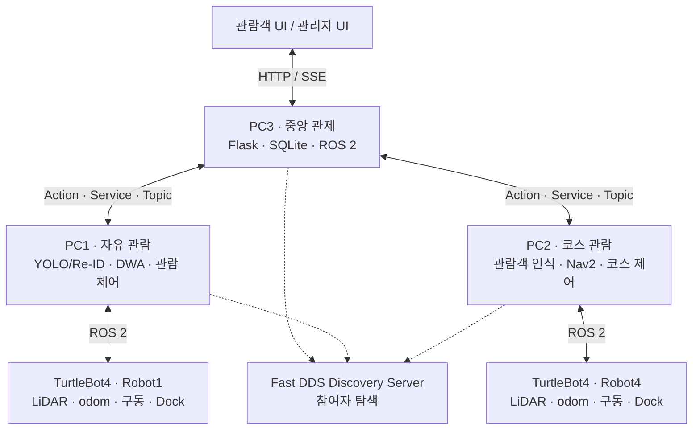
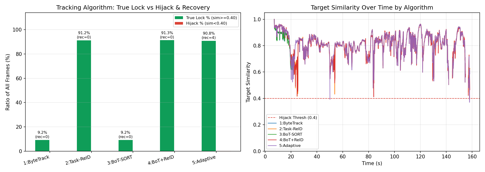

# ArtI (아티) — Autonomous Gallery Curator Robot

> **관람객을 인식하고, 함께 이동하며, 작품 앞에서 설명하는 ROS 2 기반 미술관 안내 로봇 시스템**

**ROKEY 10기 · 지능1 프로젝트 | 2026.11 | 8인 팀 프로젝트**  
`ROS 2 Jazzy` · `TurtleBot 4 × 2` · `Nav2` · `YOLO Pose` · `ByteTrack / Re-ID` · `Flask` · `SQLite` · `Fast DDS`

[주요 기능](#-주요-기능) · [시스템 아키텍처](#-시스템-아키텍처) · [핵심 기술](#-핵심-기술) · [문제 해결](#-문제-해결-기록) · [검증 결과](#-검증-및-실험) · [실행 및 문서](#-실행-및-개발-문서)

---

## 🎨 프로젝트 소개

ArtI는 **키오스크와 2대의 TurtleBot 4를 연결한 갤러리 큐레이터 로봇 서비스**입니다. 관람객이 키오스크에서 관람 방식을 선택하면 로봇이 호출에 응답하고, 관람객을 등록한 뒤 **자유 관람(사람 추종)** 또는 **코스 관람(로봇 선행)**을 수행합니다. 작품 해설은 지도 기반 관람 구역에서 제공하고, 관람이 끝나면 충전 도크로 복귀합니다.

기존의 고정형 안내 방식에서 벗어나 **관람객의 이동·체류·이탈에 반응하는 안내 경험**을 목표로 했습니다. 이를 위해 사람 인식, 위치 추정, 자율주행, 음성 안내, 키오스크 관제를 하나의 분산 ROS 2 시스템으로 통합했습니다.

**핵심 설계 선택**
- **Markerless 작품 안내:** 작품마다 마커를 부착하지 않고, `map` 좌표와 작품별 관람 구역을 기준으로 해설을 시작합니다.
- **역할 분리:** PC3는 서비스·DB·관제를, PC1/PC2는 영상 추론·현장 판단·로봇 제어를 담당합니다.
- **상태 중심 통신:** 장시간 동작은 ROS 2 Action, 작품 설명 요청은 Service, 센서·상태 데이터는 Topic으로 분리합니다.

> **개발·검증 상태:** 주요 모듈 구현 및 부분/통합 시나리오 검증을 진행했습니다. 아래 수락 기준(AC-1~AC-10)의 전체 반복 시험 달성률은 별도 증빙이 필요하며, 미측정 항목은 성능 달성으로 표시하지 않습니다.

## 🤖 주요 기능

| 자유 관람 · Robot1 (`/robot1`) | 코스 관람 · Robot4 (`/robot4`) |
| --- | --- |
| 관람객이 먼저 이동하고 로봇이 **약 0.8m 거리**로 추종 | 로봇이 선택 작품의 **사전 정의된 경로**를 선행 안내 |
| YOLO 기반 인식 + Re-ID + LiDAR 위치 추정 | 후방 관람객 인식 + Nav2 `NavigateToPose` |
| 작품 구역에 일정 시간 머무르면 해설 시작 | 작품 정차 지점 도착 후 해설 시작 |
| 관람객 소실 시 재탐색, 종료 시 도킹 복귀 | 관람객 이탈 시 정지·재개, 종료 시 도킹 복귀 |

**키오스크 · 중앙 관제**
- 관람 방식 선택, 작품 선택, 로봇 호출, 이동·도착·등록 상태 표시
- 로봇별 배터리·도킹·가용 상태 조회와 관리자 로그 확인
- 작품 설명 및 관람 세션을 SQLite로 관리하고, 브라우저에는 HTTP/SSE로 상태를 전달

**작품 해설**
- 로봇 PC가 `/arti/description` 서비스로 작품 설명을 요청하고, Edge TTS로 음성을 합성·재생
- 자유 관람은 관람객 체류 조건, 코스 관람은 로봇 정차 및 구역 조건으로 해설을 제어

## 🧩 시스템 아키텍처



*Discovery Server는 ROS 2 참여자 탐색을 지원합니다. 모든 ROS 2 데이터가 PC3를 거쳐 중계되는 구조는 아닙니다.*

### 관람 시나리오

1. **관람 요청** — 키오스크에서 모드를 선택하고 `POST /api/sessions`로 세션을 생성합니다.
2. **로봇 호출** — PC3가 `PrepareTour` Action Goal(`start=true`)을 전달합니다.
3. **현장 준비** — 로봇이 언독, 위치 추정, 만남 위치 이동, 사람 인식·등록을 수행합니다.
4. **상태 표시** — `UNDOCKING → MOVING → ARRIVED → REGISTERING → REGISTERED` 피드백을 SSE로 UI에 반영합니다.
5. **관람 자동 시작** — 등록 성공 시 PC3가 `StartTour` Goal을 자동 전송합니다. 자유 관람은 `artwork_ids=[]`, 코스 관람은 선택한 작품 ID 배열을 사용합니다.
6. **관람·해설** — 로봇 PC가 추종 또는 코스 주행을 수행하고, 작품 ID로 PC3의 설명을 조회해 TTS로 재생합니다.
7. **종료·복귀** — 관람 종료/취소/오류 상태에 따라 정지 또는 도킹 복귀를 처리하고, PC3에 결과 및 로그를 기록합니다.

### PC 간 핵심 인터페이스

| 인터페이스 | 방향 | 목적 |
| --- | --- | --- |
| `/<robot>/arti/prepare_tour` · **Action** | PC3 → PC1/PC2 | 호출, 이동, 관람객 등록 및 준비 상태 피드백 |
| `/<robot>/arti/start_tour` · **Action** | PC3 → PC1/PC2 | 관람 시작, 작품 진행 피드백, 결과 및 취소 |
| `/arti/description` · **Service** | PC1/PC2 → PC3 | `artwork_id: int32`로 작품 설명 조회 |
| `/<robot>/battery_state`, `dock_status`, `odom` · **Topic** | 로봇 → 관제/제어 | 배터리, 도킹, 이동 정보 수신 |
| `/<robot>/target_person/point_map` · **Topic** | 인식 노드 → 관람 제어 | `map` 기준 관람객 위치 전달 |

**중요:** 현재 공용 Action 정의는 `PrepareTour.start(bool)`, `StartTour.artwork_ids(int32[])`입니다. 작품별 목표 좌표는 Action Goal에 실어 보내지 않고 각 로봇 PC의 로컬 YAML에서 관리합니다.  
[ROS 2 통신 명세](docs/common/ros2_interfaces.md) · [Action/Service 원본](src/common/arti_interfaces/)

## ⚙️ 핵심 기술

### 1. 관람객 인식·등록·재식별

- **YOLO Pose + ByteTrack**으로 사람과 관절을 인식하고 추적 ID를 관리
- **MediaPipe HandLandmarker**의 손 관절을 이용해 `주먹 → 편 손` 제스처로 대상 등록
- 상·중·하체 등 **부위별 304차원 HSV 특징**과 위치 정보를 이용해 등록 관람객 재식별
- 카메라 방향과 **2D LiDAR 거리**를 결합하고 `top_cam → base_link → map` 좌표 변환을 통해 추종 좌표 생성
- 카메라 소실 시 칼만 필터 및 LiDAR 다리 후보 등 보조 정보를 활용하는 추적 로직

[코드: person_tracker](src/person_tracker/) · [인식/재식별 연구 및 벤치마크](docs/perception/README.md)

### 2. 모드별 자율주행·안전 제어

- **자유 관람:** 지도·LiDAR 장애물 격자, 경로 거리 계산, DWA 속도 후보 평가로 직접 `cmd_vel` 제어
- **코스 관람:** AMCL 위치 추정, Nav2 경로 계획·주행, 관람객 이탈 시 목표 취소/재개
- 작품·출구 영역을 **지도 좌표 기반 구역**으로 판단하고, 관람객 소실·센서 지연·도킹 실패 등 예외 상태를 관리

[코드: 자유 관람](src/arti_follow/) · [코드: 코스 관람](src/arti_pc2_nav/) · [지도 및 관람 구역](src/common/arti_common/config/)

### 3. 중앙 관제·서비스 오케스트레이션

- 키오스크 Flask API에서 관람 세션 생성 및 로봇별 Action Goal 전송
- Action Feedback/Result를 세션 상태와 운영 로그에 반영하고 **SSE로 사용자 화면에 스트리밍**
- `Art`, `TourSession`, `Log` 등 SQLite 데이터로 작품 정보와 운영 이력을 관리
- 배터리·도킹 상태를 이용해 호출 가능 여부 판정, 실제 장비 연결 없이 화면/상태 흐름을 점검하는 시뮬레이터 제공

[코드: 키오스크](apps/kiosk/) · [키오스크 실행·API·테스트 가이드](apps/kiosk/README.md)

## 🔧 문제 해결 기록

| 현장 문제 | 원인·개선 | 근거 |
| --- | --- | --- |
| 도킹 중 Nav2 활성화 실패 | 도킹 상태에서 LiDAR가 꺼져 `/scan`과 AMCL/TF가 준비되지 않음 → **언독 후 위치 초기화와 Nav2 Lifecycle 활성화**로 순서 변경 | [분석 기록](docs/troubleshooting/course/2026-11-20-docked-lidar-off-prepare-fails.md) |
| 자유 추종 중 정체·원거리 도킹 시도 | 경로 방향과 회전 판단 기준 충돌, 도킹 목표 도달 검증 부족 → **경로 기준 방향 제어·진척 감시·도킹 위치 조건** 보강 | [분석 기록](docs/troubleshooting/follow/2026-11-21-return-stuck-wall-coords.md) |
| ROS 2 토픽이 보이지 않는 현상 | PC별 환경 설정에서 `ROS_DOMAIN_ID`가 불일치 → **공통 도메인 및 환경 로드 절차 통일** | [분석 기록](docs/troubleshooting/env/2026-11-16-domain-id-mismatch.md) |

더 많은 장애 사례와 재현·수정 기록은 [Troubleshooting Index](docs/troubleshooting/README.md)에서 확인할 수 있습니다.

## 📊 검증 및 실험

**관람객 추적 모델·모드 평가**  
사람 인식 파트에서는 ROS bag과 Human-in-the-Loop Ground Truth를 이용해 모델·추적 방식별 식별 정확도와 처리시간을 비교했습니다.

- `pose_estimate2_gt` 평가에서 **GT 양성 1,996프레임 / 음성 304프레임** 사용
- 같은 조건의 `YOLO26n-pose` 추적 모드 비교에서 **GT True Lock**: ByteTrack **10.1%**, Task-ReID **93.6%**, Adaptive **96.1%**
- 단, 해당 실험에서 Adaptive의 **GT False Lock 62.8%**도 관측되어, 대상 부재 구간 오잠금이 개선 과제로 남았습니다. 이 결과는 **해당 오프라인 데이터셋의 비교값**이며 실제 현장 전체 성공률은 아닙니다.



[실험 조건·지표 정의·전체 결과](docs/perception/results/pose_estimate2_gt/summary.md) · [인식 실험 문서](docs/perception/README.md)

**통합 기능 검증**  
키오스크 ROS2 Action/Service 통신, 준비 상태 SSE, 로봇의 주행·해설·복귀 등은 코드 및 관련 테스트/운영 기록으로 확인할 수 있습니다. 다만 SDD의 **AC-1~AC-10 반복 수락 시험 목표**와 **실제 달성 횟수**는 구분합니다. 검증되지 않은 목표를 성공률로 기재하지 않습니다.

[키오스크 테스트 코드](apps/kiosk/tests/) · [코스 주행 테스트](src/arti_pc2_nav/test/) · [문제 해결·실기 기록](docs/troubleshooting/)

## 📁 프로젝트 구조

```text
arti/
├── apps/kiosk/                  # PC3: Flask UI/API, SQLite, ROS2 관제, 시뮬레이터
├── src/
│   ├── arti_follow/             # PC1: 자유 관람·사람 추종·복귀
│   ├── arti_pc2_nav/            # PC2: 코스 관람·Nav2·도킹
│   ├── person_tracker/          # YOLO, 제스처, Re-ID, LiDAR 위치 추정
│   ├── arti_audio/              # 작품 설명 조회 및 TTS 안내
│   └── common/
│       ├── arti_interfaces/     # 공용 Action / Service / Message 정의
│       ├── arti_common/         # 작품·관람 구역·초기 위치 설정
│       └── arti_bringup/        # Localization 공통 실행
├── maps/                        # 갤러리 지도
├── docs/                        # 설계·실험·트러블슈팅 기록
└── scripts/                     # 환경·Discovery Server 실행 도구
```

## 🚀 실행 및 개발 문서

**기본 환경:** Ubuntu 24.04, ROS 2 Jazzy, Python 3, Fast DDS, TurtleBot 4. 실기 실행 시 PC별 IP·도메인·카메라·로봇 안전 상태를 먼저 확인해야 합니다.

```bash
git clone https://github.com/ROKEY-10-Arti/arti.git
cd arti
```

- **공통 개발 환경:** [설치·네트워크 설정](docs/common/setup.md), [주행/Localization](docs/common/navigation.md)
- **PC3 키오스크:** [설치, 실제 로봇 연결, 시뮬레이터 실행](apps/kiosk/README.md)
- **PC1 자유 관람:** [실행 및 단계별 검증](docs/follow/run_and_test_guide.md)
- **PC2 코스 관람:** [빌드·실행·안전 설정](src/arti_pc2_nav/README.md)
- **사람 인식:** [패키지 안내](src/person_tracker/README.md)
- **통신 규격:** [ROS 2 인터페이스](docs/common/ros2_interfaces.md)
- **디버깅:** [문제 해결 사례 모음](docs/troubleshooting/README.md)

## 👥 협업 및 프로젝트 문서

**ROKEY 10기 지능1 · ArtI 팀** — 키오스크/중앙 관제, 자유 관람, 코스 관람, 사람 인식·재식별 파트로 역할을 나누고 공통 ROS 2 인터페이스와 지도·설정 파일을 기반으로 통합했습니다.

- **공통 인터페이스는 코드가 기준:** [`arti_interfaces`](src/common/arti_interfaces/)의 `.action`·`.srv`를 모든 PC가 공유
- **모듈별 상세 문서는 분리:** 각 파트의 README에는 실행 방법, 입력·출력, 파라미터, 테스트를 유지
- **변경 이력과 문제 재현을 기록:** [개발 문서](docs/README.md) · [트러블슈팅](docs/troubleshooting/README.md)

---

*이 README는 2026-11-23 기준 SDD v1.3 및 `main` 브랜치의 구조를 바탕으로 정리했습니다. 운용 파라미터, 인터페이스, 검증 결과가 달라지면 소스와 문서를 함께 갱신합니다.*
