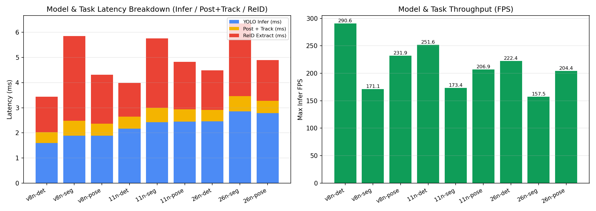
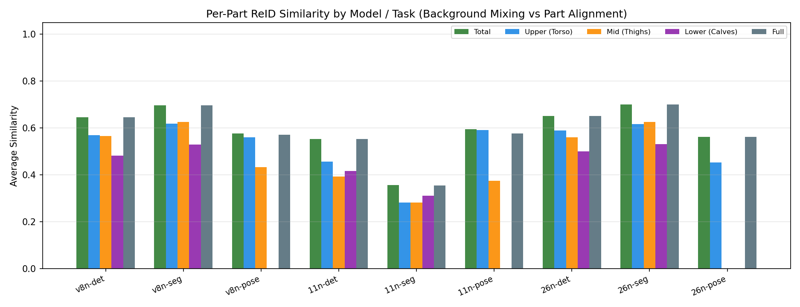
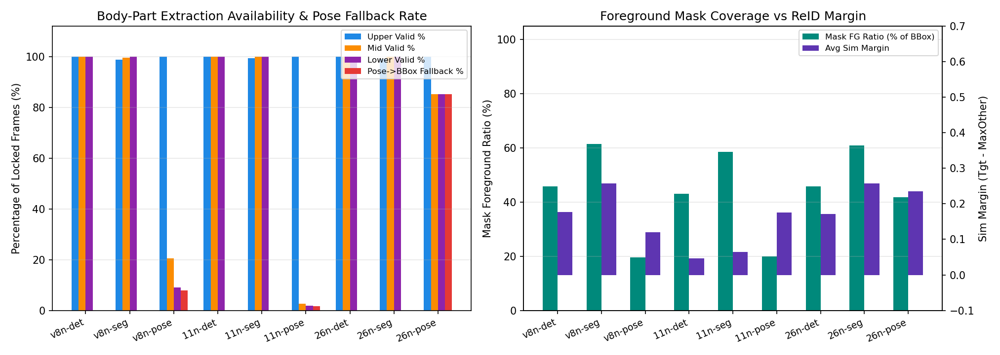
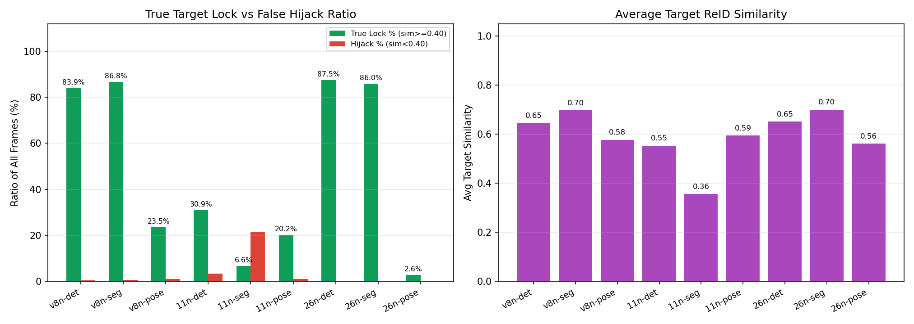
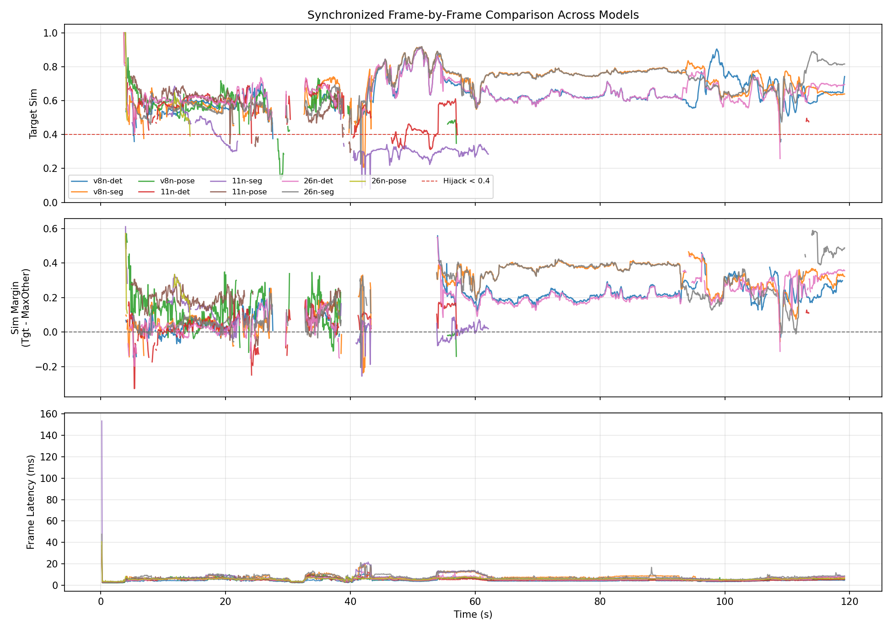
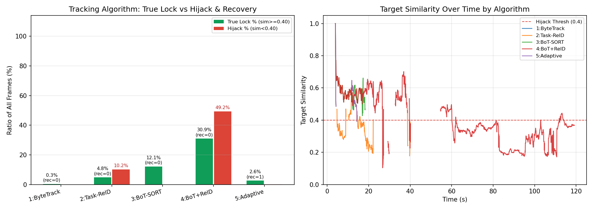

# Bag Benchmark Report: `follow_with_cam`

- **Bag Path**: `/home/jsb/bag/follow_with_cam`
- **Image Topic**: `/robot1/top_cam/image_raw/compressed` (`1786` frames evaluated)
- **Scan / TF**: `None` / `None`
- **Keyframes (`Δ=10f`)**: `motion@f61, q1@f446`

## 0. 핵심 관찰 요약 (Auto Insights)

- **최고 연산 속도**: `v8n-det` (Infer `1.59ms`, Post+Trk `0.44ms`, Max `290.6 FPS`)
- **최고 진성 유지율 (`True Lock %`, sim>=0.4)**: `26n-det` (`87.5%`, Avg Sim `0.652`)
- **최고 타인 변별 마진 (`Sim Margin`)**: `v8n-seg` (평균 `0.258`, 최소 `-0.237`)
- **Pose 부위 가용성 & BBox 폴백 비율**: `v8n-pose` M=20.5%/L=9.1%/FB=7.8%, `11n-pose` M=2.6%/L=1.8%/FB=1.6%, `26n-pose` M=85.1%/L=85.1%/FB=85.1%
- **추적 알고리즘 효과**: `1:ByteTrack` TrueLock=0.3% (Hijack=0.0%, Rec=0), `2:Task-ReID` TrueLock=4.8% (Hijack=10.2%, Rec=0), `3:BoT-SORT` TrueLock=12.1% (Hijack=0.0%, Rec=0), `4:BoT+ReID` TrueLock=30.9% (Hijack=49.2%, Rec=0), `5:Adaptive` TrueLock=2.6% (Hijack=0.1%, Rec=1)

## 1. 모델별 연산 · 후처리 속도 분해 (`5:Adaptive`)

| Model | Pre (ms) | Infer Mean / P95 (ms) | Post+Trk (ms) | ReID (ms) | Total Mean / P95 (ms) | Max FPS |
|---|---:|---:|---:|---:|---:|---:|
| v8n-det (`yolov8n.pt`) | 0.19 | 1.59 / 1.63 | 0.44 | 1.41 | 4.38 / 6.93 | 290.6 |
| v8n-seg (`yolov8n-seg.pt`) | 0.2 | 1.89 / 1.96 | 0.59 | 3.37 | 7.05 / 12.2 | 171.1 |
| v8n-pose (`yolov8n-pose.pt`) | 0.2 | 1.89 / 1.94 | 0.47 | 1.95 | 5.19 / 7.65 | 231.9 |
| 11n-det (`yolo11n.pt`) | 0.21 | 2.17 / 2.3 | 0.47 | 1.34 | 4.84 / 6.68 | 251.6 |
| 11n-seg (`yolo11n-seg.pt`) | 0.2 | 2.42 / 2.49 | 0.58 | 2.76 | 6.82 / 12.53 | 173.4 |
| 11n-pose (`yolo11n-pose.pt`) | 0.21 | 2.45 / 2.54 | 0.49 | 1.89 | 5.69 / 7.38 | 206.9 |
| 26n-det (`yolo26n.pt`) | 0.21 | 2.46 / 2.54 | 0.45 | 1.58 | 5.48 / 7.9 | 222.4 |
| 26n-seg (`yolo26n-seg.pt`) | 0.22 | 2.85 / 2.96 | 0.61 | 2.89 | 7.59 / 12.39 | 157.5 |
| 26n-pose (`yolo26n-pose.pt`) | 0.22 | 2.79 / 2.88 | 0.48 | 1.62 | 5.73 / 6.92 | 204.4 |

## 2. 특징 추출 용이성 · 부위 가용성 · 배경 분리 (`5:Adaptive`)

| Model | U / M / L Valid % | Pose Fallback % | Mask FG % | Avg Tgt Sim ± Std (Min) | U / M / L / F Avg Sim |
|---|---:|---:|---:|---:|---|
| v8n-det | 100.0% / 100.0% / 100.0% | 0.0% | 45.8% | 0.646 ± 0.085 (0.356) | 0.569 / 0.565 / 0.482 / 0.646 |
| v8n-seg | 98.8% / 99.5% / 99.9% | 0.0% | 61.4% | 0.697 ± 0.103 (0.207) | 0.619 / 0.626 / 0.529 / 0.696 |
| v8n-pose | 100.0% / 20.5% / 9.1% | 7.8% | 19.6% | 0.577 ± 0.099 (0.136) | 0.56 / 0.433 / - / 0.571 |
| 11n-det | 100.0% / 100.0% / 100.0% | 0.0% | 43.1% | 0.553 ± 0.099 (0.312) | 0.456 / 0.392 / 0.416 / 0.553 |
| 11n-seg | 99.4% / 100.0% / 100.0% | 0.0% | 58.6% | 0.356 ± 0.11 (0.079) | 0.282 / 0.282 / 0.311 / 0.354 |
| 11n-pose | 100.0% / 2.6% / 1.8% | 1.6% | 19.9% | 0.594 ± 0.08 (0.294) | 0.592 / 0.375 / - / 0.576 |
| 26n-det | 100.0% / 100.0% / 100.0% | 0.0% | 45.9% | 0.652 ± 0.071 (0.259) | 0.589 / 0.56 / 0.5 / 0.652 |
| 26n-seg | 99.0% / 99.9% / 100.0% | 0.0% | 61.0% | 0.7 ± 0.105 (0.225) | 0.617 / 0.625 / 0.531 / 0.7 |
| 26n-pose | 100.0% / 85.1% / 85.1% | 85.1% | 41.8% | 0.562 ± 0.115 (0.392) | 0.452 / - / - / 0.562 |

## 3. 재식별 변별력 · 혼잡 · 오인식 방어 (`5:Adaptive`)

> `True Lock %`: 전체 프레임 중 유사도 `>=0.4`로 실제 타겟을 유지한 비율 · `Hijack %`: 유사도 `<0.4` 오탐 잠금 비율

| Model | Det % | >=2P % | Locked % | True Lock % | Hijack % | Direct Sw | Recovered (Avg f) | Other Avg / Max | Margin Mean / Min |
|---|---:|---:|---:|---:|---:|---:|---:|---:|---:|
| v8n-det | 94.1% | 78.6% | 89.6% | **83.9%** | 0.3% | 6 | 14 (12.7f) | 0.454 / 0.6 | 0.177 / -0.184 |
| v8n-seg | 94.7% | 81.4% | 92.1% | **86.8%** | 0.5% | 6 | 11 (7.9f) | 0.401 / 0.705 | 0.258 / -0.237 |
| v8n-pose | 94.5% | 79.6% | 26.0% | **23.5%** | 1.0% | 7 | 10 (25.6f) | 0.405 / 0.675 | 0.12 / -0.306 |
| 11n-det | 94.3% | 82.4% | 36.2% | **30.9%** | 3.2% | 8 | 17 (47.1f) | 0.515 / 0.746 | 0.047 / -0.328 |
| 11n-seg | 94.1% | 82.6% | 29.7% | **6.6%** | 21.3% | 0 | 4 (62.3f) | 0.305 / 0.423 | 0.065 / -0.256 |
| 11n-pose | 94.4% | 76.5% | 22.5% | **20.2%** | 1.0% | 0 | 8 (12.6f) | 0.38 / 1.0 | 0.175 / -0.084 |
| 26n-det | 94.2% | 80.9% | 92.9% | **87.5%** | 0.1% | 9 | 8 (9.9f) | 0.463 / 0.686 | 0.171 / -0.198 |
| 26n-seg | 94.1% | 80.4% | 91.5% | **86.0%** | 0.1% | 9 | 11 (10.3f) | 0.438 / 0.601 | 0.257 / -0.206 |
| 26n-pose | 94.6% | 68.1% | 2.8% | **2.6%** | 0.1% | 0 | 1 (110.0f) | 0.273 / 0.429 | 0.235 / 0.073 |

## 4. 추적 알고리즘 비교 (`yolo26n-pose`)

| Mode | Locked % | True Lock % | Hijack % | SEARCH % | GUARD % | Direct Sw | Recovered (Avg f) | Avg Tgt Sim | Total (ms) |
|---|---:|---:|---:|---:|---:|---:|---:|---:|---:|
| 1:ByteTrack | 0.4% | **0.3%** | 0.0% | 0.0% | 0.0% | 0 | 0 | 0.732 | 5.63 |
| 2:Task-ReID | 15.8% | **4.8%** | 10.2% | 0.0% | 0.0% | 3 | 0 | 0.369 | 5.64 |
| 3:BoT-SORT | 12.8% | **12.1%** | 0.0% | 0.0% | 0.0% | 0 | 0 | 0.576 | 9.53 |
| 4:BoT+ReID | 84.5% | **30.9%** | 49.2% | 0.0% | 0.0% | 18 | 0 | 0.393 | 9.85 |
| 5:Adaptive | 2.8% | **2.6%** | 0.1% | 94.2% | 0.1% | 0 | 1 (110.0f) | 0.562 | 5.65 |

## 6. 시각 검증 스냅샷 (`snapshots/`)

- `compare_tasks_hist_motion_f0061.png`
  
- `compare_versions_motion_f0061.png`
  
- `compare_pixels_motion_f0061.png`
  
- `compare_seq_motion_f0061.png`
  
- `compare_tasks_hist_q1_f0446.png`
  
- `compare_versions_q1_f0446.png`
  
- `compare_pixels_q1_f0446.png`
  
- `compare_seq_q1_f0446.png`
  
