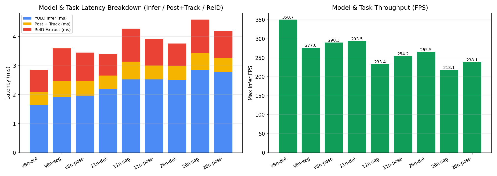
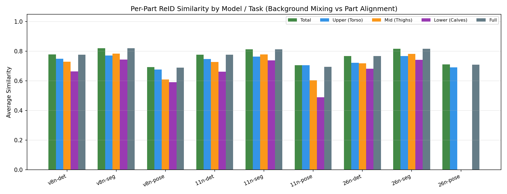
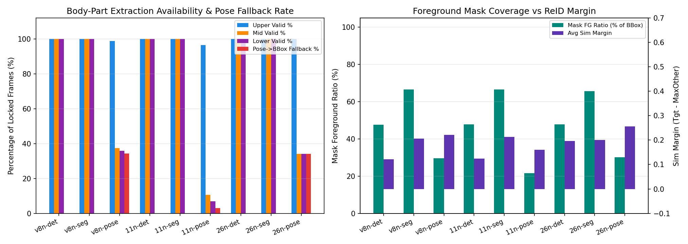
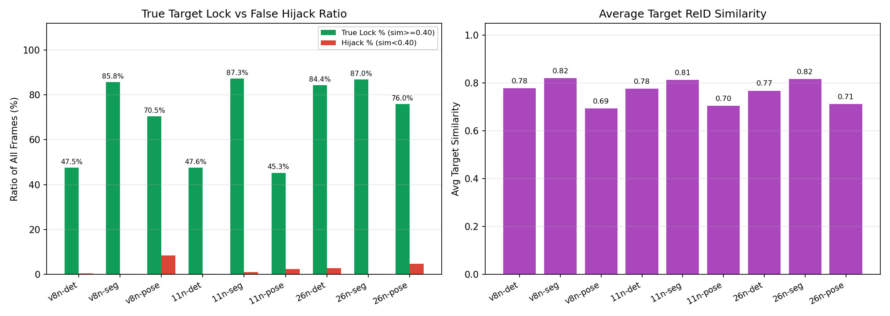
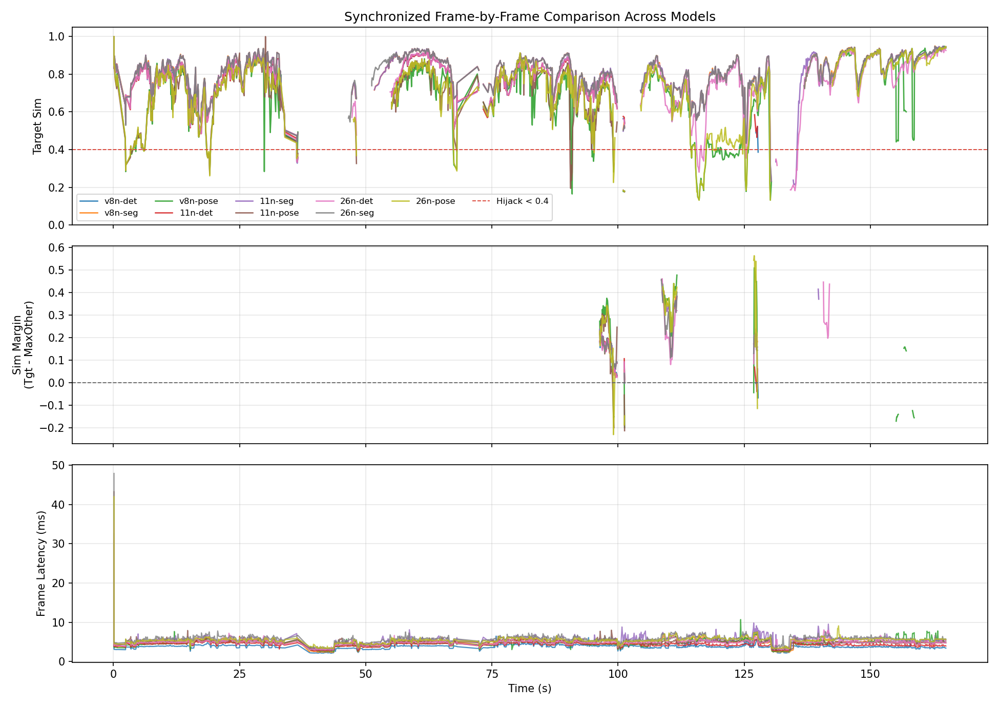
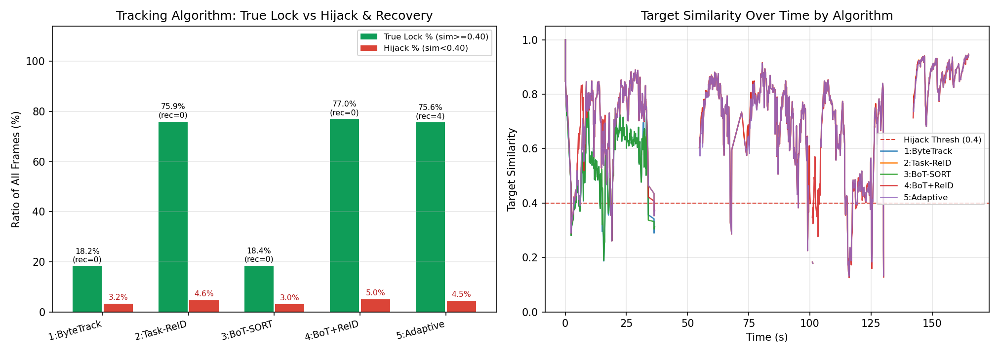
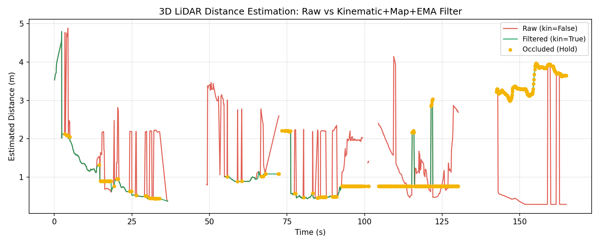

# Bag Benchmark Report: `full`

- **Bag Path**: `/home/jsb/bag3/robot4/full`
- **Image Topic**: `/robot1/top_cam/image_raw/compressed` (`1290` frames evaluated)
- **Scan / TF**: `/robot1/scan` / `/robot1/tf`
- **Keyframes (`Δ=10f`)**: `q1@f322, recovered@f352`

## 0. 핵심 관찰 요약 (Auto Insights)

- **최고 연산 속도**: `v8n-det` (Infer `1.63ms`, Post+Trk `0.47ms`, Max `350.7 FPS`)
- **최고 진성 유지율 (`True Lock %`, sim>=0.4)**: `11n-seg` (`87.3%`, Avg Sim `0.813`)
- **최고 타인 변별 마진 (`Sim Margin`)**: `26n-pose` (평균 `0.256`, 최소 `-0.229`)
- **Pose 부위 가용성 & BBox 폴백 비율**: `v8n-pose` M=37.4%/L=35.9%/FB=34.3%, `11n-pose` M=10.7%/L=7.0%/FB=3.1%, `26n-pose` M=34.2%/L=34.2%/FB=34.2%
- **추적 알고리즘 효과**: `1:ByteTrack` TrueLock=18.2% (Hijack=3.2%, Rec=0), `2:Task-ReID` TrueLock=75.9% (Hijack=4.6%, Rec=0), `3:BoT-SORT` TrueLock=18.4% (Hijack=3.0%, Rec=0), `4:BoT+ReID` TrueLock=77.0% (Hijack=5.0%, Rec=0), `5:Adaptive` TrueLock=75.6% (Hijack=4.5%, Rec=4)
- **LiDAR 필터링 효과**: Jumps `4 -> 0`, FarCamEst `189 -> 10`, AMCL Wall/Out `0 -> 0`, Occluded Hold `636f`

## 1. 모델별 연산 · 후처리 속도 분해 (`5:Adaptive`)

| Model | Pre (ms) | Infer Mean / P95 (ms) | Post+Trk (ms) | ReID (ms) | Total Mean / P95 (ms) | Max FPS |
|---|---:|---:|---:|---:|---:|---:|
| v8n-det (`yolov8n.pt`) | 0.18 | 1.63 / 1.71 | 0.47 | 0.75 | 3.76 / 4.44 | 350.7 |
| v8n-seg (`yolov8n-seg.pt`) | 0.17 | 1.91 / 1.96 | 0.57 | 1.12 | 4.8 / 5.78 | 277.0 |
| v8n-pose (`yolov8n-pose.pt`) | 0.19 | 1.97 / 2.06 | 0.5 | 0.98 | 4.69 / 5.77 | 290.3 |
| 11n-det (`yolo11n.pt`) | 0.18 | 2.21 / 2.28 | 0.45 | 0.75 | 4.31 / 5.03 | 293.5 |
| 11n-seg (`yolo11n-seg.pt`) | 0.19 | 2.53 / 2.67 | 0.61 | 1.14 | 5.53 / 6.82 | 233.4 |
| 11n-pose (`yolo11n-pose.pt`) | 0.19 | 2.53 / 2.7 | 0.48 | 0.92 | 4.94 / 5.75 | 254.2 |
| 26n-det (`yolo26n.pt`) | 0.18 | 2.52 / 2.64 | 0.46 | 0.79 | 4.88 / 5.83 | 265.5 |
| 26n-seg (`yolo26n-seg.pt`) | 0.18 | 2.85 / 2.92 | 0.59 | 1.15 | 5.8 / 6.91 | 218.1 |
| 26n-pose (`yolo26n-pose.pt`) | 0.19 | 2.79 / 2.85 | 0.48 | 0.93 | 5.42 / 6.29 | 238.1 |

## 2. 특징 추출 용이성 · 부위 가용성 · 배경 분리 (`5:Adaptive`)

| Model | U / M / L Valid % | Pose Fallback % | Mask FG % | Avg Tgt Sim ± Std (Min) | U / M / L / F Avg Sim |
|---|---:|---:|---:|---:|---|
| v8n-det | 100.0% / 100.0% / 100.0% | 0.0% | 47.7% | 0.778 ± 0.099 (0.328) | 0.75 / 0.729 / 0.664 / 0.777 |
| v8n-seg | 100.0% / 100.0% / 100.0% | 0.0% | 66.6% | 0.82 ± 0.091 (0.328) | 0.771 / 0.785 / 0.745 / 0.82 |
| v8n-pose | 98.8% / 37.4% / 35.9% | 34.3% | 29.6% | 0.694 ± 0.183 (0.132) | 0.676 / 0.61 / 0.592 / 0.69 |
| 11n-det | 100.0% / 100.0% / 100.0% | 0.0% | 47.8% | 0.776 ± 0.099 (0.337) | 0.748 / 0.727 / 0.662 / 0.776 |
| 11n-seg | 100.0% / 100.0% / 100.0% | 0.0% | 66.6% | 0.813 ± 0.106 (0.212) | 0.765 / 0.779 / 0.739 / 0.813 |
| 11n-pose | 96.4% / 10.7% / 7.0% | 3.1% | 21.6% | 0.705 ± 0.144 (0.176) | 0.705 / 0.604 / 0.489 / 0.695 |
| 26n-det | 100.0% / 100.0% / 100.0% | 0.0% | 47.8% | 0.768 ± 0.129 (0.182) | 0.723 / 0.718 / 0.683 / 0.768 |
| 26n-seg | 100.0% / 100.0% / 100.0% | 0.0% | 65.6% | 0.817 ± 0.095 (0.231) | 0.768 / 0.783 / 0.743 / 0.817 |
| 26n-pose | 100.0% / 34.2% / 34.2% | 34.2% | 30.1% | 0.712 ± 0.172 (0.131) | 0.692 / - / - / 0.71 |

## 3. 재식별 변별력 · 혼잡 · 오인식 방어 (`5:Adaptive`)

> `True Lock %`: 전체 프레임 중 유사도 `>=0.4`로 실제 타겟을 유지한 비율 · `Hijack %`: 유사도 `<0.4` 오탐 잠금 비율

| Model | Det % | >=2P % | Locked % | True Lock % | Hijack % | Direct Sw | Recovered (Avg f) | Other Avg / Max | Margin Mean / Min |
|---|---:|---:|---:|---:|---:|---:|---:|---:|---:|
| v8n-det | 93.8% | 6.4% | 51.0% | **47.5%** | 0.3% | 0 | 3 (56.2f) | 0.589 / 0.665 | 0.122 / -0.066 |
| v8n-seg | 92.9% | 6.0% | 92.4% | **85.8%** | 0.1% | 0 | 5 (22.8f) | 0.551 / 0.675 | 0.206 / 0.004 |
| v8n-pose | 93.1% | 7.8% | 84.6% | **70.5%** | 8.3% | 1 | 6 (24.9f) | 0.403 / 0.707 | 0.221 / -0.198 |
| 11n-det | 93.2% | 6.4% | 51.3% | **47.6%** | 0.2% | 0 | 4 (56.0f) | 0.587 / 0.662 | 0.124 / -0.039 |
| 11n-seg | 93.4% | 6.2% | 94.4% | **87.3%** | 0.9% | 0 | 3 (17.0f) | 0.547 / 0.678 | 0.213 / -0.002 |
| 11n-pose | 93.1% | 5.7% | 51.2% | **45.3%** | 2.3% | 0 | 5 (48.3f) | 0.455 / 0.525 | 0.16 / -0.212 |
| 26n-det | 93.7% | 7.1% | 92.9% | **84.4%** | 2.6% | 0 | 3 (20.9f) | 0.503 / 0.667 | 0.197 / -0.027 |
| 26n-seg | 93.7% | 6.1% | 93.0% | **87.0%** | 0.2% | 0 | 4 (23.7f) | 0.553 / 0.668 | 0.2 / 0.001 |
| 26n-pose | 93.3% | 6.4% | 86.4% | **76.0%** | 4.6% | 0 | 5 (27.9f) | 0.4 / 0.729 | 0.256 / -0.229 |

## 4. 추적 알고리즘 비교 (`yolo26n-pose`)

| Mode | Locked % | True Lock % | Hijack % | SEARCH % | GUARD % | Direct Sw | Recovered (Avg f) | Avg Tgt Sim | Total (ms) |
|---|---:|---:|---:|---:|---:|---:|---:|---:|---:|
| 1:ByteTrack | 22.9% | **18.2%** | 3.2% | 0.0% | 0.0% | 0 | 0 | 0.554 | 4.74 |
| 2:Task-ReID | 86.3% | **75.9%** | 4.6% | 0.0% | 0.0% | 3 | 0 | 0.714 | 5.67 |
| 3:BoT-SORT | 22.9% | **18.4%** | 3.0% | 0.0% | 0.0% | 0 | 0 | 0.554 | 7.08 |
| 4:BoT+ReID | 87.3% | **77.0%** | 5.0% | 0.0% | 0.0% | 2 | 0 | 0.714 | 8.14 |
| 5:Adaptive | 85.9% | **75.6%** | 4.5% | 19.9% | 2.1% | 0 | 4 (32.1f) | 0.713 | 5.43 |

## 5. 3D LiDAR Localizer 비교 (`Raw` vs `Kinematic+Map+EMA`)

| Config | LiDAR | Occluded (Hold) | CamEst | LiDAR Jumps (>0.8m) | Far CamEst (>2.0m) | AMCL Wall/Out |
|---|---:|---:|---:|---:|---:|---:|
| Raw (kin=False) | 878 | 0 | 189 | 4 | 189 | 0 |
| Filtered (kin=True) | 387 | 636 | 10 | 0 | 10 | 0 |

## 6. 시각 검증 스냅샷 (`snapshots/`)

- `compare_tasks_hist_q1_f0322.png`
  
- `compare_versions_q1_f0322.png`
  
- `compare_pixels_q1_f0322.png`
  
- `compare_seq_q1_f0322.png`
  
- `compare_tasks_hist_recovered_f0352.png`
  
- `compare_versions_recovered_f0352.png`
  
- `compare_pixels_recovered_f0352.png`
  
- `compare_seq_recovered_f0352.png`
  
