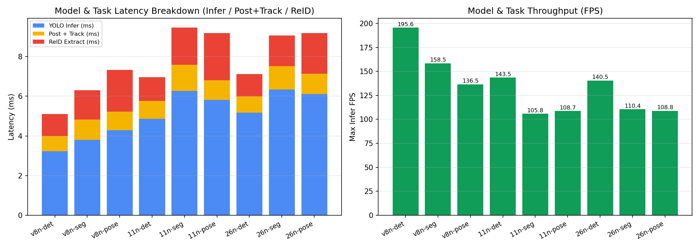
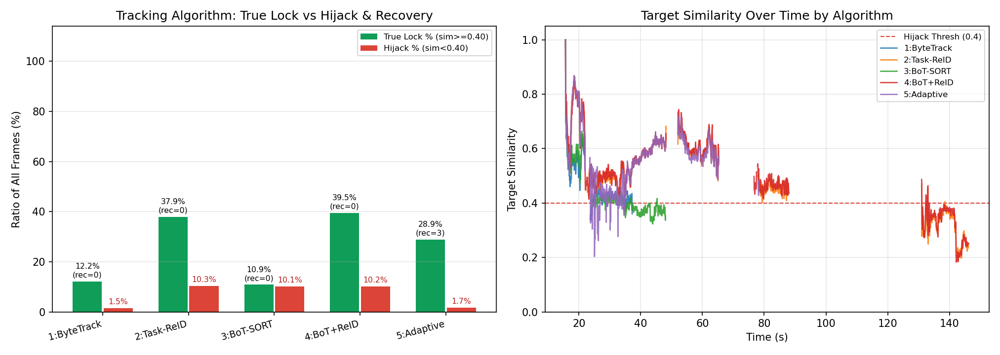

# Bag Benchmark Report: `model_benchmark`

- **Bag Path**: `/home/mu-01/Downloads/arti_benchmark_bags/model_benchmark`
- **Image Topic**: `/robot1/top_cam/image_raw/compressed` (`2184` frames evaluated)
- **Scan / TF**: `None` / `None`
- **Keyframes (`Δ=10f`)**: `q1@f546, mid@f1092`

## 0. 핵심 관찰 요약 (Auto Insights)

- **최고 연산 속도**: `v8n-det` (Infer `3.23ms`, Post+Trk `0.76ms`, Max `195.6 FPS`)
- **최고 진성 유지율 (`True Lock %`, sim>=0.4)**: `11n-seg` (`74.5%`, Avg Sim `0.704`)
- **최고 타인 변별 마진 (`Sim Margin`)**: `v8n-pose` (평균 `0.192`, 최소 `-0.145`)
- **Pose 부위 가용성 & BBox 폴백 비율**: `v8n-pose` M=90.2%/L=77.8%/FB=15.0%, `11n-pose` M=88.2%/L=83.9%/FB=12.7%, `26n-pose` M=92.5%/L=57.4%/FB=5.8%
- **추적 알고리즘 효과**: `1:ByteTrack` TrueLock=12.2% (Hijack=1.5%, Rec=0), `2:Task-ReID` TrueLock=37.9% (Hijack=10.3%, Rec=0), `3:BoT-SORT` TrueLock=10.9% (Hijack=10.1%, Rec=0), `4:BoT+ReID` TrueLock=39.5% (Hijack=10.2%, Rec=0), `5:Adaptive` TrueLock=28.9% (Hijack=1.7%, Rec=3)

## 1. 모델별 연산 · 후처리 속도 분해 (`5:Adaptive`)

| Model | Pre (ms) | Infer Mean / P95 (ms) | Post+Trk (ms) | ReID (ms) | Total Mean / P95 (ms) | Max FPS |
|---|---:|---:|---:|---:|---:|---:|
| v8n-det (`yolov8n.pt`) | 0.28 | 3.23 / 3.29 | 0.76 | 1.12 | 6.43 / 7.66 | 195.6 |
| v8n-seg (`yolov8n-seg.pt`) | 0.28 | 3.8 / 3.86 | 1.03 | 1.48 | 7.85 / 9.63 | 158.5 |
| v8n-pose (`yolov8n-pose.pt`) | 0.35 | 4.28 / 6.98 | 0.94 | 2.1 | 8.81 / 12.81 | 136.5 |
| 11n-det (`yolo11n.pt`) | 0.32 | 4.86 / 5.59 | 0.91 | 1.2 | 8.51 / 10.04 | 143.5 |
| 11n-seg (`yolo11n-seg.pt`) | 0.35 | 6.27 / 9.06 | 1.31 | 1.88 | 11.52 / 16.58 | 105.8 |
| 11n-pose (`yolo11n-pose.pt`) | 0.36 | 5.81 / 9.18 | 0.99 | 2.39 | 10.76 / 17.61 | 108.7 |
| 26n-det (`yolo26n.pt`) | 0.31 | 5.17 / 5.33 | 0.82 | 1.13 | 8.53 / 9.79 | 140.5 |
| 26n-seg (`yolo26n-seg.pt`) | 0.33 | 6.34 / 10.23 | 1.17 | 1.55 | 10.81 / 14.35 | 110.4 |
| 26n-pose (`yolo26n-pose.pt`) | 0.42 | 6.11 / 8.18 | 1.03 | 2.05 | 11.19 / 15.42 | 108.8 |

## 2. 특징 추출 용이성 · 부위 가용성 · 배경 분리 (`5:Adaptive`)

| Model | U / M / L Valid % | Pose Fallback % | Mask FG % | Avg Tgt Sim ± Std (Min) | U / M / L / F Avg Sim |
|---|---:|---:|---:|---:|---|
| v8n-det | 100.0% / 100.0% / 100.0% | 0.0% | 43.6% | 0.676 ± 0.19 (0.368) | 0.583 / 0.529 / 0.565 / 0.676 |
| v8n-seg | 98.4% / 47.1% / 45.9% | 0.0% | 46.8% | 0.709 ± 0.172 (0.314) | 0.677 / 0.546 / 0.512 / 0.705 |
| v8n-pose | 100.0% / 90.2% / 77.8% | 15.0% | 38.2% | 0.554 ± 0.113 (0.236) | 0.483 / 0.533 / 0.49 / 0.547 |
| 11n-det | 100.0% / 100.0% / 100.0% | 0.0% | 43.7% | 0.595 ± 0.16 (0.364) | 0.485 / 0.386 / 0.431 / 0.595 |
| 11n-seg | 98.4% / 46.9% / 45.7% | 0.0% | 47.3% | 0.704 ± 0.171 (0.227) | 0.685 / 0.535 / 0.506 / 0.702 |
| 11n-pose | 100.0% / 88.2% / 83.9% | 12.7% | 39.4% | 0.566 ± 0.098 (0.255) | 0.499 / 0.532 / 0.507 / 0.553 |
| 26n-det | 100.0% / 100.0% / 100.0% | 0.0% | 43.6% | 0.672 ± 0.191 (0.37) | 0.581 / 0.524 / 0.566 / 0.672 |
| 26n-seg | 98.3% / 44.4% / 44.1% | 0.0% | 46.4% | 0.701 ± 0.177 (0.32) | 0.672 / 0.534 / 0.484 / 0.698 |
| 26n-pose | 99.9% / 92.5% / 57.4% | 5.8% | 38.6% | 0.562 ± 0.11 (0.203) | 0.496 / 0.541 / - / 0.557 |

## 3. 재식별 변별력 · 혼잡 · 오인식 방어 (`5:Adaptive`)

> `True Lock %`: 전체 프레임 중 유사도 `>=0.4`로 실제 타겟을 유지한 비율 · `Hijack %`: 유사도 `<0.4` 오탐 잠금 비율

| Model | Det % | >=2P % | Locked % | True Lock % | Hijack % | Direct Sw | Recovered (Avg f) | Other Avg / Max | Margin Mean / Min |
|---|---:|---:|---:|---:|---:|---:|---:|---:|---:|
| v8n-det | 99.6% | 38.8% | 77.2% | **74.2%** | 2.7% | 10 | 6 (40.1f) | 0.453 / 0.589 | 0.106 / -0.064 |
| v8n-seg | 99.8% | 39.0% | 78.7% | **73.2%** | 5.3% | 22 | 7 (30.8f) | 0.528 / 0.742 | 0.053 / -0.342 |
| v8n-pose | 99.7% | 38.9% | 30.6% | **27.4%** | 3.1% | 0 | 4 (46.2f) | 0.334 / 0.51 | 0.192 / -0.145 |
| 11n-det | 99.8% | 38.4% | 76.2% | **73.0%** | 3.0% | 17 | 8 (33.3f) | 0.45 / 0.584 | 0.107 / -0.083 |
| 11n-seg | 99.8% | 40.8% | 79.4% | **74.5%** | 4.8% | 8 | 7 (25.4f) | 0.516 / 0.719 | 0.085 / -0.334 |
| 11n-pose | 99.7% | 38.0% | 31.4% | **30.3%** | 1.1% | 0 | 4 (199.2f) | 0.371 / 0.496 | 0.166 / -0.195 |
| 26n-det | 99.8% | 39.1% | 76.7% | **73.9%** | 2.6% | 20 | 11 (24.1f) | 0.45 / 0.584 | 0.101 / -0.092 |
| 26n-seg | 99.8% | 39.2% | 76.1% | **70.6%** | 5.4% | 9 | 8 (33.6f) | 0.515 / 0.735 | 0.05 / -0.322 |
| 26n-pose | 99.8% | 37.4% | 30.7% | **28.9%** | 1.7% | 4 | 3 (90.7f) | 0.381 / 0.472 | 0.152 / -0.216 |

## 4. 추적 알고리즘 비교 (`yolo26n-pose`)

| Mode | Locked % | True Lock % | Hijack % | SEARCH % | GUARD % | Direct Sw | Recovered (Avg f) | Avg Tgt Sim | Total (ms) |
|---|---:|---:|---:|---:|---:|---:|---:|---:|---:|
| 1:ByteTrack | 13.8% | **12.2%** | 1.5% | 0.0% | 0.0% | 0 | 0 | 0.463 | 9.75 |
| 2:Task-ReID | 48.3% | **37.9%** | 10.3% | 0.0% | 0.0% | 9 | 0 | 0.505 | 9.53 |
| 3:BoT-SORT | 21.1% | **10.9%** | 10.1% | 0.0% | 0.0% | 0 | 0 | 0.433 | 15.9 |
| 4:BoT+ReID | 49.7% | **39.5%** | 10.2% | 0.0% | 0.0% | 7 | 0 | 0.512 | 15.97 |
| 5:Adaptive | 30.7% | **28.9%** | 1.7% | 59.1% | 15.9% | 4 | 3 (90.7f) | 0.562 | 9.69 |

## 5.5 Ground Truth(GT) 기반 실제 추적 정확도 (IoU >= 0.5)

| Experiment | Mode | GT Pos / Neg (f) | GT True Lock % | GT Hijack % | GT Miss % | GT False Lock % | Mean IoU | Fail Episodes (예상 개입) |
|---|---|---:|---:|---:|---:|---:|---:|---:|
| v8n-det | 5:Adaptive | 712 / 1248 | **74.6%** | 23.3% | 2.1% | 78.7% | 0.726 | 15 |
| v8n-seg | 5:Adaptive | 712 / 1248 | **5.5%** | 89.2% | 5.3% | 83.3% | 0.112 | 7 |
| v8n-pose | 5:Adaptive | 712 / 1248 | **89.6%** | 0.0% | 10.4% | 2.2% | 0.931 | 14 |
| 11n-det | 5:Adaptive | 712 / 1248 | **74.4%** | 20.6% | 4.9% | 78.8% | 0.754 | 17 |
| 11n-seg | 5:Adaptive | 712 / 1248 | **15.0%** | 82.4% | 2.5% | 83.1% | 0.174 | 7 |
| 11n-pose | 5:Adaptive | 712 / 1248 | **90.4%** | 0.0% | 9.6% | 3.2% | 0.928 | 12 |
| 26n-det | 5:Adaptive | 712 / 1248 | **72.5%** | 26.0% | 1.5% | 77.7% | 0.705 | 20 |
| 26n-seg | 5:Adaptive | 712 / 1248 | **5.5%** | 81.5% | 13.1% | 83.3% | 0.087 | 7 |
| 26n-pose | 5:Adaptive | 712 / 1248 | **76.4%** | 13.6% | 10.0% | 2.2% | 0.791 | 12 |
| mode_1 | 1:ByteTrack | 712 / 1248 | **13.3%** | 25.7% | 61.0% | 1.8% | 0.315 | 6 |
| mode_2 | 2:Task-ReID | 712 / 1248 | **89.9%** | 9.4% | 0.7% | 27.6% | 0.841 | 13 |
| mode_3 | 3:BoT-SORT | 712 / 1248 | **13.5%** | 47.9% | 38.6% | 1.8% | 0.275 | 5 |
| mode_4 | 4:BoT+ReID | 712 / 1248 | **90.3%** | 9.7% | 0.0% | 29.8% | 0.809 | 15 |
| mode_5 | 5:Adaptive | 712 / 1248 | **76.4%** | 13.6% | 10.0% | 2.2% | 0.791 | 12 |

## 6. 시각 검증 스냅샷 (`snapshots/`)

- `compare_tasks_hist_q1_f0546.png`
  
- `compare_versions_q1_f0546.png`
  
- `compare_pixels_q1_f0546.png`
  
- `compare_seq_q1_f0546.png`
  
- `compare_tasks_hist_mid_f1092.png`
  
- `compare_versions_mid_f1092.png`
  
- `compare_pixels_mid_f1092.png`
  
- `compare_seq_mid_f1092.png`
  
