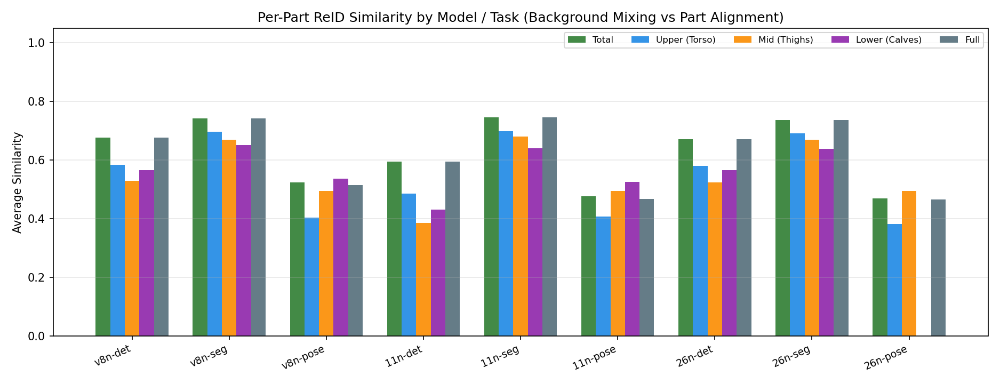
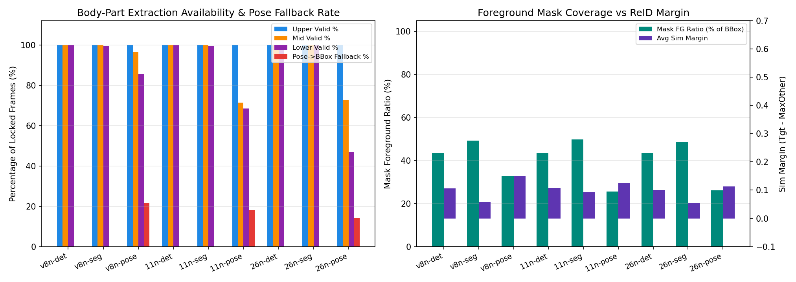
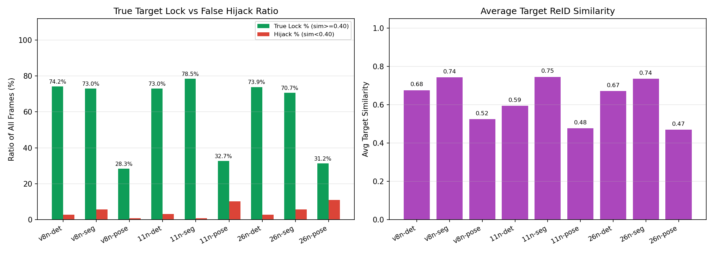
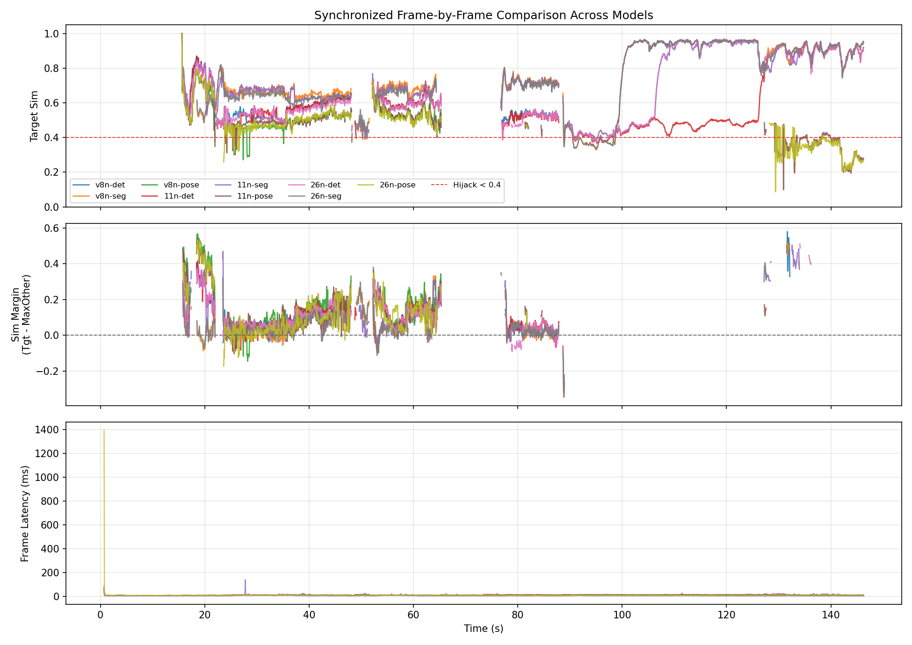

# Bag Benchmark Report: `model_benchmark`

- **Bag Path**: `/home/mu-01/Downloads/arti_benchmark_bags/model_benchmark`
- **Image Topic**: `/robot1/top_cam/image_raw/compressed` (`2184` frames evaluated)
- **Scan / TF**: `None` / `None`
- **Keyframes (`Δ=10f`)**: `q1@f546, recovered@f772`

## 0. 핵심 관찰 요약 (Auto Insights)

- **최고 연산 속도**: `v8n-det` (Infer `3.9ms`, Post+Trk `0.94ms`, Max `162.6 FPS`)
- **최고 진성 유지율 (`True Lock %`, sim>=0.4)**: `11n-seg` (`78.5%`, Avg Sim `0.746`)
- **최고 타인 변별 마진 (`Sim Margin`)**: `v8n-pose` (평균 `0.149`, 최소 `-0.145`)
- **Pose 부위 가용성 & BBox 폴백 비율**: `v8n-pose` M=96.4%/L=85.6%/FB=21.6%, `11n-pose` M=71.5%/L=68.4%/FB=18.2%, `26n-pose` M=72.6%/L=46.9%/FB=14.4%
- **추적 알고리즘 효과**: `1:ByteTrack` TrueLock=4.3% (Hijack=9.4%, Rec=0), `2:Task-ReID` TrueLock=36.0% (Hijack=12.5%, Rec=0), `3:BoT-SORT` TrueLock=4.3% (Hijack=16.7%, Rec=0), `4:BoT+ReID` TrueLock=39.2% (Hijack=10.1%, Rec=0), `5:Adaptive` TrueLock=31.2% (Hijack=11.0%, Rec=5)

## 1. 모델별 연산 · 후처리 속도 분해 (`5:Adaptive`)

| Model | Pre (ms) | Infer Mean / P95 (ms) | Post+Trk (ms) | ReID (ms) | Total Mean / P95 (ms) | Max FPS |
|---|---:|---:|---:|---:|---:|---:|
| v8n-det (`yolov8n.pt`) | 0.34 | 3.9 / 5.0 | 0.94 | 1.31 | 7.73 / 9.78 | 162.6 |
| v8n-seg (`yolov8n-seg.pt`) | 0.3 | 3.96 / 4.24 | 1.11 | 2.16 | 8.84 / 11.09 | 138.4 |
| v8n-pose (`yolov8n-pose.pt`) | 0.37 | 4.41 / 4.78 | 0.99 | 1.58 | 8.55 / 10.88 | 143.3 |
| 11n-det (`yolo11n.pt`) | 0.31 | 4.82 / 5.38 | 0.86 | 1.23 | 8.39 / 10.19 | 144.7 |
| 11n-seg (`yolo11n-seg.pt`) | 0.31 | 5.45 / 5.87 | 1.14 | 2.4 | 10.73 / 12.8 | 111.1 |
| 11n-pose (`yolo11n-pose.pt`) | 0.41 | 6.86 / 9.42 | 1.19 | 2.23 | 12.12 / 17.09 | 97.3 |
| 26n-det (`yolo26n.pt`) | 0.33 | 5.4 / 6.37 | 0.87 | 1.17 | 8.93 / 10.66 | 134.5 |
| 26n-seg (`yolo26n-seg.pt`) | 0.38 | 6.95 / 8.05 | 1.33 | 2.53 | 12.78 / 16.39 | 92.6 |
| 26n-pose (`yolo26n-pose.pt`) | 0.43 | 5.85 / 6.27 | 1.02 | 1.4 | 10.36 / 11.99 | 121.0 |

## 2. 특징 추출 용이성 · 부위 가용성 · 배경 분리 (`5:Adaptive`)

| Model | U / M / L Valid % | Pose Fallback % | Mask FG % | Avg Tgt Sim ± Std (Min) | U / M / L / F Avg Sim |
|---|---:|---:|---:|---:|---|
| v8n-det | 100.0% / 100.0% / 100.0% | 0.0% | 43.6% | 0.676 ± 0.19 (0.368) | 0.583 / 0.529 / 0.565 / 0.676 |
| v8n-seg | 100.0% / 100.0% / 99.3% | 0.0% | 49.2% | 0.743 ± 0.177 (0.329) | 0.696 / 0.669 / 0.652 / 0.743 |
| v8n-pose | 100.0% / 96.4% / 85.6% | 21.6% | 32.9% | 0.524 ± 0.082 (0.272) | 0.403 / 0.495 / 0.537 / 0.514 |
| 11n-det | 100.0% / 100.0% / 100.0% | 0.0% | 43.7% | 0.595 ± 0.16 (0.364) | 0.485 / 0.386 / 0.431 / 0.595 |
| 11n-seg | 100.0% / 100.0% / 99.3% | 0.0% | 49.9% | 0.746 ± 0.167 (0.368) | 0.699 / 0.68 / 0.641 / 0.746 |
| 11n-pose | 100.0% / 71.5% / 68.4% | 18.2% | 25.7% | 0.477 ± 0.112 (0.098) | 0.408 / 0.494 / 0.526 / 0.468 |
| 26n-det | 100.0% / 100.0% / 100.0% | 0.0% | 43.6% | 0.672 ± 0.191 (0.37) | 0.581 / 0.524 / 0.566 / 0.672 |
| 26n-seg | 100.0% / 99.9% / 99.9% | 0.0% | 48.7% | 0.736 ± 0.182 (0.332) | 0.691 / 0.67 / 0.638 / 0.736 |
| 26n-pose | 100.0% / 72.6% / 46.9% | 14.4% | 26.1% | 0.47 ± 0.114 (0.087) | 0.382 / 0.494 / - / 0.465 |

## 3. 재식별 변별력 · 혼잡 · 오인식 방어 (`5:Adaptive`)

> `True Lock %`: 전체 프레임 중 유사도 `>=0.4`로 실제 타겟을 유지한 비율 · `Hijack %`: 유사도 `<0.4` 오탐 잠금 비율

| Model | Det % | >=2P % | Locked % | True Lock % | Hijack % | Direct Sw | Recovered (Avg f) | Other Avg / Max | Margin Mean / Min |
|---|---:|---:|---:|---:|---:|---:|---:|---:|---:|
| v8n-det | 99.6% | 38.8% | 77.2% | **74.2%** | 2.7% | 10 | 6 (40.1f) | 0.453 / 0.589 | 0.106 / -0.064 |
| v8n-seg | 99.8% | 39.0% | 78.8% | **73.0%** | 5.6% | 19 | 7 (30.2f) | 0.547 / 0.762 | 0.057 / -0.347 |
| v8n-pose | 99.7% | 38.9% | 29.1% | **28.3%** | 0.7% | 1 | 3 (37.7f) | 0.331 / 0.496 | 0.149 / -0.145 |
| 11n-det | 99.8% | 38.4% | 76.2% | **73.0%** | 3.0% | 17 | 8 (33.3f) | 0.45 / 0.584 | 0.107 / -0.083 |
| 11n-seg | 99.8% | 40.8% | 79.4% | **78.5%** | 0.8% | 9 | 6 (28.5f) | 0.537 / 0.727 | 0.092 / -0.328 |
| 11n-pose | 99.7% | 38.0% | 43.0% | **32.7%** | 10.2% | 2 | 7 (146.1f) | 0.358 / 0.527 | 0.125 / -0.104 |
| 26n-det | 99.8% | 39.1% | 76.7% | **73.9%** | 2.6% | 20 | 11 (24.1f) | 0.45 / 0.584 | 0.101 / -0.092 |
| 26n-seg | 99.8% | 39.2% | 76.4% | **70.7%** | 5.6% | 9 | 8 (32.8f) | 0.537 / 0.741 | 0.053 / -0.345 |
| 26n-pose | 99.8% | 37.4% | 42.3% | **31.2%** | 11.0% | 5 | 5 (173.0f) | 0.37 / 0.532 | 0.113 / -0.173 |

## 4. 추적 알고리즘 비교 (`yolo26n-pose`)

| Mode | Locked % | True Lock % | Hijack % | SEARCH % | GUARD % | Direct Sw | Recovered (Avg f) | Avg Tgt Sim | Total (ms) |
|---|---:|---:|---:|---:|---:|---:|---:|---:|---:|
| 1:ByteTrack | 13.8% | **4.3%** | 9.4% | 0.0% | 0.0% | 0 | 0 | 0.405 | 9.95 |
| 2:Task-ReID | 48.6% | **36.0%** | 12.5% | 0.0% | 0.0% | 30 | 0 | 0.467 | 12.61 |
| 3:BoT-SORT | 21.1% | **4.3%** | 16.7% | 0.0% | 0.0% | 0 | 0 | 0.382 | 14.58 |
| 4:BoT+ReID | 49.4% | **39.2%** | 10.1% | 0.0% | 0.0% | 30 | 0 | 0.484 | 15.55 |
| 5:Adaptive | 42.3% | **31.2%** | 11.0% | 47.5% | 15.4% | 5 | 5 (173.0f) | 0.47 | 9.49 |

## 5.5 Ground Truth(GT) 기반 실제 추적 정확도 (IoU >= 0.5)

| Experiment | Mode | GT Pos / Neg (f) | GT True Lock % | GT Hijack % | GT Miss % | GT False Lock % | Mean IoU | Fail Episodes (예상 개입) |
|---|---|---:|---:|---:|---:|---:|---:|---:|
| v8n-det | 5:Adaptive | 712 / 1248 | **74.6%** | 23.3% | 2.1% | 78.7% | 0.726 | 15 |
| v8n-seg | 5:Adaptive | 712 / 1248 | **5.6%** | 89.0% | 5.3% | 83.7% | 0.113 | 7 |
| v8n-pose | 5:Adaptive | 712 / 1248 | **67.0%** | 18.5% | 14.5% | 1.9% | 0.749 | 8 |
| 11n-det | 5:Adaptive | 712 / 1248 | **74.4%** | 20.6% | 4.9% | 78.8% | 0.754 | 17 |
| 11n-seg | 5:Adaptive | 712 / 1248 | **15.0%** | 82.6% | 2.4% | 83.1% | 0.173 | 7 |
| 11n-pose | 5:Adaptive | 712 / 1248 | **68.7%** | 22.2% | 9.1% | 23.2% | 0.718 | 10 |
| 26n-det | 5:Adaptive | 712 / 1248 | **72.5%** | 26.0% | 1.5% | 77.7% | 0.705 | 20 |
| 26n-seg | 5:Adaptive | 712 / 1248 | **4.9%** | 82.0% | 13.1% | 83.8% | 0.087 | 7 |
| 26n-pose | 5:Adaptive | 712 / 1248 | **75.4%** | 12.6% | 11.9% | 23.6% | 0.803 | 12 |
| mode_1 | 1:ByteTrack | 712 / 1248 | **13.3%** | 25.7% | 61.0% | 1.8% | 0.315 | 6 |
| mode_2 | 2:Task-ReID | 712 / 1248 | **76.4%** | 21.9% | 1.7% | 28.7% | 0.727 | 20 |
| mode_3 | 3:BoT-SORT | 712 / 1248 | **13.5%** | 47.9% | 38.6% | 1.8% | 0.275 | 5 |
| mode_4 | 4:BoT+ReID | 712 / 1248 | **76.1%** | 22.5% | 1.4% | 30.0% | 0.684 | 21 |
| mode_5 | 5:Adaptive | 712 / 1248 | **75.4%** | 12.6% | 11.9% | 23.6% | 0.803 | 12 |

## 6. 시각 검증 스냅샷 (`snapshots/`)

- `compare_tasks_hist_q1_f0546.png`
  
- `compare_versions_q1_f0546.png`
  
- `compare_pixels_q1_f0546.png`
  
- `compare_seq_q1_f0546.png`
  
- `compare_tasks_hist_recovered_f0772.png`
  
- `compare_versions_recovered_f0772.png`
  
- `compare_pixels_recovered_f0772.png`
  
- `compare_seq_recovered_f0772.png`
  
