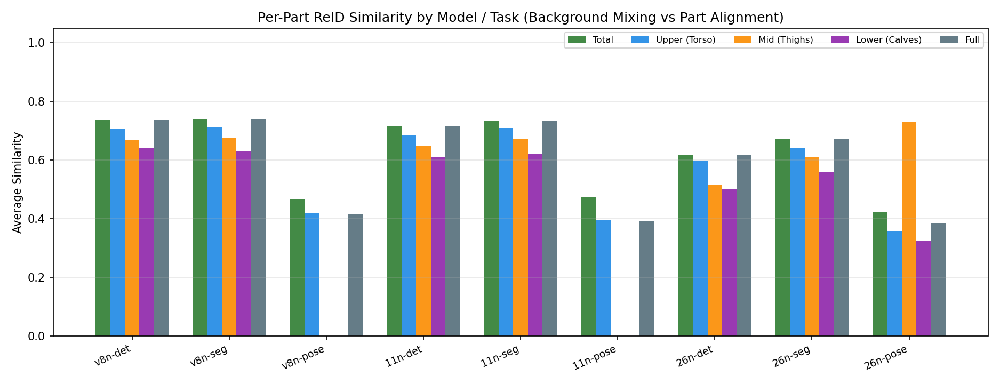
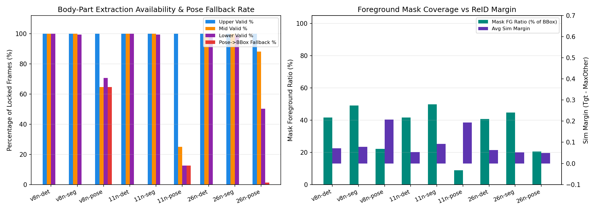
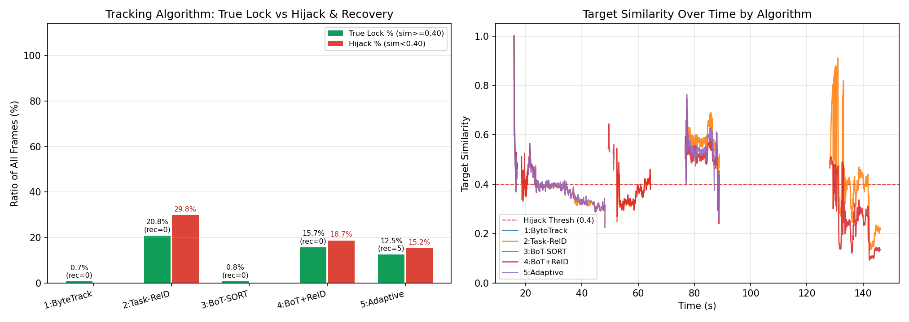

# Bag Benchmark Report: `model_benchmark`

- **Bag Path**: `/home/mu-01/Downloads/arti_benchmark_bags/model_benchmark`
- **Image Topic**: `/robot1/top_cam/image_raw/compressed` (`2184` frames evaluated)
- **Scan / TF**: `None` / `None`
- **Keyframes (`Δ=10f`)**: `crowd@f228, recovered@f304`

## 0. 핵심 관찰 요약 (Auto Insights)

- **최고 연산 속도**: `v8n-det` (Infer `3.52ms`, Post+Trk `0.84ms`, Max `183.9 FPS`)
- **최고 진성 유지율 (`True Lock %`, sim>=0.4)**: `v8n-seg` (`73.4%`, Avg Sim `0.741`)
- **최고 타인 변별 마진 (`Sim Margin`)**: `v8n-pose` (평균 `0.207`, 최소 `0.0`)
- **Pose 부위 가용성 & BBox 폴백 비율**: `v8n-pose` M=64.7%/L=70.6%/FB=64.7%, `11n-pose` M=25.0%/L=12.5%/FB=12.5%, `26n-pose` M=88.1%/L=50.3%/FB=1.3%
- **추적 알고리즘 효과**: `1:ByteTrack` TrueLock=0.7% (Hijack=0.0%, Rec=0), `2:Task-ReID` TrueLock=20.8% (Hijack=29.8%, Rec=0), `3:BoT-SORT` TrueLock=0.8% (Hijack=0.0%, Rec=0), `4:BoT+ReID` TrueLock=15.7% (Hijack=18.7%, Rec=0), `5:Adaptive` TrueLock=12.5% (Hijack=15.2%, Rec=5)

## 1. 모델별 연산 · 후처리 속도 분해 (`5:Adaptive`)

| Model | Pre (ms) | Infer Mean / P95 (ms) | Post+Trk (ms) | ReID (ms) | Total Mean / P95 (ms) | Max FPS |
|---|---:|---:|---:|---:|---:|---:|
| v8n-det (`yolov8n.pt`) | 0.3 | 3.52 / 3.81 | 0.84 | 1.08 | 6.84 / 7.89 | 183.9 |
| v8n-seg (`yolov8n-seg.pt`) | 0.31 | 4.24 / 4.6 | 1.18 | 2.33 | 9.45 / 12.21 | 129.0 |
| v8n-pose (`yolov8n-pose.pt`) | 0.32 | 4.19 / 4.28 | 0.93 | 1.31 | 7.79 / 8.74 | 155.5 |
| 11n-det (`yolo11n.pt`) | 0.3 | 4.68 / 6.38 | 0.84 | 1.06 | 7.98 / 10.69 | 152.0 |
| 11n-seg (`yolo11n-seg.pt`) | 0.3 | 5.31 / 5.73 | 1.13 | 2.35 | 10.45 / 13.51 | 113.8 |
| 11n-pose (`yolo11n-pose.pt`) | 0.33 | 5.54 / 8.84 | 0.96 | 1.41 | 9.28 / 14.94 | 126.6 |
| 26n-det (`yolo26n.pt`) | 0.34 | 5.84 / 9.49 | 0.92 | 1.2 | 9.51 / 16.3 | 125.7 |
| 26n-seg (`yolo26n-seg.pt`) | 0.34 | 6.53 / 7.04 | 1.24 | 2.29 | 11.82 / 14.56 | 99.4 |
| 26n-pose (`yolo26n-pose.pt`) | 0.46 | 6.52 / 7.6 | 1.12 | 1.69 | 11.47 / 13.21 | 107.2 |

## 2. 특징 추출 용이성 · 부위 가용성 · 배경 분리 (`5:Adaptive`)

| Model | U / M / L Valid % | Pose Fallback % | Mask FG % | Avg Tgt Sim ± Std (Min) | U / M / L / F Avg Sim |
|---|---:|---:|---:|---:|---|
| v8n-det | 100.0% / 100.0% / 100.0% | 0.0% | 41.7% | 0.737 ± 0.217 (0.168) | 0.708 / 0.67 / 0.643 / 0.737 |
| v8n-seg | 100.0% / 100.0% / 99.3% | 0.0% | 49.1% | 0.741 ± 0.176 (0.33) | 0.711 / 0.674 / 0.63 / 0.74 |
| v8n-pose | 100.0% / 64.7% / 70.6% | 64.7% | 22.1% | 0.467 ± 0.14 (0.338) | 0.419 / - / - / 0.416 |
| 11n-det | 100.0% / 100.0% / 100.0% | 0.0% | 41.6% | 0.715 ± 0.221 (0.18) | 0.686 / 0.649 / 0.609 / 0.715 |
| 11n-seg | 100.0% / 100.0% / 99.4% | 0.0% | 49.9% | 0.734 ± 0.177 (0.336) | 0.709 / 0.672 / 0.621 / 0.734 |
| 11n-pose | 100.0% / 25.0% / 12.5% | 12.5% | 8.9% | 0.474 ± 0.224 (0.237) | 0.395 / - / - / 0.391 |
| 26n-det | 100.0% / 100.0% / 100.0% | 0.0% | 40.8% | 0.618 ± 0.186 (0.195) | 0.597 / 0.516 / 0.5 / 0.617 |
| 26n-seg | 100.0% / 99.9% / 98.7% | 0.0% | 44.8% | 0.672 ± 0.253 (0.3) | 0.641 / 0.611 / 0.558 / 0.672 |
| 26n-pose | 100.0% / 88.1% / 50.3% | 1.3% | 20.5% | 0.422 ± 0.096 (0.225) | 0.358 / 0.732 / 0.324 / 0.384 |

## 3. 재식별 변별력 · 혼잡 · 오인식 방어 (`5:Adaptive`)

> `True Lock %`: 전체 프레임 중 유사도 `>=0.4`로 실제 타겟을 유지한 비율 · `Hijack %`: 유사도 `<0.4` 오탐 잠금 비율

| Model | Det % | >=2P % | Locked % | True Lock % | Hijack % | Direct Sw | Recovered (Avg f) | Other Avg / Max | Margin Mean / Min |
|---|---:|---:|---:|---:|---:|---:|---:|---:|---:|
| v8n-det | 99.6% | 38.8% | 52.8% | **47.3%** | 5.4% | 1 | 10 (80.7f) | 0.449 / 1.0 | 0.071 / -0.34 |
| v8n-seg | 99.8% | 39.0% | 78.9% | **73.4%** | 5.3% | 19 | 6 (33.9f) | 0.516 / 1.0 | 0.078 / -0.347 |
| v8n-pose | 99.7% | 38.9% | 0.8% | **0.6%** | 0.2% | 0 | 2 (450.0f) | 0.26 / 1.0 | 0.207 / 0.0 |
| 11n-det | 99.8% | 38.4% | 53.0% | **46.8%** | 6.0% | 1 | 10 (80.3f) | 0.457 / 1.0 | 0.054 / -0.345 |
| 11n-seg | 99.8% | 40.8% | 78.7% | **73.2%** | 5.4% | 10 | 6 (26.9f) | 0.501 / 1.0 | 0.093 / -0.339 |
| 11n-pose | 99.7% | 38.0% | 0.4% | **0.2%** | 0.2% | 0 | 1 (529.0f) | 0.281 / 1.0 | 0.193 / 0.0 |
| 26n-det | 99.8% | 39.1% | 45.1% | **43.4%** | 1.6% | 1 | 8 (121.9f) | 0.435 / 1.0 | 0.063 / -0.317 |
| 26n-seg | 99.8% | 39.2% | 68.2% | **49.9%** | 18.1% | 2 | 9 (52.6f) | 0.368 / 1.0 | 0.052 / -0.297 |
| 26n-pose | 99.8% | 37.4% | 27.7% | **12.5%** | 15.2% | 0 | 5 (82.2f) | 0.35 / 1.0 | 0.049 / -0.14 |

## 4. 추적 알고리즘 비교 (`yolo26n-pose`)

| Mode | Locked % | True Lock % | Hijack % | SEARCH % | GUARD % | Direct Sw | Recovered (Avg f) | Avg Tgt Sim | Total (ms) |
|---|---:|---:|---:|---:|---:|---:|---:|---:|---:|
| 1:ByteTrack | 0.8% | **0.7%** | 0.0% | 0.0% | 0.0% | 0 | 0 | 0.523 | 11.17 |
| 2:Task-ReID | 50.7% | **20.8%** | 29.8% | 0.0% | 0.0% | 15 | 0 | 0.411 | 10.24 |
| 3:BoT-SORT | 0.9% | **0.8%** | 0.0% | 0.0% | 0.0% | 0 | 0 | 0.533 | 15.48 |
| 4:BoT+ReID | 34.4% | **15.7%** | 18.7% | 0.0% | 0.0% | 22 | 0 | 0.375 | 16.17 |
| 5:Adaptive | 27.7% | **12.5%** | 15.2% | 62.0% | 20.9% | 0 | 5 (82.2f) | 0.422 | 9.54 |

## 5.5 Ground Truth(GT) 기반 실제 추적 정확도 (IoU >= 0.5)

| Experiment | Mode | GT Pos / Neg (f) | GT True Lock % | GT Hijack % | GT Miss % | GT False Lock % | Mean IoU | Fail Episodes (예상 개입) |
|---|---|---:|---:|---:|---:|---:|---:|---:|
| v8n-det | 5:Adaptive | 487 / 1471 | **3.7%** | 33.9% | 62.4% | 65.7% | 0.085 | 15 |
| v8n-seg | 5:Adaptive | 487 / 1471 | **38.6%** | 61.0% | 0.4% | 84.0% | 0.35 | 22 |
| v8n-pose | 5:Adaptive | 487 / 1471 | **0.8%** | 0.0% | 99.2% | 0.9% | 0.837 | 10 |
| 11n-det | 5:Adaptive | 487 / 1471 | **3.7%** | 33.7% | 62.6% | 66.1% | 0.09 | 15 |
| 11n-seg | 5:Adaptive | 487 / 1471 | **51.1%** | 48.5% | 0.4% | 83.6% | 0.458 | 19 |
| 11n-pose | 5:Adaptive | 487 / 1471 | **1.0%** | 0.0% | 99.0% | 0.2% | 0.872 | 9 |
| 26n-det | 5:Adaptive | 487 / 1471 | **3.9%** | 33.3% | 62.8% | 54.5% | 0.098 | 13 |
| 26n-seg | 5:Adaptive | 487 / 1471 | **4.7%** | 80.7% | 14.6% | 72.7% | 0.055 | 9 |
| 26n-pose | 5:Adaptive | 487 / 1471 | **3.3%** | 71.9% | 24.8% | 16.2% | 0.033 | 12 |
| mode_1 | 1:ByteTrack | 487 / 1471 | **3.3%** | 0.2% | 96.5% | 0.0% | 0.691 | 9 |
| mode_2 | 2:Task-ReID | 487 / 1471 | **5.5%** | 93.6% | 0.8% | 42.2% | 0.048 | 14 |
| mode_3 | 3:BoT-SORT | 487 / 1471 | **3.7%** | 0.0% | 96.3% | 0.1% | 0.656 | 9 |
| mode_4 | 4:BoT+ReID | 487 / 1471 | **5.3%** | 52.6% | 42.1% | 31.8% | 0.071 | 12 |
| mode_5 | 5:Adaptive | 487 / 1471 | **3.3%** | 71.9% | 24.8% | 16.2% | 0.033 | 12 |

## 6. 시각 검증 스냅샷 (`snapshots/`)

- `compare_tasks_hist_crowd_f0228.png`
  
- `compare_versions_crowd_f0228.png`
  
- `compare_pixels_crowd_f0228.png`
  
- `compare_seq_crowd_f0228.png`
  
- `compare_tasks_hist_recovered_f0304.png`
  
- `compare_versions_recovered_f0304.png`
  
- `compare_pixels_recovered_f0304.png`
  
- `compare_seq_recovered_f0304.png`
  
