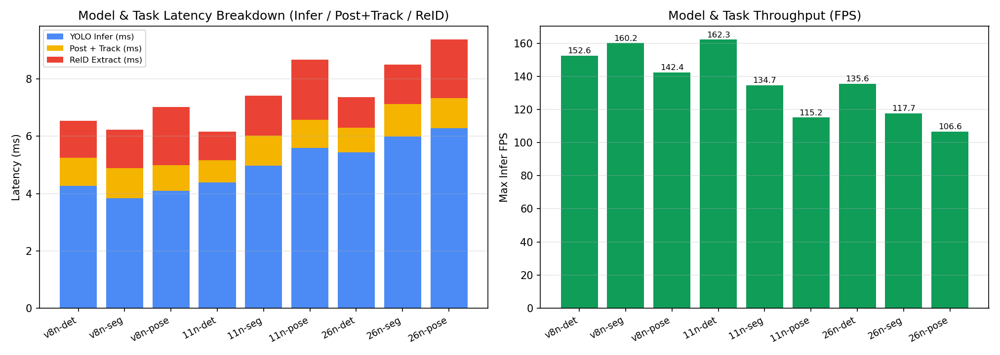
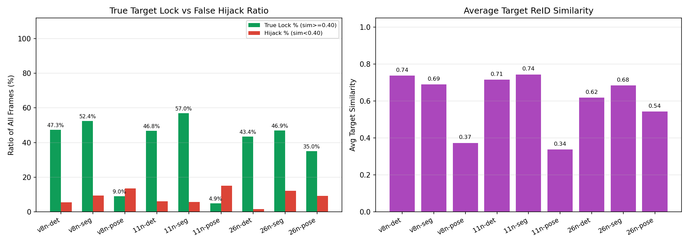
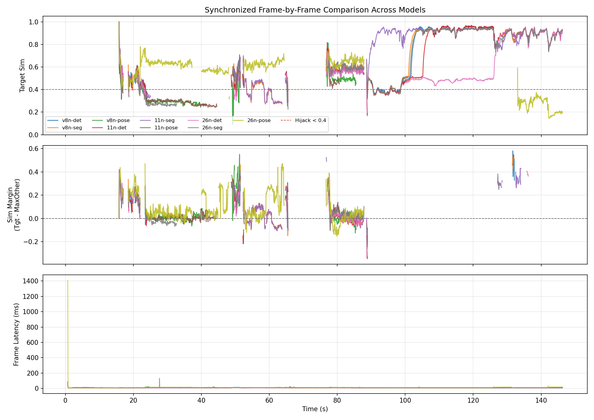

# Bag Benchmark Report: `model_benchmark`

- **Bag Path**: `/home/mu-01/Downloads/arti_benchmark_bags/model_benchmark`
- **Image Topic**: `/robot1/top_cam/image_raw/compressed` (`2184` frames evaluated)
- **Scan / TF**: `None` / `None`
- **Keyframes (`Δ=10f`)**: `crowd@f228, recovered@f268`

## 0. 핵심 관찰 요약 (Auto Insights)

- **최고 연산 속도**: `11n-det` (Infer `4.38ms`, Post+Trk `0.79ms`, Max `162.3 FPS`)
- **최고 진성 유지율 (`True Lock %`, sim>=0.4)**: `11n-seg` (`57.0%`, Avg Sim `0.744`)
- **최고 타인 변별 마진 (`Sim Margin`)**: `26n-pose` (평균 `0.088`, 최소 `-0.152`)
- **Pose 부위 가용성 & BBox 폴백 비율**: `v8n-pose` M=91.8%/L=67.5%/FB=2.5%, `11n-pose` M=95.4%/L=62.5%/FB=0.0%, `26n-pose` M=70.0%/L=49.6%/FB=2.0%
- **추적 알고리즘 효과**: `1:ByteTrack` TrueLock=0.8% (Hijack=0.0%, Rec=0), `2:Task-ReID` TrueLock=39.1% (Hijack=10.6%, Rec=0), `3:BoT-SORT` TrueLock=0.8% (Hijack=0.0%, Rec=0), `4:BoT+ReID` TrueLock=39.9% (Hijack=10.3%, Rec=0), `5:Adaptive` TrueLock=35.0% (Hijack=9.2%, Rec=11)

## 1. 모델별 연산 · 후처리 속도 분해 (`5:Adaptive`)

| Model | Pre (ms) | Infer Mean / P95 (ms) | Post+Trk (ms) | ReID (ms) | Total Mean / P95 (ms) | Max FPS |
|---|---:|---:|---:|---:|---:|---:|
| v8n-det (`yolov8n.pt`) | 0.34 | 4.26 / 5.98 | 0.99 | 1.3 | 8.1 / 11.7 | 152.6 |
| v8n-seg (`yolov8n-seg.pt`) | 0.29 | 3.83 / 3.99 | 1.05 | 1.36 | 7.78 / 9.5 | 160.2 |
| v8n-pose (`yolov8n-pose.pt`) | 0.33 | 4.09 / 4.6 | 0.91 | 2.02 | 8.44 / 12.2 | 142.4 |
| 11n-det (`yolo11n.pt`) | 0.29 | 4.38 / 4.59 | 0.79 | 0.99 | 7.48 / 8.04 | 162.3 |
| 11n-seg (`yolo11n-seg.pt`) | 0.28 | 4.98 / 5.03 | 1.05 | 1.39 | 8.97 / 10.84 | 134.7 |
| 11n-pose (`yolo11n-pose.pt`) | 0.33 | 5.6 / 8.02 | 0.97 | 2.11 | 10.15 / 13.52 | 115.2 |
| 26n-det (`yolo26n.pt`) | 0.32 | 5.44 / 5.53 | 0.86 | 1.07 | 8.8 / 9.34 | 135.6 |
| 26n-seg (`yolo26n-seg.pt`) | 0.31 | 5.99 / 6.13 | 1.13 | 1.38 | 10.12 / 12.27 | 117.7 |
| 26n-pose (`yolo26n-pose.pt`) | 0.45 | 6.28 / 10.4 | 1.06 | 2.04 | 11.61 / 16.65 | 106.6 |

## 2. 특징 추출 용이성 · 부위 가용성 · 배경 분리 (`5:Adaptive`)

| Model | U / M / L Valid % | Pose Fallback % | Mask FG % | Avg Tgt Sim ± Std (Min) | U / M / L / F Avg Sim |
|---|---:|---:|---:|---:|---|
| v8n-det | 100.0% / 100.0% / 100.0% | 0.0% | 41.7% | 0.737 ± 0.217 (0.168) | 0.708 / 0.67 / 0.643 / 0.737 |
| v8n-seg | 98.0% / 34.5% / 25.1% | 0.0% | 44.7% | 0.69 ± 0.232 (0.271) | 0.688 / 0.317 / 0.299 / 0.689 |
| v8n-pose | 100.0% / 91.8% / 67.5% | 2.5% | 27.8% | 0.373 ± 0.11 (0.09) | 0.327 / 0.627 / 0.31 / 0.359 |
| 11n-det | 100.0% / 100.0% / 100.0% | 0.0% | 41.6% | 0.715 ± 0.221 (0.18) | 0.686 / 0.649 / 0.609 / 0.715 |
| 11n-seg | 98.0% / 35.2% / 26.1% | 0.0% | 44.5% | 0.744 ± 0.216 (0.274) | 0.746 / 0.302 / 0.342 / 0.743 |
| 11n-pose | 100.0% / 95.4% / 62.5% | 0.0% | 30.2% | 0.337 ± 0.099 (0.24) | 0.28 / 0.388 / 0.392 / 0.335 |
| 26n-det | 100.0% / 100.0% / 100.0% | 0.0% | 40.8% | 0.618 ± 0.186 (0.195) | 0.597 / 0.516 / 0.5 / 0.617 |
| 26n-seg | 97.7% / 33.2% / 32.8% | 0.0% | 43.5% | 0.684 ± 0.249 (0.226) | 0.665 / 0.37 / 0.274 / 0.683 |
| 26n-pose | 100.0% / 70.0% / 49.6% | 2.0% | 27.8% | 0.543 ± 0.155 (0.144) | 0.5 / 0.518 / 0.306 / 0.539 |

## 3. 재식별 변별력 · 혼잡 · 오인식 방어 (`5:Adaptive`)

> `True Lock %`: 전체 프레임 중 유사도 `>=0.4`로 실제 타겟을 유지한 비율 · `Hijack %`: 유사도 `<0.4` 오탐 잠금 비율

| Model | Det % | >=2P % | Locked % | True Lock % | Hijack % | Direct Sw | Recovered (Avg f) | Other Avg / Max | Margin Mean / Min |
|---|---:|---:|---:|---:|---:|---:|---:|---:|---:|
| v8n-det | 99.6% | 38.8% | 52.8% | **47.3%** | 5.4% | 1 | 10 (80.7f) | 0.449 / 1.0 | 0.071 / -0.34 |
| v8n-seg | 99.8% | 39.0% | 61.9% | **52.4%** | 9.3% | 3 | 9 (50.7f) | 0.393 / 1.0 | 0.074 / -0.26 |
| v8n-pose | 99.7% | 38.9% | 22.5% | **9.0%** | 13.4% | 1 | 4 (93.2f) | 0.284 / 1.0 | 0.048 / -0.126 |
| 11n-det | 99.8% | 38.4% | 53.0% | **46.8%** | 6.0% | 1 | 10 (80.3f) | 0.457 / 1.0 | 0.054 / -0.345 |
| 11n-seg | 99.8% | 40.8% | 62.7% | **57.0%** | 5.6% | 3 | 8 (53.7f) | 0.385 / 1.0 | 0.085 / -0.226 |
| 11n-pose | 99.7% | 38.0% | 20.0% | **4.9%** | 15.0% | 1 | 4 (134.8f) | 0.251 / 1.0 | 0.043 / -0.037 |
| 26n-det | 99.8% | 39.1% | 45.1% | **43.4%** | 1.6% | 1 | 8 (121.9f) | 0.435 / 1.0 | 0.063 / -0.317 |
| 26n-seg | 99.8% | 39.2% | 59.2% | **46.9%** | 12.1% | 2 | 7 (95.6f) | 0.353 / 1.0 | 0.058 / -0.243 |
| 26n-pose | 99.8% | 37.4% | 44.3% | **35.0%** | 9.2% | 6 | 11 (82.6f) | 0.468 / 1.0 | 0.088 / -0.152 |

## 4. 추적 알고리즘 비교 (`yolo26n-pose`)

| Mode | Locked % | True Lock % | Hijack % | SEARCH % | GUARD % | Direct Sw | Recovered (Avg f) | Avg Tgt Sim | Total (ms) |
|---|---:|---:|---:|---:|---:|---:|---:|---:|---:|
| 1:ByteTrack | 0.8% | **0.8%** | 0.0% | 0.0% | 0.0% | 0 | 0 | 0.576 | 9.13 |
| 2:Task-ReID | 49.7% | **39.1%** | 10.6% | 0.0% | 0.0% | 8 | 0 | 0.532 | 10.1 |
| 3:BoT-SORT | 0.9% | **0.8%** | 0.0% | 0.0% | 0.0% | 0 | 0 | 0.56 | 13.58 |
| 4:BoT+ReID | 50.2% | **39.9%** | 10.3% | 0.0% | 0.0% | 12 | 0 | 0.514 | 15.1 |
| 5:Adaptive | 44.3% | **35.0%** | 9.2% | 45.4% | 20.7% | 6 | 11 (82.6f) | 0.543 | 10.9 |

## 5.5 Ground Truth(GT) 기반 실제 추적 정확도 (IoU >= 0.5)

| Experiment | Mode | GT Pos / Neg (f) | GT True Lock % | GT Hijack % | GT Miss % | GT False Lock % | Mean IoU | Fail Episodes (예상 개입) |
|---|---|---:|---:|---:|---:|---:|---:|---:|
| v8n-det | 5:Adaptive | 487 / 1471 | **3.7%** | 33.9% | 62.4% | 65.7% | 0.085 | 15 |
| v8n-seg | 5:Adaptive | 487 / 1471 | **4.7%** | 53.6% | 41.7% | 72.4% | 0.074 | 15 |
| v8n-pose | 5:Adaptive | 487 / 1471 | **3.5%** | 66.7% | 29.8% | 10.0% | 0.041 | 12 |
| 11n-det | 5:Adaptive | 487 / 1471 | **3.7%** | 33.7% | 62.6% | 66.1% | 0.09 | 15 |
| 11n-seg | 5:Adaptive | 487 / 1471 | **4.7%** | 56.9% | 38.4% | 72.5% | 0.07 | 14 |
| 11n-pose | 5:Adaptive | 487 / 1471 | **4.7%** | 51.3% | 43.9% | 11.0% | 0.071 | 9 |
| 26n-det | 5:Adaptive | 487 / 1471 | **3.9%** | 33.3% | 62.8% | 54.5% | 0.098 | 13 |
| 26n-seg | 5:Adaptive | 487 / 1471 | **4.9%** | 60.0% | 35.1% | 66.1% | 0.073 | 12 |
| 26n-pose | 5:Adaptive | 487 / 1471 | **27.1%** | 72.1% | 0.8% | 32.8% | 0.238 | 18 |
| mode_1 | 1:ByteTrack | 487 / 1471 | **3.3%** | 0.2% | 96.5% | 0.0% | 0.691 | 9 |
| mode_2 | 2:Task-ReID | 487 / 1471 | **23.2%** | 76.4% | 0.4% | 40.7% | 0.204 | 11 |
| mode_3 | 3:BoT-SORT | 487 / 1471 | **3.7%** | 0.0% | 96.3% | 0.1% | 0.656 | 9 |
| mode_4 | 4:BoT+ReID | 487 / 1471 | **23.6%** | 76.2% | 0.2% | 41.4% | 0.203 | 12 |
| mode_5 | 5:Adaptive | 487 / 1471 | **27.1%** | 72.1% | 0.8% | 32.8% | 0.238 | 18 |

## 6. 시각 검증 스냅샷 (`snapshots/`)

- `compare_tasks_hist_crowd_f0228.png`
  
- `compare_versions_crowd_f0228.png`
  
- `compare_pixels_crowd_f0228.png`
  
- `compare_seq_crowd_f0228.png`
  
- `compare_tasks_hist_recovered_f0268.png`
  
- `compare_versions_recovered_f0268.png`
  
- `compare_pixels_recovered_f0268.png`
  
- `compare_seq_recovered_f0268.png`
  
