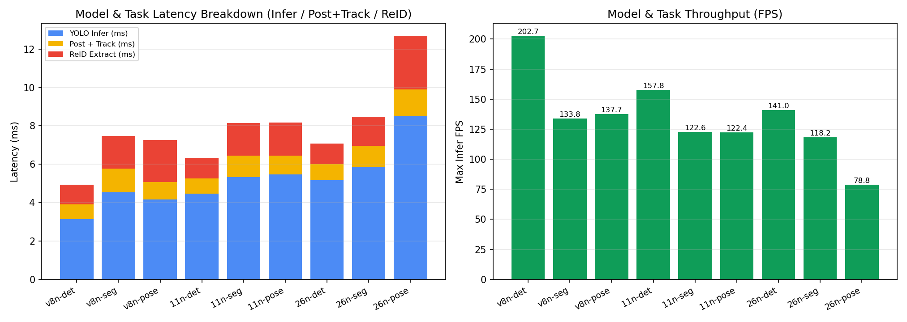
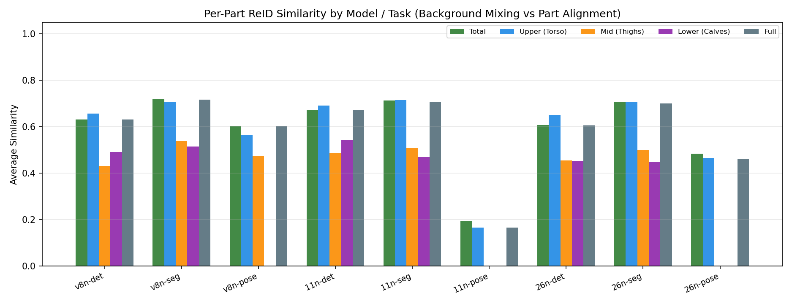
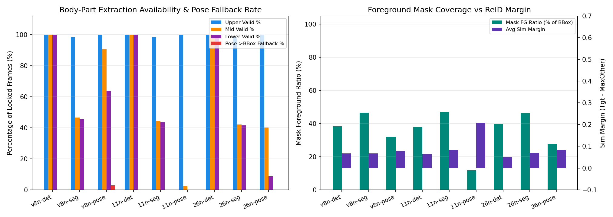
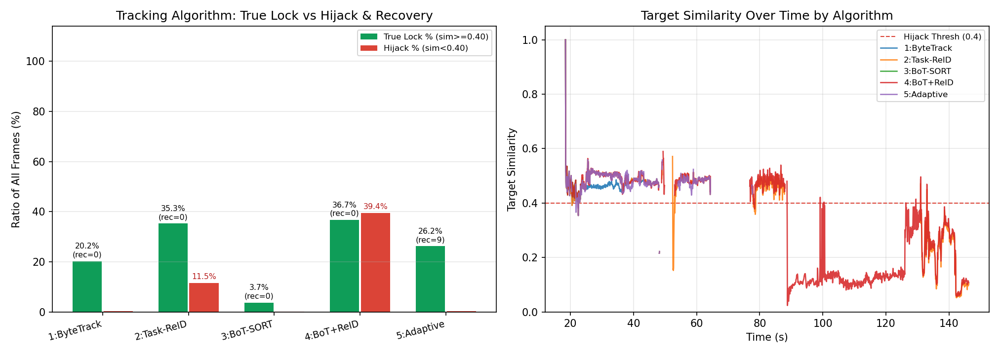

# Bag Benchmark Report: `model_benchmark`

- **Bag Path**: `/home/mu-01/Downloads/arti_benchmark_bags/model_benchmark`
- **Image Topic**: `/robot1/top_cam/image_raw/compressed` (`2184` frames evaluated)
- **Scan / TF**: `None` / `None`
- **Keyframes (`Δ=10f`)**: `crowd@f228, recovered@f274`

## 0. 핵심 관찰 요약 (Auto Insights)

- **최고 연산 속도**: `v8n-det` (Infer `3.15ms`, Post+Trk `0.75ms`, Max `202.7 FPS`)
- **최고 진성 유지율 (`True Lock %`, sim>=0.4)**: `v8n-seg` (`72.4%`, Avg Sim `0.721`)
- **최고 타인 변별 마진 (`Sim Margin`)**: `11n-pose` (평균 `0.209`, 최소 `-0.162`)
- **Pose 부위 가용성 & BBox 폴백 비율**: `v8n-pose` M=90.7%/L=63.9%/FB=2.8%, `11n-pose` M=2.5%/L=0.0%/FB=0.0%, `26n-pose` M=40.1%/L=8.6%/FB=0.0%
- **추적 알고리즘 효과**: `1:ByteTrack` TrueLock=20.2% (Hijack=0.3%, Rec=0), `2:Task-ReID` TrueLock=35.3% (Hijack=11.5%, Rec=0), `3:BoT-SORT` TrueLock=3.7% (Hijack=0.1%, Rec=0), `4:BoT+ReID` TrueLock=36.7% (Hijack=39.4%, Rec=0), `5:Adaptive` TrueLock=26.2% (Hijack=0.4%, Rec=9)

## 1. 모델별 연산 · 후처리 속도 분해 (`5:Adaptive`)

| Model | Pre (ms) | Infer Mean / P95 (ms) | Post+Trk (ms) | ReID (ms) | Total Mean / P95 (ms) | Max FPS |
|---|---:|---:|---:|---:|---:|---:|
| v8n-det (`yolov8n.pt`) | 0.28 | 3.15 / 3.2 | 0.75 | 1.03 | 6.14 / 7.13 | 202.7 |
| v8n-seg (`yolov8n-seg.pt`) | 0.33 | 4.55 / 7.19 | 1.23 | 1.7 | 9.39 / 14.82 | 133.8 |
| v8n-pose (`yolov8n-pose.pt`) | 0.33 | 4.16 / 6.61 | 0.92 | 2.19 | 8.71 / 12.34 | 137.7 |
| 11n-det (`yolo11n.pt`) | 0.29 | 4.46 / 4.52 | 0.81 | 1.07 | 7.62 / 8.48 | 157.8 |
| 11n-seg (`yolo11n-seg.pt`) | 0.31 | 5.34 / 8.56 | 1.12 | 1.69 | 9.87 / 15.49 | 122.6 |
| 11n-pose (`yolo11n-pose.pt`) | 0.34 | 5.48 / 6.47 | 0.97 | 1.72 | 9.71 / 11.59 | 122.4 |
| 26n-det (`yolo26n.pt`) | 0.32 | 5.17 / 5.76 | 0.84 | 1.08 | 8.51 / 10.24 | 141.0 |
| 26n-seg (`yolo26n-seg.pt`) | 0.31 | 5.85 / 5.97 | 1.11 | 1.51 | 10.12 / 12.07 | 118.2 |
| 26n-pose (`yolo26n-pose.pt`) | 0.55 | 8.5 / 10.72 | 1.39 | 2.8 | 15.18 / 19.81 | 78.8 |

## 2. 특징 추출 용이성 · 부위 가용성 · 배경 분리 (`5:Adaptive`)

| Model | U / M / L Valid % | Pose Fallback % | Mask FG % | Avg Tgt Sim ± Std (Min) | U / M / L / F Avg Sim |
|---|---:|---:|---:|---:|---|
| v8n-det | 100.0% / 100.0% / 100.0% | 0.0% | 38.4% | 0.631 ± 0.215 (0.303) | 0.656 / 0.431 / 0.491 / 0.631 |
| v8n-seg | 98.4% / 46.6% / 45.4% | 0.0% | 46.6% | 0.721 ± 0.171 (0.314) | 0.706 / 0.538 / 0.514 / 0.716 |
| v8n-pose | 100.0% / 90.7% / 63.9% | 2.8% | 32.0% | 0.604 ± 0.072 (0.153) | 0.563 / 0.475 / - / 0.602 |
| 11n-det | 100.0% / 100.0% / 100.0% | 0.0% | 37.9% | 0.672 ± 0.223 (0.314) | 0.692 / 0.488 / 0.542 / 0.671 |
| 11n-seg | 98.4% / 44.5% / 43.4% | 0.0% | 47.1% | 0.714 ± 0.172 (0.31) | 0.715 / 0.51 / 0.469 / 0.707 |
| 11n-pose | 100.0% / 2.5% / 0.0% | 0.0% | 11.7% | 0.195 ± 0.145 (0.014) | 0.165 / - / - / 0.165 |
| 26n-det | 100.0% / 100.0% / 100.0% | 0.0% | 39.8% | 0.607 ± 0.185 (0.183) | 0.649 / 0.454 / 0.452 / 0.606 |
| 26n-seg | 98.2% / 42.1% / 41.4% | 0.0% | 46.3% | 0.707 ± 0.176 (0.312) | 0.707 / 0.5 / 0.45 / 0.7 |
| 26n-pose | 100.0% / 40.1% / 8.6% | 0.0% | 27.6% | 0.483 ± 0.038 (0.216) | 0.466 / - / - / 0.461 |

## 3. 재식별 변별력 · 혼잡 · 오인식 방어 (`5:Adaptive`)

> `True Lock %`: 전체 프레임 중 유사도 `>=0.4`로 실제 타겟을 유지한 비율 · `Hijack %`: 유사도 `<0.4` 오탐 잠금 비율

| Model | Det % | >=2P % | Locked % | True Lock % | Hijack % | Direct Sw | Recovered (Avg f) | Other Avg / Max | Margin Mean / Min |
|---|---:|---:|---:|---:|---:|---:|---:|---:|---:|
| v8n-det | 99.6% | 38.8% | 27.2% | **24.6%** | 2.5% | 1 | 10 (132.6f) | 0.377 / 1.0 | 0.068 / -0.139 |
| v8n-seg | 99.8% | 39.0% | 78.1% | **72.4%** | 5.5% | 18 | 5 (36.0f) | 0.513 / 1.0 | 0.067 / -0.349 |
| v8n-pose | 99.7% | 38.9% | 36.5% | **35.6%** | 0.8% | 3 | 7 (24.7f) | 0.472 / 1.0 | 0.078 / -0.149 |
| 11n-det | 99.8% | 38.4% | 26.4% | **24.0%** | 2.3% | 1 | 10 (103.3f) | 0.373 / 1.0 | 0.065 / -0.134 |
| 11n-seg | 99.8% | 40.8% | 77.9% | **72.2%** | 5.6% | 13 | 6 (24.3f) | 0.499 / 1.0 | 0.083 / -0.337 |
| 11n-pose | 99.7% | 38.0% | 14.5% | **0.9%** | 13.6% | 0 | 3 (534.3f) | 0.214 / 1.0 | 0.209 / -0.162 |
| 26n-det | 99.8% | 39.1% | 49.6% | **47.6%** | 1.9% | 1 | 9 (93.0f) | 0.432 / 1.0 | 0.051 / -0.333 |
| 26n-seg | 99.8% | 39.2% | 75.5% | **69.9%** | 5.5% | 15 | 6 (38.9f) | 0.492 / 1.0 | 0.069 / -0.329 |
| 26n-pose | 99.8% | 37.4% | 26.7% | **26.2%** | 0.4% | 4 | 9 (30.9f) | 0.332 / 1.0 | 0.083 / -0.038 |

## 4. 추적 알고리즘 비교 (`yolo26n-pose`)

| Mode | Locked % | True Lock % | Hijack % | SEARCH % | GUARD % | Direct Sw | Recovered (Avg f) | Avg Tgt Sim | Total (ms) |
|---|---:|---:|---:|---:|---:|---:|---:|---:|---:|
| 1:ByteTrack | 20.5% | **20.2%** | 0.3% | 0.0% | 0.0% | 0 | 0 | 0.465 | 9.85 |
| 2:Task-ReID | 46.9% | **35.3%** | 11.5% | 0.0% | 0.0% | 40 | 0 | 0.415 | 12.04 |
| 3:BoT-SORT | 3.8% | **3.7%** | 0.1% | 0.0% | 0.0% | 0 | 0 | 0.464 | 13.86 |
| 4:BoT+ReID | 76.2% | **36.7%** | 39.4% | 0.0% | 0.0% | 41 | 0 | 0.318 | 14.42 |
| 5:Adaptive | 26.7% | **26.2%** | 0.4% | 61.2% | 23.4% | 4 | 9 (30.9f) | 0.483 | 10.48 |

## 5.5 Ground Truth(GT) 기반 실제 추적 정확도 (IoU >= 0.5)

| Experiment | Mode | GT Pos / Neg (f) | GT True Lock % | GT Hijack % | GT Miss % | GT False Lock % | Mean IoU | Fail Episodes (예상 개입) |
|---|---|---:|---:|---:|---:|---:|---:|---:|
| v8n-det | 5:Adaptive | 783 / 1135 | **14.8%** | 15.7% | 69.5% | 31.1% | 0.544 | 10 |
| v8n-seg | 5:Adaptive | 783 / 1135 | **73.4%** | 26.3% | 0.3% | 81.1% | 0.705 | 14 |
| v8n-pose | 5:Adaptive | 783 / 1135 | **79.9%** | 16.2% | 3.8% | 3.7% | 0.778 | 11 |
| 11n-det | 5:Adaptive | 783 / 1135 | **15.3%** | 12.6% | 72.0% | 31.4% | 0.621 | 10 |
| 11n-seg | 5:Adaptive | 783 / 1135 | **65.6%** | 34.1% | 0.3% | 80.9% | 0.629 | 14 |
| 11n-pose | 5:Adaptive | 783 / 1135 | **2.9%** | 0.0% | 97.1% | 25.7% | 0.823 | 7 |
| 26n-det | 5:Adaptive | 783 / 1135 | **25.3%** | 17.5% | 57.2% | 65.7% | 0.63 | 10 |
| 26n-seg | 5:Adaptive | 783 / 1135 | **56.7%** | 36.1% | 7.2% | 81.0% | 0.603 | 11 |
| 26n-pose | 5:Adaptive | 783 / 1135 | **39.3%** | 34.1% | 26.6% | 0.5% | 0.539 | 13 |
| mode_1 | 1:ByteTrack | 783 / 1135 | **56.8%** | 0.0% | 43.2% | 0.2% | 0.858 | 4 |
| mode_2 | 2:Task-ReID | 783 / 1135 | **67.2%** | 32.4% | 0.4% | 21.4% | 0.642 | 25 |
| mode_3 | 3:BoT-SORT | 783 / 1135 | **10.5%** | 0.0% | 89.5% | 0.0% | 0.845 | 4 |
| mode_4 | 4:BoT+ReID | 783 / 1135 | **65.0%** | 33.3% | 1.7% | 78.6% | 0.62 | 26 |
| mode_5 | 5:Adaptive | 783 / 1135 | **39.3%** | 34.1% | 26.6% | 0.5% | 0.539 | 13 |

## 6. 시각 검증 스냅샷 (`snapshots/`)

- `compare_tasks_hist_crowd_f0228.png`
  
- `compare_versions_crowd_f0228.png`
  
- `compare_pixels_crowd_f0228.png`
  
- `compare_seq_crowd_f0228.png`
  
- `compare_tasks_hist_recovered_f0274.png`
  
- `compare_versions_recovered_f0274.png`
  
- `compare_pixels_recovered_f0274.png`
  
- `compare_seq_recovered_f0274.png`
  
