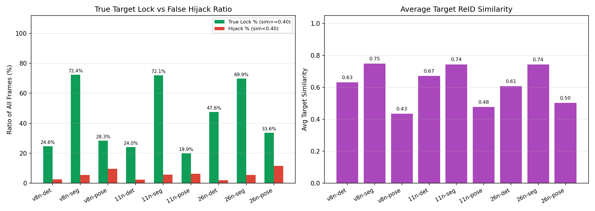
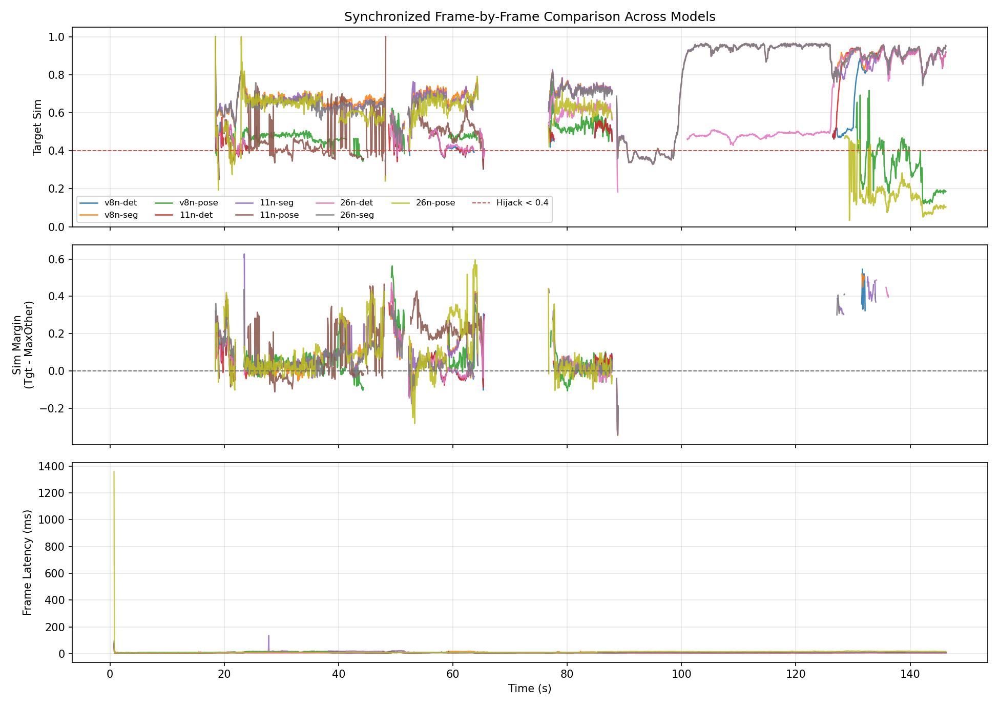

# Bag Benchmark Report: `model_benchmark`

- **Bag Path**: `/home/mu-01/Downloads/arti_benchmark_bags/model_benchmark`
- **Image Topic**: `/robot1/top_cam/image_raw/compressed` (`2184` frames evaluated)
- **Scan / TF**: `None` / `None`
- **Keyframes (`Δ=10f`)**: `crowd@f228, recovered@f289`

## 0. 핵심 관찰 요약 (Auto Insights)

- **최고 연산 속도**: `11n-det` (Infer `4.31ms`, Post+Trk `0.78ms`, Max `163.7 FPS`)
- **최고 진성 유지율 (`True Lock %`, sim>=0.4)**: `v8n-seg` (`72.4%`, Avg Sim `0.749`)
- **최고 타인 변별 마진 (`Sim Margin`)**: `11n-pose` (평균 `0.121`, 최소 `-0.113`)
- **Pose 부위 가용성 & BBox 폴백 비율**: `v8n-pose` M=69.3%/L=53.8%/FB=7.1%, `11n-pose` M=83.6%/L=69.2%/FB=18.2%, `26n-pose` M=68.8%/L=50.4%/FB=3.2%
- **추적 알고리즘 효과**: `1:ByteTrack` TrueLock=16.7% (Hijack=3.8%, Rec=0), `2:Task-ReID` TrueLock=37.6% (Hijack=12.3%, Rec=0), `3:BoT-SORT` TrueLock=1.9% (Hijack=1.8%, Rec=0), `4:BoT+ReID` TrueLock=38.1% (Hijack=12.0%, Rec=0), `5:Adaptive` TrueLock=33.6% (Hijack=11.5%, Rec=8)

## 1. 모델별 연산 · 후처리 속도 분해 (`5:Adaptive`)

| Model | Pre (ms) | Infer Mean / P95 (ms) | Post+Trk (ms) | ReID (ms) | Total Mean / P95 (ms) | Max FPS |
|---|---:|---:|---:|---:|---:|---:|
| v8n-det (`yolov8n.pt`) | 0.42 | 5.45 / 6.31 | 1.25 | 1.75 | 10.31 / 12.6 | 118.2 |
| v8n-seg (`yolov8n-seg.pt`) | 0.33 | 4.47 / 6.89 | 1.22 | 2.46 | 9.92 / 14.39 | 122.7 |
| v8n-pose (`yolov8n-pose.pt`) | 0.37 | 4.83 / 7.26 | 1.07 | 1.91 | 9.5 / 18.28 | 128.1 |
| 11n-det (`yolo11n.pt`) | 0.29 | 4.31 / 4.5 | 0.78 | 1.02 | 7.36 / 8.29 | 163.7 |
| 11n-seg (`yolo11n-seg.pt`) | 0.31 | 5.42 / 8.87 | 1.13 | 2.55 | 10.78 / 20.1 | 110.0 |
| 11n-pose (`yolo11n-pose.pt`) | 0.33 | 5.32 / 5.79 | 0.92 | 1.68 | 9.35 / 12.82 | 126.2 |
| 26n-det (`yolo26n.pt`) | 0.32 | 5.41 / 5.98 | 0.86 | 1.12 | 8.84 / 10.43 | 135.3 |
| 26n-seg (`yolo26n-seg.pt`) | 0.32 | 6.13 / 6.67 | 1.15 | 2.27 | 11.27 / 13.2 | 104.7 |
| 26n-pose (`yolo26n-pose.pt`) | 0.52 | 7.89 / 11.17 | 1.3 | 2.2 | 13.95 / 19.99 | 87.7 |

## 2. 특징 추출 용이성 · 부위 가용성 · 배경 분리 (`5:Adaptive`)

| Model | U / M / L Valid % | Pose Fallback % | Mask FG % | Avg Tgt Sim ± Std (Min) | U / M / L / F Avg Sim |
|---|---:|---:|---:|---:|---|
| v8n-det | 100.0% / 100.0% / 100.0% | 0.0% | 38.4% | 0.631 ± 0.215 (0.303) | 0.656 / 0.431 / 0.491 / 0.631 |
| v8n-seg | 100.0% / 99.6% / 98.9% | 0.0% | 48.8% | 0.749 ± 0.174 (0.328) | 0.728 / 0.67 / 0.639 / 0.747 |
| v8n-pose | 100.0% / 69.3% / 53.8% | 7.1% | 18.0% | 0.434 ± 0.113 (0.121) | 0.396 / 0.562 / 0.321 / 0.429 |
| 11n-det | 100.0% / 100.0% / 100.0% | 0.0% | 37.9% | 0.672 ± 0.223 (0.314) | 0.692 / 0.488 / 0.542 / 0.671 |
| 11n-seg | 100.0% / 99.8% / 99.1% | 0.0% | 49.6% | 0.744 ± 0.174 (0.329) | 0.731 / 0.669 / 0.629 / 0.743 |
| 11n-pose | 100.0% / 83.6% / 69.2% | 18.2% | 27.1% | 0.477 ± 0.1 (0.247) | 0.515 / 0.263 / 0.131 / 0.438 |
| 26n-det | 100.0% / 100.0% / 100.0% | 0.0% | 39.8% | 0.607 ± 0.185 (0.183) | 0.649 / 0.454 / 0.452 / 0.606 |
| 26n-seg | 100.0% / 98.8% / 98.7% | 0.0% | 48.1% | 0.743 ± 0.179 (0.331) | 0.73 / 0.668 / 0.626 / 0.74 |
| 26n-pose | 100.0% / 68.8% / 50.4% | 3.2% | 20.0% | 0.503 ± 0.212 (0.034) | 0.469 / 0.495 / - / 0.496 |

## 3. 재식별 변별력 · 혼잡 · 오인식 방어 (`5:Adaptive`)

> `True Lock %`: 전체 프레임 중 유사도 `>=0.4`로 실제 타겟을 유지한 비율 · `Hijack %`: 유사도 `<0.4` 오탐 잠금 비율

| Model | Det % | >=2P % | Locked % | True Lock % | Hijack % | Direct Sw | Recovered (Avg f) | Other Avg / Max | Margin Mean / Min |
|---|---:|---:|---:|---:|---:|---:|---:|---:|---:|
| v8n-det | 99.6% | 38.8% | 27.2% | **24.6%** | 2.5% | 1 | 10 (132.6f) | 0.377 / 1.0 | 0.068 / -0.139 |
| v8n-seg | 99.8% | 39.0% | 78.1% | **72.4%** | 5.5% | 17 | 5 (36.0f) | 0.533 / 1.0 | 0.07 / -0.347 |
| v8n-pose | 99.7% | 38.9% | 38.0% | **28.3%** | 9.5% | 4 | 9 (99.2f) | 0.39 / 1.0 | 0.057 / -0.107 |
| 11n-det | 99.8% | 38.4% | 26.4% | **24.0%** | 2.3% | 1 | 10 (103.3f) | 0.373 / 1.0 | 0.065 / -0.134 |
| 11n-seg | 99.8% | 40.8% | 77.8% | **72.1%** | 5.6% | 10 | 5 (27.6f) | 0.52 / 1.0 | 0.087 / -0.339 |
| 11n-pose | 99.7% | 38.0% | 26.3% | **19.9%** | 6.3% | 8 | 5 (11.0f) | 0.318 / 1.0 | 0.121 / -0.113 |
| 26n-det | 99.8% | 39.1% | 49.6% | **47.6%** | 1.9% | 1 | 9 (93.0f) | 0.432 / 1.0 | 0.051 / -0.333 |
| 26n-seg | 99.8% | 39.2% | 75.5% | **69.9%** | 5.4% | 15 | 6 (38.9f) | 0.52 / 1.0 | 0.068 / -0.345 |
| 26n-pose | 99.8% | 37.4% | 45.3% | **33.6%** | 11.5% | 18 | 8 (103.6f) | 0.491 / 1.0 | 0.087 / -0.283 |

## 4. 추적 알고리즘 비교 (`yolo26n-pose`)

| Mode | Locked % | True Lock % | Hijack % | SEARCH % | GUARD % | Direct Sw | Recovered (Avg f) | Avg Tgt Sim | Total (ms) |
|---|---:|---:|---:|---:|---:|---:|---:|---:|---:|
| 1:ByteTrack | 20.5% | **16.7%** | 3.8% | 0.0% | 0.0% | 0 | 0 | 0.446 | 10.46 |
| 2:Task-ReID | 50.1% | **37.6%** | 12.3% | 0.0% | 0.0% | 10 | 0 | 0.526 | 9.84 |
| 3:BoT-SORT | 3.8% | **1.9%** | 1.8% | 0.0% | 0.0% | 0 | 0 | 0.414 | 13.93 |
| 4:BoT+ReID | 50.2% | **38.1%** | 12.0% | 0.0% | 0.0% | 14 | 0 | 0.515 | 13.64 |
| 5:Adaptive | 45.3% | **33.6%** | 11.5% | 42.7% | 20.4% | 18 | 8 (103.6f) | 0.503 | 9.32 |

## 5.5 Ground Truth(GT) 기반 실제 추적 정확도 (IoU >= 0.5)

| Experiment | Mode | GT Pos / Neg (f) | GT True Lock % | GT Hijack % | GT Miss % | GT False Lock % | Mean IoU | Fail Episodes (예상 개입) |
|---|---|---:|---:|---:|---:|---:|---:|---:|
| v8n-det | 5:Adaptive | 783 / 1135 | **14.8%** | 15.7% | 69.5% | 31.1% | 0.544 | 10 |
| v8n-seg | 5:Adaptive | 783 / 1135 | **73.2%** | 26.6% | 0.3% | 81.1% | 0.696 | 13 |
| v8n-pose | 5:Adaptive | 783 / 1135 | **55.6%** | 14.3% | 30.1% | 24.7% | 0.755 | 15 |
| 11n-det | 5:Adaptive | 783 / 1135 | **15.3%** | 12.6% | 72.0% | 31.4% | 0.621 | 10 |
| 11n-seg | 5:Adaptive | 783 / 1135 | **66.3%** | 33.5% | 0.3% | 80.7% | 0.635 | 13 |
| 11n-pose | 5:Adaptive | 783 / 1135 | **18.9%** | 52.1% | 29.0% | 1.4% | 0.327 | 8 |
| 26n-det | 5:Adaptive | 783 / 1135 | **25.3%** | 17.5% | 57.2% | 65.7% | 0.63 | 10 |
| 26n-seg | 5:Adaptive | 783 / 1135 | **55.0%** | 37.8% | 7.2% | 81.0% | 0.593 | 13 |
| 26n-pose | 5:Adaptive | 783 / 1135 | **58.4%** | 32.6% | 9.1% | 24.1% | 0.57 | 17 |
| mode_1 | 1:ByteTrack | 783 / 1135 | **56.8%** | 0.0% | 43.2% | 0.2% | 0.858 | 4 |
| mode_2 | 2:Task-ReID | 783 / 1135 | **65.8%** | 32.8% | 1.4% | 28.1% | 0.58 | 8 |
| mode_3 | 3:BoT-SORT | 783 / 1135 | **10.5%** | 0.0% | 89.5% | 0.0% | 0.845 | 4 |
| mode_4 | 4:BoT+ReID | 783 / 1135 | **65.6%** | 33.2% | 1.1% | 28.3% | 0.567 | 7 |
| mode_5 | 5:Adaptive | 783 / 1135 | **58.4%** | 32.6% | 9.1% | 24.1% | 0.57 | 17 |

## 6. 시각 검증 스냅샷 (`snapshots/`)

- `compare_tasks_hist_crowd_f0228.png`
  
- `compare_versions_crowd_f0228.png`
  
- `compare_pixels_crowd_f0228.png`
  
- `compare_seq_crowd_f0228.png`
  
- `compare_tasks_hist_recovered_f0289.png`
  
- `compare_versions_recovered_f0289.png`
  
- `compare_pixels_recovered_f0289.png`
  
- `compare_seq_recovered_f0289.png`
  
