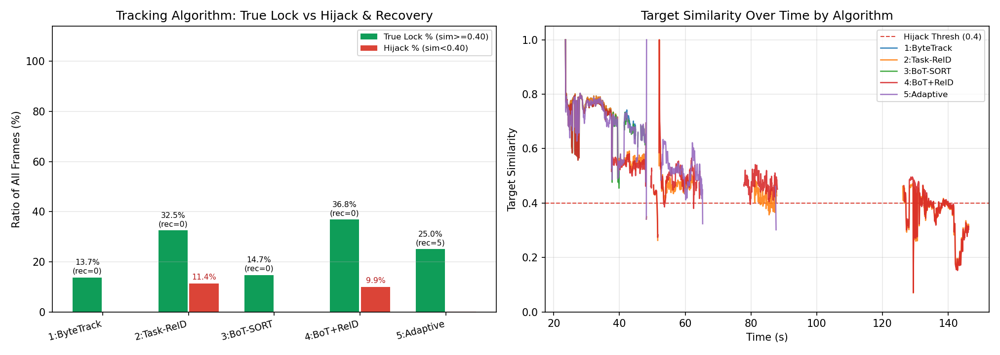

# Bag Benchmark Report: `model_benchmark`

- **Bag Path**: `/home/mu-01/Downloads/arti_benchmark_bags/model_benchmark`
- **Image Topic**: `/robot1/top_cam/image_raw/compressed` (`2184` frames evaluated)
- **Scan / TF**: `None` / `None`
- **Keyframes (`Δ=10f`)**: `crowd@f228, recovered@f666`

## 0. 핵심 관찰 요약 (Auto Insights)

- **최고 연산 속도**: `v8n-det` (Infer `3.45ms`, Post+Trk `0.83ms`, Max `180.1 FPS`)
- **최고 진성 유지율 (`True Lock %`, sim>=0.4)**: `v8n-det` (`68.2%`, Avg Sim `0.754`)
- **최고 타인 변별 마진 (`Sim Margin`)**: `26n-pose` (평균 `0.151`, 최소 `-0.038`)
- **Pose 부위 가용성 & BBox 폴백 비율**: `v8n-pose` M=91.6%/L=78.0%/FB=28.4%, `11n-pose` M=91.0%/L=84.1%/FB=46.0%, `26n-pose` M=94.5%/L=83.5%/FB=50.9%
- **추적 알고리즘 효과**: `1:ByteTrack` TrueLock=13.7% (Hijack=0.0%, Rec=0), `2:Task-ReID` TrueLock=32.5% (Hijack=11.4%, Rec=0), `3:BoT-SORT` TrueLock=14.7% (Hijack=0.0%, Rec=0), `4:BoT+ReID` TrueLock=36.8% (Hijack=9.9%, Rec=0), `5:Adaptive` TrueLock=25.0% (Hijack=0.2%, Rec=5)

## 1. 모델별 연산 · 후처리 속도 분해 (`5:Adaptive`)

| Model | Pre (ms) | Infer Mean / P95 (ms) | Post+Trk (ms) | ReID (ms) | Total Mean / P95 (ms) | Max FPS |
|---|---:|---:|---:|---:|---:|---:|
| v8n-det (`yolov8n.pt`) | 0.3 | 3.45 / 5.15 | 0.83 | 1.27 | 6.94 / 12.46 | 180.1 |
| v8n-seg (`yolov8n-seg.pt`) | 0.33 | 4.62 / 5.31 | 1.27 | 2.54 | 9.98 / 12.93 | 118.5 |
| v8n-pose (`yolov8n-pose.pt`) | 0.32 | 4.04 / 4.26 | 0.9 | 1.54 | 7.86 / 10.47 | 154.3 |
| 11n-det (`yolo11n.pt`) | 0.28 | 4.35 / 4.51 | 0.79 | 1.17 | 7.59 / 8.93 | 158.4 |
| 11n-seg (`yolo11n-seg.pt`) | 0.32 | 5.53 / 6.32 | 1.21 | 2.31 | 10.54 / 13.45 | 110.5 |
| 11n-pose (`yolo11n-pose.pt`) | 0.44 | 6.61 / 8.14 | 1.19 | 2.02 | 11.72 / 18.14 | 101.7 |
| 26n-det (`yolo26n.pt`) | 0.46 | 6.81 / 9.7 | 1.15 | 1.51 | 11.38 / 18.18 | 105.6 |
| 26n-seg (`yolo26n-seg.pt`) | 0.56 | 9.59 / 14.66 | 1.84 | 3.26 | 17.03 / 24.62 | 68.1 |
| 26n-pose (`yolo26n-pose.pt`) | 0.43 | 6.16 / 6.83 | 1.06 | 1.63 | 10.88 / 13.16 | 113.0 |

## 2. 특징 추출 용이성 · 부위 가용성 · 배경 분리 (`5:Adaptive`)

| Model | U / M / L Valid % | Pose Fallback % | Mask FG % | Avg Tgt Sim ± Std (Min) | U / M / L / F Avg Sim |
|---|---:|---:|---:|---:|---|
| v8n-det | 100.0% / 99.8% / 99.3% | 0.0% | 39.7% | 0.754 ± 0.166 (0.183) | 0.682 / 0.668 / 0.677 / 0.754 |
| v8n-seg | 100.0% / 99.9% / 99.9% | 0.0% | 46.2% | 0.671 ± 0.086 (0.216) | 0.512 / 0.657 / 0.627 / 0.671 |
| v8n-pose | 100.0% / 91.6% / 78.0% | 28.4% | 28.4% | 0.645 ± 0.112 (0.319) | 0.493 / 0.595 / 0.693 / 0.644 |
| 11n-det | 100.0% / 99.9% / 99.9% | 0.0% | 37.3% | 0.738 ± 0.123 (0.253) | 0.649 / 0.687 / 0.634 / 0.738 |
| 11n-seg | 100.0% / 100.0% / 100.0% | 0.0% | 46.2% | 0.675 ± 0.086 (0.219) | 0.523 / 0.658 / 0.628 / 0.674 |
| 11n-pose | 100.0% / 91.0% / 84.1% | 46.0% | 29.8% | 0.655 ± 0.115 (0.305) | 0.517 / 0.623 / 0.73 / 0.654 |
| 26n-det | 100.0% / 99.8% / 99.5% | 0.0% | 37.9% | 0.736 ± 0.115 (0.342) | 0.643 / 0.684 / 0.632 / 0.736 |
| 26n-seg | 99.4% / 100.0% / 100.0% | 0.0% | 44.5% | 0.68 ± 0.104 (0.216) | - / 0.648 / 0.632 / 0.679 |
| 26n-pose | 100.0% / 94.5% / 83.5% | 50.9% | 31.3% | 0.637 ± 0.113 (0.302) | 0.489 / 0.578 / 0.661 / 0.637 |

## 3. 재식별 변별력 · 혼잡 · 오인식 방어 (`5:Adaptive`)

> `True Lock %`: 전체 프레임 중 유사도 `>=0.4`로 실제 타겟을 유지한 비율 · `Hijack %`: 유사도 `<0.4` 오탐 잠금 비율

| Model | Det % | >=2P % | Locked % | True Lock % | Hijack % | Direct Sw | Recovered (Avg f) | Other Avg / Max | Margin Mean / Min |
|---|---:|---:|---:|---:|---:|---:|---:|---:|---:|
| v8n-det | 99.6% | 38.8% | 71.5% | **68.2%** | 3.0% | 9 | 5 (47.5f) | 0.568 / 1.0 | 0.056 / -0.37 |
| v8n-seg | 99.8% | 39.0% | 31.8% | **31.6%** | 0.1% | 22 | 5 (30.4f) | 0.481 / 1.0 | 0.051 / -0.093 |
| v8n-pose | 99.7% | 38.9% | 25.3% | **25.0%** | 0.1% | 22 | 4 (14.2f) | 0.465 / 1.0 | 0.124 / -0.038 |
| 11n-det | 99.8% | 38.4% | 46.2% | **45.6%** | 0.5% | 10 | 6 (104.2f) | 0.544 / 1.0 | 0.072 / -0.176 |
| 11n-seg | 99.8% | 40.8% | 31.8% | **31.6%** | 0.1% | 16 | 4 (30.4f) | 0.481 / 1.0 | 0.054 / -0.085 |
| 11n-pose | 99.7% | 38.0% | 25.4% | **25.3%** | 0.1% | 14 | 7 (8.0f) | 0.48 / 1.0 | 0.13 / -0.04 |
| 26n-det | 99.8% | 39.1% | 45.4% | **45.2%** | 0.1% | 12 | 6 (121.6f) | 0.533 / 1.0 | 0.069 / -0.107 |
| 26n-seg | 99.8% | 39.2% | 31.7% | **31.4%** | 0.2% | 12 | 4 (46.2f) | 0.484 / 1.0 | 0.055 / -0.157 |
| 26n-pose | 99.8% | 37.4% | 25.2% | **25.0%** | 0.2% | 13 | 5 (51.5f) | 0.471 / 1.0 | 0.151 / -0.038 |

## 4. 추적 알고리즘 비교 (`yolo26n-pose`)

| Mode | Locked % | True Lock % | Hijack % | SEARCH % | GUARD % | Direct Sw | Recovered (Avg f) | Avg Tgt Sim | Total (ms) |
|---|---:|---:|---:|---:|---:|---:|---:|---:|---:|
| 1:ByteTrack | 13.7% | **13.7%** | 0.0% | 0.0% | 0.0% | 0 | 0 | 0.73 | 18.64 |
| 2:Task-ReID | 43.9% | **32.5%** | 11.4% | 0.0% | 0.0% | 18 | 0 | 0.508 | 19.16 |
| 3:BoT-SORT | 14.8% | **14.7%** | 0.0% | 0.0% | 0.0% | 0 | 0 | 0.716 | 19.24 |
| 4:BoT+ReID | 46.8% | **36.8%** | 9.9% | 0.0% | 0.0% | 28 | 0 | 0.51 | 19.44 |
| 5:Adaptive | 25.2% | **25.0%** | 0.2% | 59.1% | 21.8% | 13 | 5 (51.5f) | 0.637 | 14.58 |

## 5.5 Ground Truth(GT) 기반 실제 추적 정확도 (IoU >= 0.5)

| Experiment | Mode | GT Pos / Neg (f) | GT True Lock % | GT Hijack % | GT Miss % | GT False Lock % | Mean IoU | Fail Episodes (예상 개입) |
|---|---|---:|---:|---:|---:|---:|---:|---:|
| v8n-det | 5:Adaptive | 514 / 1327 | **55.4%** | 42.4% | 2.1% | 79.4% | 0.596 | 10 |
| v8n-seg | 5:Adaptive | 514 / 1327 | **56.0%** | 43.0% | 1.0% | 13.9% | 0.539 | 16 |
| v8n-pose | 5:Adaptive | 514 / 1327 | **33.1%** | 64.6% | 2.3% | 3.6% | 0.317 | 14 |
| 11n-det | 5:Adaptive | 514 / 1327 | **56.4%** | 43.2% | 0.4% | 37.3% | 0.607 | 12 |
| 11n-seg | 5:Adaptive | 514 / 1327 | **52.5%** | 46.5% | 1.0% | 13.9% | 0.508 | 14 |
| 11n-pose | 5:Adaptive | 514 / 1327 | **56.2%** | 42.2% | 1.6% | 3.6% | 0.514 | 16 |
| 26n-det | 5:Adaptive | 514 / 1327 | **67.3%** | 32.3% | 0.4% | 36.0% | 0.701 | 12 |
| 26n-seg | 5:Adaptive | 514 / 1327 | **50.8%** | 49.0% | 0.2% | 13.3% | 0.508 | 12 |
| 26n-pose | 5:Adaptive | 514 / 1327 | **56.0%** | 41.1% | 2.9% | 3.8% | 0.479 | 17 |
| mode_1 | 1:ByteTrack | 514 / 1327 | **56.2%** | 1.9% | 41.8% | 0.0% | 0.772 | 6 |
| mode_2 | 2:Task-ReID | 514 / 1327 | **52.9%** | 44.2% | 2.9% | 34.5% | 0.485 | 16 |
| mode_3 | 3:BoT-SORT | 514 / 1327 | **59.7%** | 2.5% | 37.7% | 0.2% | 0.787 | 10 |
| mode_4 | 4:BoT+ReID | 514 / 1327 | **57.0%** | 42.0% | 1.0% | 38.6% | 0.543 | 19 |
| mode_5 | 5:Adaptive | 514 / 1327 | **56.0%** | 41.1% | 2.9% | 3.8% | 0.479 | 17 |

## 6. 시각 검증 스냅샷 (`snapshots/`)

- `compare_tasks_hist_crowd_f0228.png`
  
- `compare_versions_crowd_f0228.png`
  
- `compare_pixels_crowd_f0228.png`
  
- `compare_seq_crowd_f0228.png`
  
- `compare_tasks_hist_recovered_f0666.png`
  
- `compare_versions_recovered_f0666.png`
  
- `compare_pixels_recovered_f0666.png`
  
- `compare_seq_recovered_f0666.png`
  
