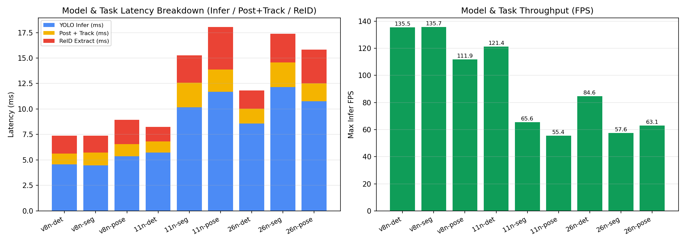
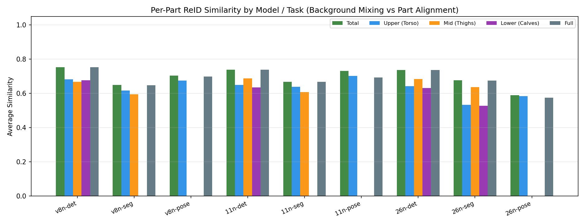
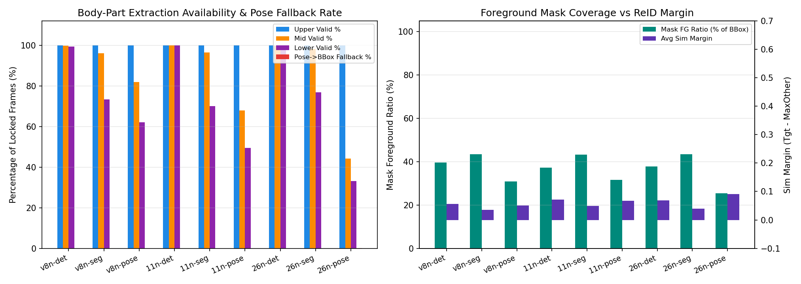
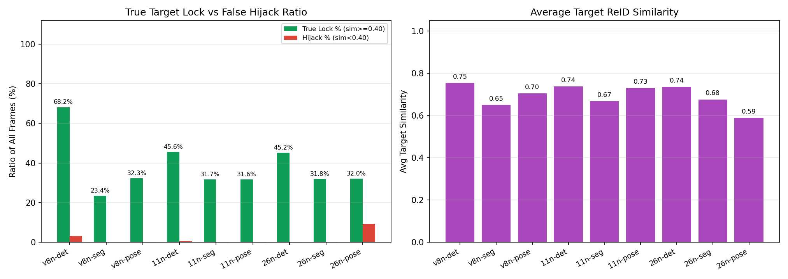
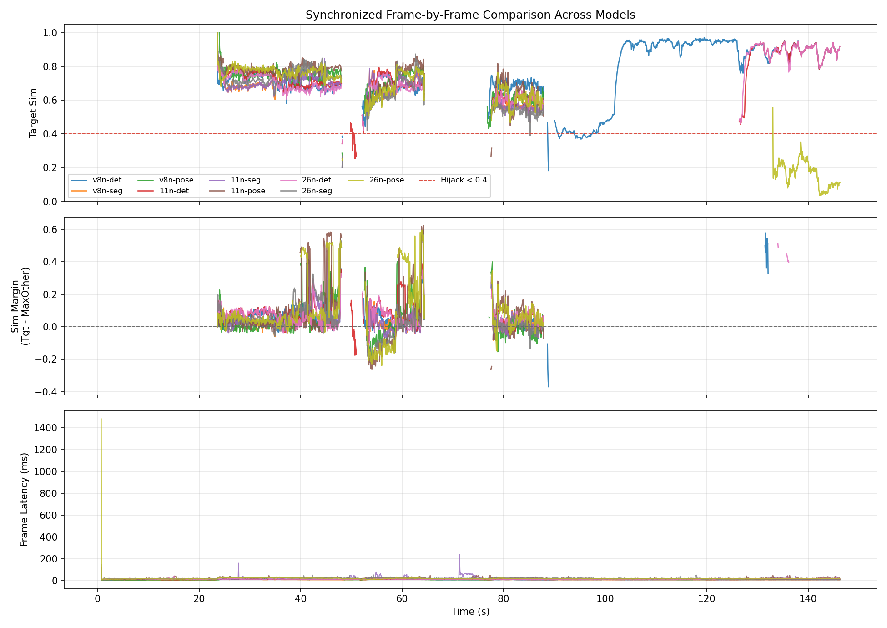

# Bag Benchmark Report: `model_benchmark`

- **Bag Path**: `/home/mu-01/Downloads/arti_benchmark_bags/model_benchmark`
- **Image Topic**: `/robot1/top_cam/image_raw/compressed` (`2184` frames evaluated)
- **Scan / TF**: `None` / `None`
- **Keyframes (`Δ=10f`)**: `crowd@f228, recovered@f591`

## 0. 핵심 관찰 요약 (Auto Insights)

- **최고 연산 속도**: `v8n-seg` (Infer `4.48ms`, Post+Trk `1.24ms`, Max `135.7 FPS`)
- **최고 진성 유지율 (`True Lock %`, sim>=0.4)**: `v8n-det` (`68.2%`, Avg Sim `0.754`)
- **최고 타인 변별 마진 (`Sim Margin`)**: `26n-pose` (평균 `0.091`, 최소 `-0.24`)
- **Pose 부위 가용성 & BBox 폴백 비율**: `v8n-pose` M=81.8%/L=62.0%/FB=0.0%, `11n-pose` M=68.0%/L=49.4%/FB=0.0%, `26n-pose` M=44.2%/L=33.1%/FB=0.2%
- **추적 알고리즘 효과**: `1:ByteTrack` TrueLock=13.7% (Hijack=0.0%, Rec=0), `2:Task-ReID` TrueLock=33.6% (Hijack=9.7%, Rec=0), `3:BoT-SORT` TrueLock=14.7% (Hijack=0.0%, Rec=0), `4:BoT+ReID` TrueLock=34.0% (Hijack=10.7%, Rec=0), `5:Adaptive` TrueLock=32.0% (Hijack=9.2%, Rec=7)

## 1. 모델별 연산 · 후처리 속도 분해 (`5:Adaptive`)

| Model | Pre (ms) | Infer Mean / P95 (ms) | Post+Trk (ms) | ReID (ms) | Total Mean / P95 (ms) | Max FPS |
|---|---:|---:|---:|---:|---:|---:|
| v8n-det (`yolov8n.pt`) | 0.38 | 4.57 / 6.01 | 1.07 | 1.74 | 9.16 / 13.86 | 135.5 |
| v8n-seg (`yolov8n-seg.pt`) | 0.33 | 4.48 / 7.28 | 1.24 | 1.65 | 8.85 / 15.99 | 135.7 |
| v8n-pose (`yolov8n-pose.pt`) | 0.42 | 5.37 / 7.85 | 1.19 | 2.38 | 10.72 / 14.73 | 111.9 |
| 11n-det (`yolo11n.pt`) | 0.38 | 5.72 / 8.28 | 1.09 | 1.43 | 9.95 / 13.61 | 121.4 |
| 11n-seg (`yolo11n-seg.pt`) | 0.55 | 10.17 / 17.84 | 2.4 | 2.69 | 17.96 / 32.17 | 65.6 |
| 11n-pose (`yolo11n-pose.pt`) | 0.76 | 11.69 / 14.42 | 2.19 | 4.16 | 21.37 / 31.63 | 55.4 |
| 26n-det (`yolo26n.pt`) | 0.6 | 8.57 / 12.05 | 1.45 | 1.8 | 14.3 / 20.27 | 84.6 |
| 26n-seg (`yolo26n-seg.pt`) | 0.69 | 12.14 / 14.45 | 2.43 | 2.8 | 20.38 / 28.43 | 57.6 |
| 26n-pose (`yolo26n-pose.pt`) | 0.69 | 10.77 / 11.61 | 1.74 | 3.33 | 19.11 / 25.84 | 63.1 |

## 2. 특징 추출 용이성 · 부위 가용성 · 배경 분리 (`5:Adaptive`)

| Model | U / M / L Valid % | Pose Fallback % | Mask FG % | Avg Tgt Sim ± Std (Min) | U / M / L / F Avg Sim |
|---|---:|---:|---:|---:|---|
| v8n-det | 100.0% / 99.8% / 99.3% | 0.0% | 39.7% | 0.754 ± 0.166 (0.183) | 0.682 / 0.668 / 0.677 / 0.754 |
| v8n-seg | 100.0% / 96.1% / 73.4% | 0.0% | 43.4% | 0.65 ± 0.072 (0.468) | 0.617 / 0.595 / - / 0.648 |
| v8n-pose | 100.0% / 81.8% / 62.0% | 0.0% | 30.9% | 0.704 ± 0.079 (0.257) | 0.675 / - / - / 0.698 |
| 11n-det | 100.0% / 99.9% / 99.9% | 0.0% | 37.3% | 0.738 ± 0.123 (0.253) | 0.649 / 0.687 / 0.634 / 0.738 |
| 11n-seg | 100.0% / 96.4% / 70.0% | 0.0% | 43.2% | 0.668 ± 0.076 (0.2) | 0.639 / 0.608 / - / 0.667 |
| 11n-pose | 100.0% / 68.0% / 49.4% | 0.0% | 31.6% | 0.731 ± 0.095 (0.244) | 0.703 / - / - / 0.694 |
| 26n-det | 100.0% / 99.8% / 99.5% | 0.0% | 37.9% | 0.736 ± 0.115 (0.342) | 0.643 / 0.684 / 0.632 / 0.736 |
| 26n-seg | 100.0% / 98.3% / 76.9% | 0.0% | 43.5% | 0.676 ± 0.101 (0.2) | 0.533 / 0.637 / 0.527 / 0.675 |
| 26n-pose | 100.0% / 44.2% / 33.1% | 0.2% | 25.4% | 0.589 ± 0.243 (0.035) | 0.584 / - / - / 0.574 |

## 3. 재식별 변별력 · 혼잡 · 오인식 방어 (`5:Adaptive`)

> `True Lock %`: 전체 프레임 중 유사도 `>=0.4`로 실제 타겟을 유지한 비율 · `Hijack %`: 유사도 `<0.4` 오탐 잠금 비율

| Model | Det % | >=2P % | Locked % | True Lock % | Hijack % | Direct Sw | Recovered (Avg f) | Other Avg / Max | Margin Mean / Min |
|---|---:|---:|---:|---:|---:|---:|---:|---:|---:|
| v8n-det | 99.6% | 38.8% | 71.5% | **68.2%** | 3.0% | 9 | 5 (47.5f) | 0.568 / 1.0 | 0.056 / -0.37 |
| v8n-seg | 99.8% | 39.0% | 23.5% | **23.4%** | 0.0% | 19 | 2 (75.8f) | 0.471 / 1.0 | 0.035 / -0.108 |
| v8n-pose | 99.7% | 38.9% | 32.5% | **32.3%** | 0.1% | 12 | 5 (36.3f) | 0.547 / 1.0 | 0.051 / -0.199 |
| 11n-det | 99.8% | 38.4% | 46.2% | **45.6%** | 0.5% | 10 | 6 (104.2f) | 0.544 / 1.0 | 0.072 / -0.176 |
| 11n-seg | 99.8% | 40.8% | 31.8% | **31.7%** | 0.1% | 20 | 4 (30.3f) | 0.468 / 1.0 | 0.049 / -0.088 |
| 11n-pose | 99.7% | 38.0% | 32.0% | **31.6%** | 0.2% | 13 | 5 (33.5f) | 0.544 / 1.0 | 0.068 / -0.261 |
| 26n-det | 99.8% | 39.1% | 45.4% | **45.2%** | 0.1% | 12 | 6 (121.6f) | 0.533 / 1.0 | 0.069 / -0.107 |
| 26n-seg | 99.8% | 39.2% | 32.0% | **31.8%** | 0.1% | 10 | 3 (54.0f) | 0.475 / 1.0 | 0.04 / -0.218 |
| 26n-pose | 99.8% | 37.4% | 41.2% | **32.0%** | 9.2% | 10 | 7 (117.9f) | 0.501 / 1.0 | 0.091 / -0.24 |

## 4. 추적 알고리즘 비교 (`yolo26n-pose`)

| Mode | Locked % | True Lock % | Hijack % | SEARCH % | GUARD % | Direct Sw | Recovered (Avg f) | Avg Tgt Sim | Total (ms) |
|---|---:|---:|---:|---:|---:|---:|---:|---:|---:|
| 1:ByteTrack | 13.7% | **13.7%** | 0.0% | 0.0% | 0.0% | 0 | 0 | 0.76 | 10.2 |
| 2:Task-ReID | 43.3% | **33.6%** | 9.7% | 0.0% | 0.0% | 10 | 0 | 0.591 | 10.65 |
| 3:BoT-SORT | 14.8% | **14.7%** | 0.0% | 0.0% | 0.0% | 0 | 0 | 0.744 | 17.18 |
| 4:BoT+ReID | 44.8% | **34.0%** | 10.7% | 0.0% | 0.0% | 14 | 0 | 0.583 | 17.01 |
| 5:Adaptive | 41.2% | **32.0%** | 9.2% | 43.2% | 20.9% | 10 | 7 (117.9f) | 0.589 | 13.84 |

## 5.5 Ground Truth(GT) 기반 실제 추적 정확도 (IoU >= 0.5)

| Experiment | Mode | GT Pos / Neg (f) | GT True Lock % | GT Hijack % | GT Miss % | GT False Lock % | Mean IoU | Fail Episodes (예상 개입) |
|---|---|---:|---:|---:|---:|---:|---:|---:|
| v8n-det | 5:Adaptive | 514 / 1327 | **55.4%** | 42.4% | 2.1% | 79.4% | 0.596 | 10 |
| v8n-seg | 5:Adaptive | 514 / 1327 | **26.3%** | 39.1% | 34.6% | 13.3% | 0.397 | 12 |
| v8n-pose | 5:Adaptive | 514 / 1327 | **19.1%** | 79.4% | 1.6% | 15.1% | 0.235 | 11 |
| 11n-det | 5:Adaptive | 514 / 1327 | **56.4%** | 43.2% | 0.4% | 37.3% | 0.607 | 12 |
| 11n-seg | 5:Adaptive | 514 / 1327 | **44.7%** | 54.3% | 1.0% | 13.9% | 0.436 | 15 |
| 11n-pose | 5:Adaptive | 514 / 1327 | **41.4%** | 57.8% | 0.8% | 14.0% | 0.42 | 14 |
| 26n-det | 5:Adaptive | 514 / 1327 | **67.3%** | 32.3% | 0.4% | 36.0% | 0.701 | 12 |
| 26n-seg | 5:Adaptive | 514 / 1327 | **38.1%** | 61.9% | 0.0% | 13.8% | 0.378 | 9 |
| 26n-pose | 5:Adaptive | 514 / 1327 | **49.2%** | 50.2% | 0.6% | 29.2% | 0.416 | 12 |
| mode_1 | 1:ByteTrack | 514 / 1327 | **56.2%** | 1.9% | 41.8% | 0.0% | 0.772 | 6 |
| mode_2 | 2:Task-ReID | 514 / 1327 | **47.5%** | 52.5% | 0.0% | 32.4% | 0.431 | 8 |
| mode_3 | 3:BoT-SORT | 514 / 1327 | **59.7%** | 2.5% | 37.7% | 0.2% | 0.787 | 10 |
| mode_4 | 4:BoT+ReID | 514 / 1327 | **47.1%** | 52.9% | 0.0% | 34.8% | 0.431 | 9 |
| mode_5 | 5:Adaptive | 514 / 1327 | **49.2%** | 50.2% | 0.6% | 29.2% | 0.416 | 12 |

## 6. 시각 검증 스냅샷 (`snapshots/`)

- `compare_tasks_hist_crowd_f0228.png`
  
- `compare_versions_crowd_f0228.png`
  
- `compare_pixels_crowd_f0228.png`
  
- `compare_seq_crowd_f0228.png`
  
- `compare_tasks_hist_recovered_f0591.png`
  
- `compare_versions_recovered_f0591.png`
  
- `compare_pixels_recovered_f0591.png`
  
- `compare_seq_recovered_f0591.png`
  
