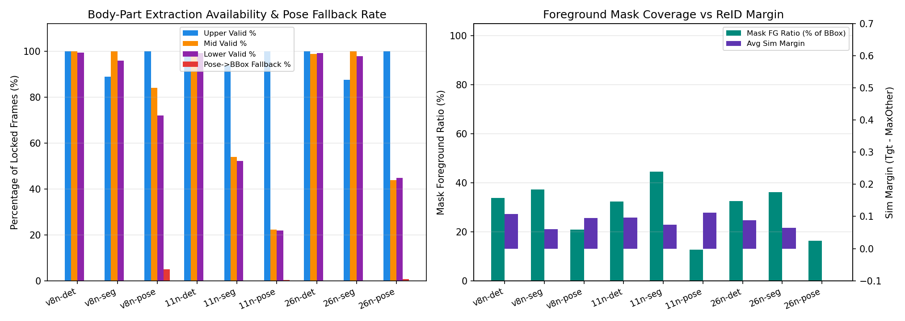
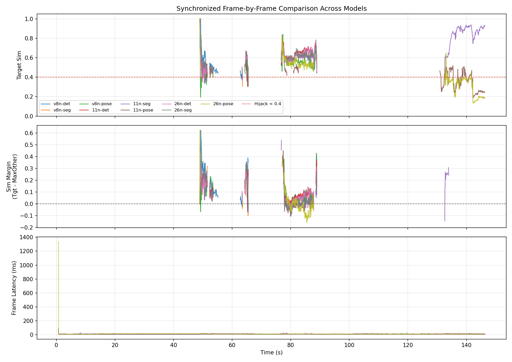
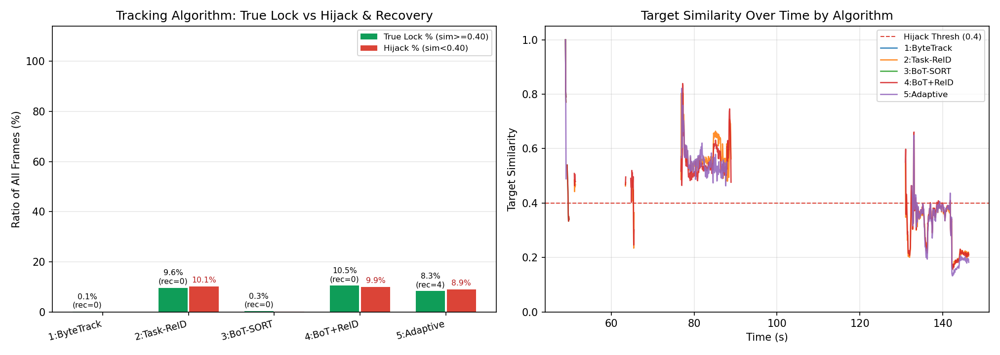

# Bag Benchmark Report: `model_benchmark`

- **Bag Path**: `/home/mu-01/Downloads/arti_benchmark_bags/model_benchmark`
- **Image Topic**: `/robot1/top_cam/image_raw/compressed` (`2184` frames evaluated)
- **Scan / TF**: `None` / `None`
- **Keyframes (`Δ=10f`)**: `crowd@f228, recovered@f943`

## 0. 핵심 관찰 요약 (Auto Insights)

- **최고 연산 속도**: `v8n-det` (Infer `3.84ms`, Post+Trk `0.92ms`, Max `175.0 FPS`)
- **최고 진성 유지율 (`True Lock %`, sim>=0.4)**: `11n-seg` (`20.0%`, Avg Sim `0.704`)
- **최고 타인 변별 마진 (`Sim Margin`)**: `11n-pose` (평균 `0.112`, 최소 `-0.07`)
- **Pose 부위 가용성 & BBox 폴백 비율**: `v8n-pose` M=84.1%/L=72.0%/FB=4.9%, `11n-pose` M=22.3%/L=21.9%/FB=0.3%, `26n-pose` M=43.9%/L=44.7%/FB=0.8%
- **추적 알고리즘 효과**: `1:ByteTrack` TrueLock=0.1% (Hijack=0.0%, Rec=0), `2:Task-ReID` TrueLock=9.6% (Hijack=10.1%, Rec=0), `3:BoT-SORT` TrueLock=0.3% (Hijack=0.2%, Rec=0), `4:BoT+ReID` TrueLock=10.5% (Hijack=9.9%, Rec=0), `5:Adaptive` TrueLock=8.3% (Hijack=8.9%, Rec=4)

## 1. 모델별 연산 · 후처리 속도 분해 (`5:Adaptive`)

| Model | Pre (ms) | Infer Mean / P95 (ms) | Post+Trk (ms) | ReID (ms) | Total Mean / P95 (ms) | Max FPS |
|---|---:|---:|---:|---:|---:|---:|
| v8n-det (`yolov8n.pt`) | 0.33 | 3.84 / 5.84 | 0.92 | 0.96 | 7.14 / 9.51 | 175.0 |
| v8n-seg (`yolov8n-seg.pt`) | 0.3 | 4.02 / 4.82 | 1.11 | 1.03 | 7.5 / 9.22 | 162.2 |
| v8n-pose (`yolov8n-pose.pt`) | 0.37 | 4.56 / 7.17 | 1.03 | 1.32 | 8.47 / 13.18 | 144.7 |
| 11n-det (`yolo11n.pt`) | 0.33 | 4.96 / 5.77 | 0.92 | 0.91 | 8.24 / 10.36 | 147.2 |
| 11n-seg (`yolo11n-seg.pt`) | 0.43 | 8.0 / 9.76 | 1.69 | 1.51 | 13.29 / 17.79 | 89.3 |
| 11n-pose (`yolo11n-pose.pt`) | 0.33 | 5.37 / 5.82 | 0.93 | 1.25 | 9.04 / 11.35 | 132.5 |
| 26n-det (`yolo26n.pt`) | 0.32 | 5.25 / 5.87 | 0.85 | 0.85 | 8.29 / 10.05 | 144.0 |
| 26n-seg (`yolo26n-seg.pt`) | 0.34 | 6.36 / 7.51 | 1.22 | 1.1 | 10.16 / 13.01 | 115.3 |
| 26n-pose (`yolo26n-pose.pt`) | 0.52 | 7.67 / 10.91 | 1.29 | 1.29 | 12.68 / 16.14 | 97.6 |

## 2. 특징 추출 용이성 · 부위 가용성 · 배경 분리 (`5:Adaptive`)

| Model | U / M / L Valid % | Pose Fallback % | Mask FG % | Avg Tgt Sim ± Std (Min) | U / M / L / F Avg Sim |
|---|---:|---:|---:|---:|---|
| v8n-det | 100.0% / 100.0% / 99.3% | 0.0% | 33.8% | 0.593 ± 0.082 (0.37) | 0.521 / 0.592 / 0.498 / 0.589 |
| v8n-seg | 88.8% / 100.0% / 95.9% | 0.0% | 37.2% | 0.596 ± 0.076 (0.306) | 0.538 / 0.496 / 0.395 / 0.595 |
| v8n-pose | 100.0% / 84.1% / 72.0% | 4.9% | 20.9% | 0.538 ± 0.087 (0.194) | 0.531 / 0.638 / 0.288 / 0.511 |
| 11n-det | 100.0% / 98.4% / 99.2% | 0.0% | 32.4% | 0.611 ± 0.089 (0.351) | 0.58 / 0.516 / 0.406 / 0.609 |
| 11n-seg | 93.7% / 53.9% / 52.1% | 0.0% | 44.6% | 0.704 ± 0.157 (0.307) | 0.685 / 0.476 / 0.423 / 0.703 |
| 11n-pose | 100.0% / 22.3% / 21.9% | 0.3% | 12.6% | 0.391 ± 0.122 (0.19) | 0.377 / 0.391 / 0.395 / 0.382 |
| 26n-det | 100.0% / 98.8% / 99.2% | 0.0% | 32.5% | 0.604 ± 0.088 (0.352) | 0.6 / 0.48 / 0.408 / 0.602 |
| 26n-seg | 87.6% / 100.0% / 97.9% | 0.0% | 36.2% | 0.601 ± 0.073 (0.315) | 0.559 / 0.489 / 0.42 / 0.599 |
| 26n-pose | 100.0% / 43.9% / 44.7% | 0.8% | 16.3% | 0.417 ± 0.15 (0.132) | 0.379 / 0.528 / 0.416 / 0.395 |

## 3. 재식별 변별력 · 혼잡 · 오인식 방어 (`5:Adaptive`)

> `True Lock %`: 전체 프레임 중 유사도 `>=0.4`로 실제 타겟을 유지한 비율 · `Hijack %`: 유사도 `<0.4` 오탐 잠금 비율

| Model | Det % | >=2P % | Locked % | True Lock % | Hijack % | Direct Sw | Recovered (Avg f) | Other Avg / Max | Margin Mean / Min |
|---|---:|---:|---:|---:|---:|---:|---:|---:|---:|
| v8n-det | 99.6% | 38.8% | 12.7% | **12.5%** | 0.2% | 0 | 8 (39.9f) | 0.448 / 1.0 | 0.107 / -0.03 |
| v8n-seg | 99.8% | 39.0% | 11.1% | **10.8%** | 0.2% | 1 | 5 (71.8f) | 0.514 / 1.0 | 0.061 / -0.105 |
| v8n-pose | 99.7% | 38.9% | 11.3% | **10.5%** | 0.7% | 0 | 6 (44.2f) | 0.42 / 1.0 | 0.095 / -0.067 |
| 11n-det | 99.8% | 38.4% | 11.3% | **11.1%** | 0.2% | 0 | 5 (70.6f) | 0.477 / 1.0 | 0.096 / -0.045 |
| 11n-seg | 99.8% | 40.8% | 20.4% | **20.0%** | 0.4% | 2 | 6 (126.9f) | 0.495 / 1.0 | 0.075 / -0.144 |
| 11n-pose | 99.7% | 38.0% | 14.2% | **7.1%** | 7.1% | 1 | 6 (191.7f) | 0.331 / 1.0 | 0.112 / -0.07 |
| 26n-det | 99.8% | 39.1% | 11.1% | **10.9%** | 0.2% | 0 | 4 (89.8f) | 0.471 / 1.0 | 0.088 / -0.037 |
| 26n-seg | 99.8% | 39.2% | 11.1% | **10.9%** | 0.1% | 1 | 5 (71.8f) | 0.517 / 1.0 | 0.065 / -0.102 |
| 26n-pose | 99.8% | 37.4% | 17.3% | **8.3%** | 8.9% | 1 | 4 (271.0f) | 0.491 / 1.0 | 0.0 / -0.161 |

## 4. 추적 알고리즘 비교 (`yolo26n-pose`)

| Mode | Locked % | True Lock % | Hijack % | SEARCH % | GUARD % | Direct Sw | Recovered (Avg f) | Avg Tgt Sim | Total (ms) |
|---|---:|---:|---:|---:|---:|---:|---:|---:|---:|
| 1:ByteTrack | 0.1% | **0.1%** | 0.0% | 0.0% | 0.0% | 0 | 0 | 0.855 | 8.74 |
| 2:Task-ReID | 19.7% | **9.6%** | 10.1% | 0.0% | 0.0% | 8 | 0 | 0.432 | 9.82 |
| 3:BoT-SORT | 0.5% | **0.3%** | 0.2% | 0.0% | 0.0% | 0 | 0 | 0.541 | 18.37 |
| 4:BoT+ReID | 20.4% | **10.5%** | 9.9% | 0.0% | 0.0% | 11 | 0 | 0.425 | 13.68 |
| 5:Adaptive | 17.3% | **8.3%** | 8.9% | 49.6% | 0.6% | 1 | 4 (271.0f) | 0.417 | 9.53 |

## 5.5 Ground Truth(GT) 기반 실제 추적 정확도 (IoU >= 0.5)

| Experiment | Mode | GT Pos / Neg (f) | GT True Lock % | GT Hijack % | GT Miss % | GT False Lock % | Mean IoU | Fail Episodes (예상 개입) |
|---|---|---:|---:|---:|---:|---:|---:|---:|
| v8n-det | 5:Adaptive | 241 / 1324 | **94.6%** | 0.0% | 5.4% | 3.7% | 0.926 | 10 |
| v8n-seg | 5:Adaptive | 241 / 1324 | **55.6%** | 37.3% | 7.1% | 1.3% | 0.56 | 6 |
| v8n-pose | 5:Adaptive | 241 / 1324 | **96.7%** | 0.0% | 3.3% | 1.0% | 0.915 | 8 |
| 11n-det | 5:Adaptive | 241 / 1324 | **95.4%** | 0.0% | 4.6% | 1.3% | 0.938 | 6 |
| 11n-seg | 5:Adaptive | 241 / 1324 | **54.4%** | 37.3% | 8.3% | 1.4% | 0.546 | 8 |
| 11n-pose | 5:Adaptive | 241 / 1324 | **24.5%** | 5.4% | 70.1% | 0.5% | 0.683 | 7 |
| 26n-det | 5:Adaptive | 241 / 1324 | **97.5%** | 0.0% | 2.5% | 0.5% | 0.952 | 5 |
| 26n-seg | 5:Adaptive | 241 / 1324 | **56.0%** | 37.3% | 6.6% | 1.2% | 0.594 | 5 |
| 26n-pose | 5:Adaptive | 241 / 1324 | **29.5%** | 40.2% | 30.3% | 0.1% | 0.367 | 5 |
| mode_1 | 1:ByteTrack | 241 / 1324 | **1.2%** | 0.0% | 98.8% | 0.0% | 0.816 | 3 |
| mode_2 | 2:Task-ReID | 241 / 1324 | **78.8%** | 3.3% | 17.8% | 0.2% | 0.861 | 6 |
| mode_3 | 3:BoT-SORT | 241 / 1324 | **4.6%** | 0.0% | 95.4% | 0.0% | 0.773 | 4 |
| mode_4 | 4:BoT+ReID | 241 / 1324 | **79.7%** | 8.7% | 11.6% | 0.2% | 0.762 | 9 |
| mode_5 | 5:Adaptive | 241 / 1324 | **29.5%** | 40.2% | 30.3% | 0.1% | 0.367 | 5 |

## 6. 시각 검증 스냅샷 (`snapshots/`)

- `compare_tasks_hist_crowd_f0228.png`
  
- `compare_versions_crowd_f0228.png`
  
- `compare_pixels_crowd_f0228.png`
  
- `compare_seq_crowd_f0228.png`
  
- `compare_tasks_hist_recovered_f0943.png`
  
- `compare_versions_recovered_f0943.png`
  
- `compare_pixels_recovered_f0943.png`
  
- `compare_seq_recovered_f0943.png`
  
