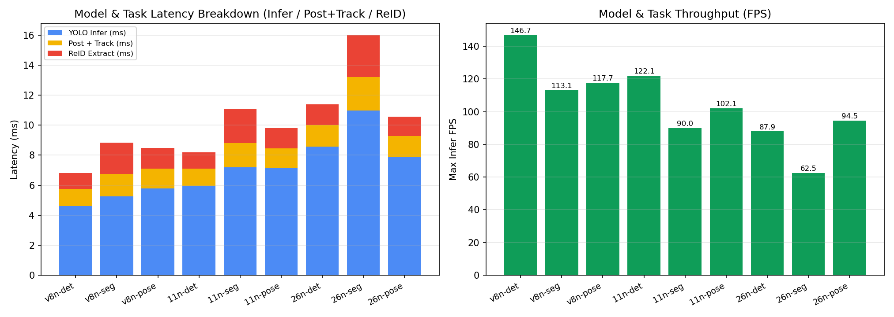
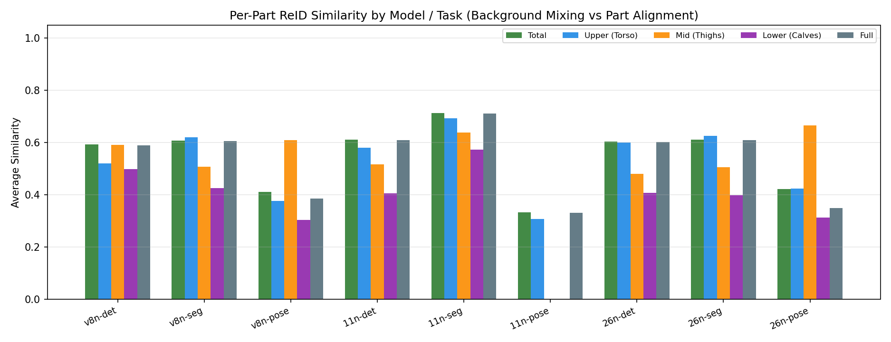
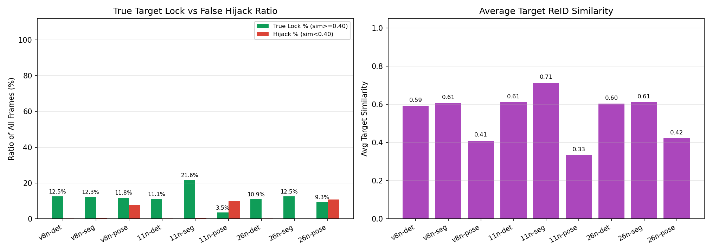

# Bag Benchmark Report: `model_benchmark`

- **Bag Path**: `/home/mu-01/Downloads/arti_benchmark_bags/model_benchmark`
- **Image Topic**: `/robot1/top_cam/image_raw/compressed` (`2184` frames evaluated)
- **Scan / TF**: `None` / `None`
- **Keyframes (`Δ=10f`)**: `crowd@f228, recovered@f1145`

## 0. 핵심 관찰 요약 (Auto Insights)

- **최고 연산 속도**: `v8n-det` (Infer `4.6ms`, Post+Trk `1.15ms`, Max `146.7 FPS`)
- **최고 진성 유지율 (`True Lock %`, sim>=0.4)**: `11n-seg` (`21.6%`, Avg Sim `0.713`)
- **최고 타인 변별 마진 (`Sim Margin`)**: `11n-pose` (평균 `0.158`, 최소 `-0.057`)
- **Pose 부위 가용성 & BBox 폴백 비율**: `v8n-pose` M=44.9%/L=38.6%/FB=8.9%, `11n-pose` M=13.4%/L=13.4%/FB=3.4%, `26n-pose` M=46.6%/L=46.6%/FB=8.7%
- **추적 알고리즘 효과**: `1:ByteTrack` TrueLock=0.1% (Hijack=0.0%, Rec=0), `2:Task-ReID` TrueLock=10.6% (Hijack=14.9%, Rec=0), `3:BoT-SORT` TrueLock=0.4% (Hijack=0.1%, Rec=0), `4:BoT+ReID` TrueLock=10.6% (Hijack=10.9%, Rec=0), `5:Adaptive` TrueLock=9.3% (Hijack=10.8%, Rec=2)

## 1. 모델별 연산 · 후처리 속도 분해 (`5:Adaptive`)

| Model | Pre (ms) | Infer Mean / P95 (ms) | Post+Trk (ms) | ReID (ms) | Total Mean / P95 (ms) | Max FPS |
|---|---:|---:|---:|---:|---:|---:|
| v8n-det (`yolov8n.pt`) | 0.4 | 4.6 / 6.41 | 1.15 | 1.07 | 8.54 / 10.73 | 146.7 |
| v8n-seg (`yolov8n-seg.pt`) | 0.39 | 5.26 / 6.09 | 1.5 | 2.09 | 10.59 / 14.86 | 113.1 |
| v8n-pose (`yolov8n-pose.pt`) | 0.48 | 5.78 / 7.41 | 1.32 | 1.39 | 10.58 / 14.04 | 117.7 |
| 11n-det (`yolo11n.pt`) | 0.39 | 5.96 / 7.11 | 1.13 | 1.1 | 9.91 / 12.53 | 122.1 |
| 11n-seg (`yolo11n-seg.pt`) | 0.42 | 7.19 / 9.77 | 1.61 | 2.31 | 13.14 / 20.33 | 90.0 |
| 11n-pose (`yolo11n-pose.pt`) | 0.45 | 7.17 / 8.28 | 1.28 | 1.35 | 11.83 / 15.07 | 102.1 |
| 26n-det (`yolo26n.pt`) | 0.54 | 8.56 / 12.03 | 1.44 | 1.38 | 13.57 / 20.11 | 87.9 |
| 26n-seg (`yolo26n-seg.pt`) | 0.6 | 10.98 / 14.08 | 2.23 | 2.79 | 18.63 / 26.43 | 62.5 |
| 26n-pose (`yolo26n-pose.pt`) | 0.65 | 7.89 / 8.89 | 1.38 | 1.31 | 13.57 / 16.25 | 94.5 |

## 2. 특징 추출 용이성 · 부위 가용성 · 배경 분리 (`5:Adaptive`)

| Model | U / M / L Valid % | Pose Fallback % | Mask FG % | Avg Tgt Sim ± Std (Min) | U / M / L / F Avg Sim |
|---|---:|---:|---:|---:|---|
| v8n-det | 100.0% / 100.0% / 99.3% | 0.0% | 33.8% | 0.593 ± 0.082 (0.37) | 0.521 / 0.592 / 0.498 / 0.589 |
| v8n-seg | 100.0% / 100.0% / 100.0% | 0.0% | 40.6% | 0.607 ± 0.093 (0.374) | 0.62 / 0.507 / 0.426 / 0.605 |
| v8n-pose | 100.0% / 44.9% / 38.6% | 8.9% | 11.6% | 0.41 ± 0.121 (0.177) | 0.376 / 0.609 / 0.303 / 0.385 |
| 11n-det | 100.0% / 98.4% / 99.2% | 0.0% | 32.4% | 0.611 ± 0.089 (0.351) | 0.58 / 0.516 / 0.406 / 0.609 |
| 11n-seg | 100.0% / 100.0% / 100.0% | 0.0% | 47.1% | 0.713 ± 0.157 (0.384) | 0.694 / 0.639 / 0.573 / 0.712 |
| 11n-pose | 100.0% / 13.4% / 13.4% | 3.4% | 9.1% | 0.333 ± 0.119 (0.126) | 0.307 / - / - / 0.33 |
| 26n-det | 100.0% / 98.8% / 99.2% | 0.0% | 32.5% | 0.604 ± 0.088 (0.352) | 0.6 / 0.48 / 0.408 / 0.602 |
| 26n-seg | 100.0% / 99.6% / 99.6% | 0.0% | 40.2% | 0.611 ± 0.09 (0.395) | 0.626 / 0.505 / 0.398 / 0.609 |
| 26n-pose | 100.0% / 46.6% / 46.6% | 8.7% | 13.6% | 0.422 ± 0.224 (0.116) | 0.424 / 0.665 / 0.313 / 0.349 |

## 3. 재식별 변별력 · 혼잡 · 오인식 방어 (`5:Adaptive`)

> `True Lock %`: 전체 프레임 중 유사도 `>=0.4`로 실제 타겟을 유지한 비율 · `Hijack %`: 유사도 `<0.4` 오탐 잠금 비율

| Model | Det % | >=2P % | Locked % | True Lock % | Hijack % | Direct Sw | Recovered (Avg f) | Other Avg / Max | Margin Mean / Min |
|---|---:|---:|---:|---:|---:|---:|---:|---:|---:|
| v8n-det | 99.6% | 38.8% | 12.7% | **12.5%** | 0.2% | 0 | 8 (39.9f) | 0.448 / 1.0 | 0.107 / -0.03 |
| v8n-seg | 99.8% | 39.0% | 12.6% | **12.3%** | 0.3% | 0 | 4 (81.5f) | 0.517 / 1.0 | 0.065 / -0.093 |
| v8n-pose | 99.7% | 38.9% | 19.7% | **11.8%** | 7.8% | 0 | 6 (129.0f) | 0.392 / 1.0 | 0.091 / -0.073 |
| 11n-det | 99.8% | 38.4% | 11.3% | **11.1%** | 0.2% | 0 | 5 (70.6f) | 0.477 / 1.0 | 0.096 / -0.045 |
| 11n-seg | 99.8% | 40.8% | 21.9% | **21.6%** | 0.3% | 1 | 5 (140.4f) | 0.501 / 1.0 | 0.083 / -0.134 |
| 11n-pose | 99.7% | 38.0% | 13.3% | **3.5%** | 9.8% | 0 | 3 (390.0f) | 0.273 / 1.0 | 0.158 / -0.057 |
| 26n-det | 99.8% | 39.1% | 11.1% | **10.9%** | 0.2% | 0 | 4 (89.8f) | 0.471 / 1.0 | 0.088 / -0.037 |
| 26n-seg | 99.8% | 39.2% | 12.6% | **12.5%** | 0.0% | 0 | 4 (81.5f) | 0.518 / 1.0 | 0.068 / -0.09 |
| 26n-pose | 99.8% | 37.4% | 20.1% | **9.3%** | 10.8% | 1 | 2 (340.7f) | 0.562 / 1.0 | 0.01 / -0.252 |

## 4. 추적 알고리즘 비교 (`yolo26n-pose`)

| Mode | Locked % | True Lock % | Hijack % | SEARCH % | GUARD % | Direct Sw | Recovered (Avg f) | Avg Tgt Sim | Total (ms) |
|---|---:|---:|---:|---:|---:|---:|---:|---:|---:|
| 1:ByteTrack | 0.1% | **0.1%** | 0.0% | 0.0% | 0.0% | 0 | 0 | 0.86 | 11.13 |
| 2:Task-ReID | 25.5% | **10.6%** | 14.9% | 0.0% | 0.0% | 6 | 0 | 0.427 | 11.53 |
| 3:BoT-SORT | 0.5% | **0.4%** | 0.1% | 0.0% | 0.0% | 0 | 0 | 0.56 | 15.13 |
| 4:BoT+ReID | 21.6% | **10.6%** | 10.9% | 0.0% | 0.0% | 7 | 0 | 0.411 | 14.51 |
| 5:Adaptive | 20.1% | **9.3%** | 10.8% | 46.8% | 1.2% | 1 | 2 (340.7f) | 0.422 | 9.49 |

## 5.5 Ground Truth(GT) 기반 실제 추적 정확도 (IoU >= 0.5)

| Experiment | Mode | GT Pos / Neg (f) | GT True Lock % | GT Hijack % | GT Miss % | GT False Lock % | Mean IoU | Fail Episodes (예상 개입) |
|---|---|---:|---:|---:|---:|---:|---:|---:|
| v8n-det | 5:Adaptive | 241 / 1324 | **94.6%** | 0.0% | 5.4% | 3.7% | 0.926 | 10 |
| v8n-seg | 5:Adaptive | 241 / 1324 | **98.8%** | 0.0% | 1.2% | 2.7% | 0.948 | 5 |
| v8n-pose | 5:Adaptive | 241 / 1324 | **75.5%** | 0.0% | 24.5% | 0.7% | 0.917 | 9 |
| 11n-det | 5:Adaptive | 241 / 1324 | **95.4%** | 0.0% | 4.6% | 1.3% | 0.938 | 6 |
| 11n-seg | 5:Adaptive | 241 / 1324 | **97.5%** | 0.0% | 2.5% | 2.7% | 0.937 | 7 |
| 11n-pose | 5:Adaptive | 241 / 1324 | **11.2%** | 0.0% | 88.8% | 0.4% | 0.78 | 5 |
| 26n-det | 5:Adaptive | 241 / 1324 | **97.5%** | 0.0% | 2.5% | 0.5% | 0.952 | 5 |
| 26n-seg | 5:Adaptive | 241 / 1324 | **99.2%** | 0.0% | 0.8% | 2.6% | 0.994 | 4 |
| 26n-pose | 5:Adaptive | 241 / 1324 | **35.3%** | 34.4% | 30.3% | 0.0% | 0.445 | 4 |
| mode_1 | 1:ByteTrack | 241 / 1324 | **1.2%** | 0.0% | 98.8% | 0.0% | 0.816 | 3 |
| mode_2 | 2:Task-ReID | 241 / 1324 | **73.0%** | 3.7% | 23.2% | 7.6% | 0.852 | 5 |
| mode_3 | 3:BoT-SORT | 241 / 1324 | **4.6%** | 0.0% | 95.4% | 0.0% | 0.773 | 4 |
| mode_4 | 4:BoT+ReID | 241 / 1324 | **75.1%** | 7.5% | 17.4% | 0.0% | 0.786 | 7 |
| mode_5 | 5:Adaptive | 241 / 1324 | **35.3%** | 34.4% | 30.3% | 0.0% | 0.445 | 4 |

## 6. 시각 검증 스냅샷 (`snapshots/`)

- `compare_tasks_hist_crowd_f0228.png`
  
- `compare_versions_crowd_f0228.png`
  
- `compare_pixels_crowd_f0228.png`
  
- `compare_seq_crowd_f0228.png`
  
- `compare_tasks_hist_recovered_f1145.png`
  
- `compare_versions_recovered_f1145.png`
  
- `compare_pixels_recovered_f1145.png`
  
- `compare_seq_recovered_f1145.png`
  
