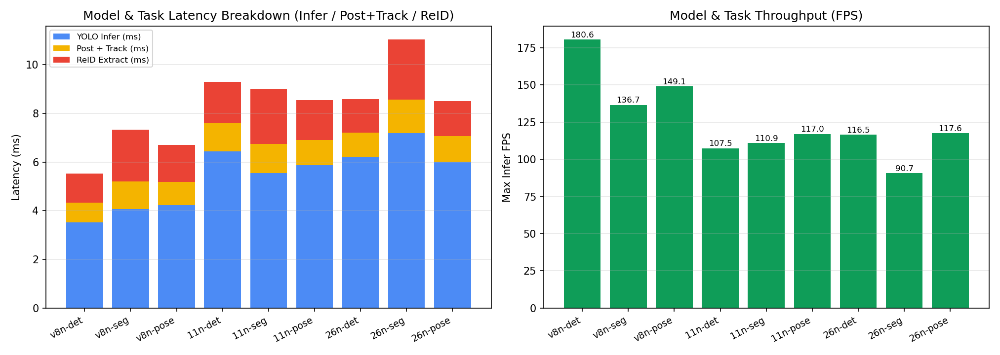
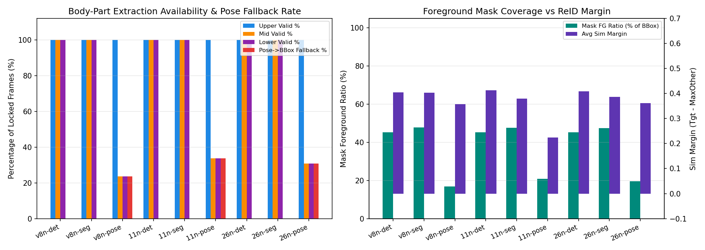
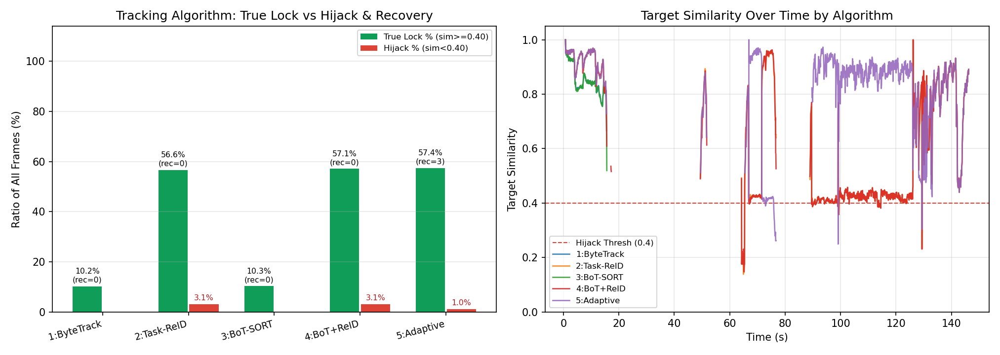

# Bag Benchmark Report: `model_benchmark`

- **Bag Path**: `/home/mu-01/Downloads/arti_benchmark_bags/model_benchmark`
- **Image Topic**: `/robot1/top_cam/image_raw/compressed` (`2184` frames evaluated)
- **Scan / TF**: `None` / `None`
- **Keyframes (`Δ=10f`)**: `q1@f546, recovered@f733`

## 0. 핵심 관찰 요약 (Auto Insights)

- **최고 연산 속도**: `v8n-det` (Infer `3.51ms`, Post+Trk `0.82ms`, Max `180.6 FPS`)
- **최고 진성 유지율 (`True Lock %`, sim>=0.4)**: `11n-seg` (`59.0%`, Avg Sim `0.912`)
- **최고 타인 변별 마진 (`Sim Margin`)**: `11n-det` (평균 `0.413`, 최소 `0.247`)
- **Pose 부위 가용성 & BBox 폴백 비율**: `v8n-pose` M=23.7%/L=23.7%/FB=23.6%, `11n-pose` M=33.8%/L=33.8%/FB=33.7%, `26n-pose` M=30.9%/L=30.9%/FB=30.8%
- **추적 알고리즘 효과**: `1:ByteTrack` TrueLock=10.2% (Hijack=0.0%, Rec=0), `2:Task-ReID` TrueLock=56.6% (Hijack=3.1%, Rec=0), `3:BoT-SORT` TrueLock=10.3% (Hijack=0.0%, Rec=0), `4:BoT+ReID` TrueLock=57.1% (Hijack=3.1%, Rec=0), `5:Adaptive` TrueLock=57.4% (Hijack=1.0%, Rec=3)

## 1. 모델별 연산 · 후처리 속도 분해 (`5:Adaptive`)

| Model | Pre (ms) | Infer Mean / P95 (ms) | Post+Trk (ms) | ReID (ms) | Total Mean / P95 (ms) | Max FPS |
|---|---:|---:|---:|---:|---:|---:|
| v8n-det (`yolov8n.pt`) | 0.3 | 3.51 / 5.37 | 0.82 | 1.2 | 6.98 / 11.31 | 180.6 |
| v8n-seg (`yolov8n-seg.pt`) | 0.31 | 4.07 / 4.27 | 1.13 | 2.12 | 9.02 / 10.01 | 136.7 |
| v8n-pose (`yolov8n-pose.pt`) | 0.35 | 4.23 / 4.45 | 0.95 | 1.52 | 8.54 / 9.52 | 149.1 |
| 11n-det (`yolo11n.pt`) | 0.41 | 6.43 / 8.52 | 1.18 | 1.68 | 11.37 / 15.8 | 107.5 |
| 11n-seg (`yolo11n-seg.pt`) | 0.33 | 5.55 / 6.25 | 1.2 | 2.26 | 10.86 / 13.59 | 110.9 |
| 11n-pose (`yolo11n-pose.pt`) | 0.38 | 5.87 / 6.35 | 1.04 | 1.63 | 10.54 / 12.1 | 117.0 |
| 26n-det (`yolo26n.pt`) | 0.39 | 6.21 / 9.22 | 1.0 | 1.37 | 10.37 / 15.96 | 116.5 |
| 26n-seg (`yolo26n-seg.pt`) | 0.41 | 7.19 / 11.02 | 1.38 | 2.46 | 13.16 / 21.3 | 90.7 |
| 26n-pose (`yolo26n-pose.pt`) | 0.44 | 6.02 / 6.42 | 1.05 | 1.44 | 10.89 / 11.53 | 117.6 |

## 2. 특징 추출 용이성 · 부위 가용성 · 배경 분리 (`5:Adaptive`)

| Model | U / M / L Valid % | Pose Fallback % | Mask FG % | Avg Tgt Sim ± Std (Min) | U / M / L / F Avg Sim |
|---|---:|---:|---:|---:|---|
| v8n-det | 100.0% / 100.0% / 100.0% | 0.0% | 45.3% | 0.903 ± 0.07 (0.502) | 0.864 / 0.871 / 0.874 / 0.903 |
| v8n-seg | 99.9% / 99.9% / 100.0% | 0.0% | 47.8% | 0.915 ± 0.061 (0.484) | 0.853 / 0.882 / 0.896 / 0.915 |
| v8n-pose | 100.0% / 23.7% / 23.7% | 23.6% | 16.8% | 0.852 ± 0.119 (0.261) | 0.843 / 0.833 / 0.836 / 0.852 |
| 11n-det | 100.0% / 100.0% / 100.0% | 0.0% | 45.3% | 0.904 ± 0.07 (0.497) | 0.864 / 0.871 / 0.874 / 0.904 |
| 11n-seg | 100.0% / 100.0% / 100.0% | 0.0% | 47.7% | 0.912 ± 0.064 (0.481) | 0.851 / 0.879 / 0.892 / 0.912 |
| 11n-pose | 100.0% / 33.8% / 33.8% | 33.7% | 20.8% | 0.796 ± 0.194 (0.237) | 0.773 / 0.851 / 0.849 / 0.796 |
| 26n-det | 100.0% / 100.0% / 100.0% | 0.0% | 45.3% | 0.904 ± 0.069 (0.52) | 0.864 / 0.871 / 0.875 / 0.904 |
| 26n-seg | 100.0% / 100.0% / 100.0% | 0.0% | 47.5% | 0.915 ± 0.06 (0.512) | 0.854 / 0.881 / 0.896 / 0.915 |
| 26n-pose | 100.0% / 30.9% / 30.9% | 30.8% | 19.6% | 0.824 ± 0.159 (0.249) | 0.801 / 0.851 / 0.846 / 0.823 |

## 3. 재식별 변별력 · 혼잡 · 오인식 방어 (`5:Adaptive`)

> `True Lock %`: 전체 프레임 중 유사도 `>=0.4`로 실제 타겟을 유지한 비율 · `Hijack %`: 유사도 `<0.4` 오탐 잠금 비율

| Model | Det % | >=2P % | Locked % | True Lock % | Hijack % | Direct Sw | Recovered (Avg f) | Other Avg / Max | Margin Mean / Min |
|---|---:|---:|---:|---:|---:|---:|---:|---:|---:|
| v8n-det | 99.6% | 38.8% | 59.0% | **58.7%** | 0.0% | 0 | 3 (300.3f) | 0.306 / 0.502 | 0.404 / 0.269 |
| v8n-seg | 99.8% | 39.0% | 59.1% | **58.9%** | 0.0% | 0 | 3 (299.0f) | 0.364 / 0.428 | 0.403 / 0.056 |
| v8n-pose | 99.7% | 38.9% | 58.7% | **57.8%** | 0.7% | 0 | 4 (226.2f) | 0.28 / 0.465 | 0.358 / 0.195 |
| 11n-det | 99.8% | 38.4% | 59.0% | **58.9%** | 0.0% | 0 | 4 (224.5f) | 0.243 / 0.361 | 0.413 / 0.247 |
| 11n-seg | 99.8% | 40.8% | 59.1% | **59.0%** | 0.0% | 0 | 3 (298.7f) | 0.411 / 0.495 | 0.38 / 0.05 |
| 11n-pose | 99.7% | 38.0% | 58.5% | **54.2%** | 4.2% | 0 | 3 (303.3f) | 0.374 / 0.516 | 0.224 / 0.049 |
| 26n-det | 99.8% | 39.1% | 59.0% | **58.9%** | 0.0% | 0 | 3 (299.3f) | 0.293 / 0.448 | 0.408 / 0.297 |
| 26n-seg | 99.8% | 39.2% | 59.0% | **58.8%** | 0.0% | 0 | 3 (299.7f) | 0.395 / 0.499 | 0.387 / 0.134 |
| 26n-pose | 99.8% | 37.4% | 58.5% | **57.4%** | 1.0% | 0 | 3 (303.0f) | 0.306 / 0.446 | 0.361 / 0.201 |

## 4. 추적 알고리즘 비교 (`yolo26n-pose`)

| Mode | Locked % | True Lock % | Hijack % | SEARCH % | GUARD % | Direct Sw | Recovered (Avg f) | Avg Tgt Sim | Total (ms) |
|---|---:|---:|---:|---:|---:|---:|---:|---:|---:|
| 1:ByteTrack | 10.2% | **10.2%** | 0.0% | 0.0% | 0.0% | 0 | 0 | 0.851 | 10.72 |
| 2:Task-ReID | 59.9% | **56.6%** | 3.1% | 0.0% | 0.0% | 4 | 0 | 0.627 | 10.74 |
| 3:BoT-SORT | 10.3% | **10.3%** | 0.0% | 0.0% | 0.0% | 0 | 0 | 0.847 | 14.06 |
| 4:BoT+ReID | 60.2% | **57.1%** | 3.1% | 0.0% | 0.0% | 5 | 0 | 0.627 | 17.32 |
| 5:Adaptive | 58.5% | **57.4%** | 1.0% | 41.6% | 0.3% | 0 | 3 (303.0f) | 0.824 | 10.25 |

## 5.5 Ground Truth(GT) 기반 실제 추적 정확도 (IoU >= 0.5)

| Experiment | Mode | GT Pos / Neg (f) | GT True Lock % | GT Hijack % | GT Miss % | GT False Lock % | Mean IoU | Fail Episodes (예상 개입) |
|---|---|---:|---:|---:|---:|---:|---:|---:|
| v8n-det | 5:Adaptive | 1301 / 883 | **98.5%** | 0.0% | 1.5% | 0.1% | 0.973 | 3 |
| v8n-seg | 5:Adaptive | 1301 / 883 | **98.8%** | 0.0% | 1.2% | 0.2% | 0.974 | 3 |
| v8n-pose | 5:Adaptive | 1301 / 883 | **97.8%** | 0.1% | 2.2% | 0.7% | 0.979 | 5 |
| 11n-det | 5:Adaptive | 1301 / 883 | **98.7%** | 0.0% | 1.3% | 0.2% | 0.976 | 4 |
| 11n-seg | 5:Adaptive | 1301 / 883 | **98.8%** | 0.0% | 1.2% | 0.3% | 0.969 | 4 |
| 11n-pose | 5:Adaptive | 1301 / 883 | **97.7%** | 0.2% | 2.2% | 0.1% | 0.971 | 5 |
| 26n-det | 5:Adaptive | 1301 / 883 | **98.7%** | 0.0% | 1.3% | 0.2% | 0.979 | 3 |
| 26n-seg | 5:Adaptive | 1301 / 883 | **98.7%** | 0.0% | 1.3% | 0.1% | 1.0 | 2 |
| 26n-pose | 5:Adaptive | 1301 / 883 | **97.8%** | 0.1% | 2.1% | 0.1% | 0.957 | 4 |
| mode_1 | 1:ByteTrack | 1301 / 883 | **17.1%** | 0.1% | 82.9% | 0.0% | 0.944 | 4 |
| mode_2 | 2:Task-ReID | 1301 / 883 | **98.5%** | 0.1% | 1.4% | 2.5% | 0.956 | 5 |
| mode_3 | 3:BoT-SORT | 1301 / 883 | **17.1%** | 0.1% | 82.8% | 0.1% | 0.929 | 4 |
| mode_4 | 4:BoT+ReID | 1301 / 883 | **98.1%** | 0.7% | 1.2% | 3.2% | 0.944 | 8 |
| mode_5 | 5:Adaptive | 1301 / 883 | **97.8%** | 0.1% | 2.1% | 0.1% | 0.957 | 4 |

## 6. 시각 검증 스냅샷 (`snapshots/`)

- `compare_tasks_hist_q1_f0546.png`
  
- `compare_versions_q1_f0546.png`
  
- `compare_pixels_q1_f0546.png`
  
- `compare_seq_q1_f0546.png`
  
- `compare_tasks_hist_recovered_f0733.png`
  
- `compare_versions_recovered_f0733.png`
  
- `compare_pixels_recovered_f0733.png`
  
- `compare_seq_recovered_f0733.png`
  
