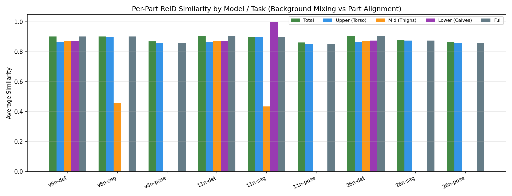
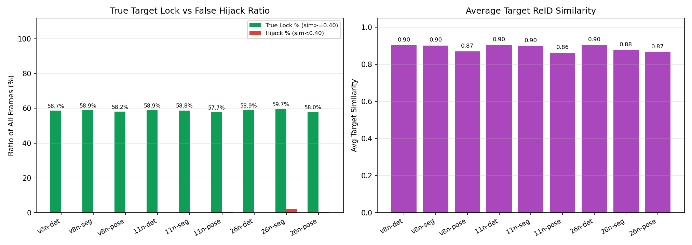
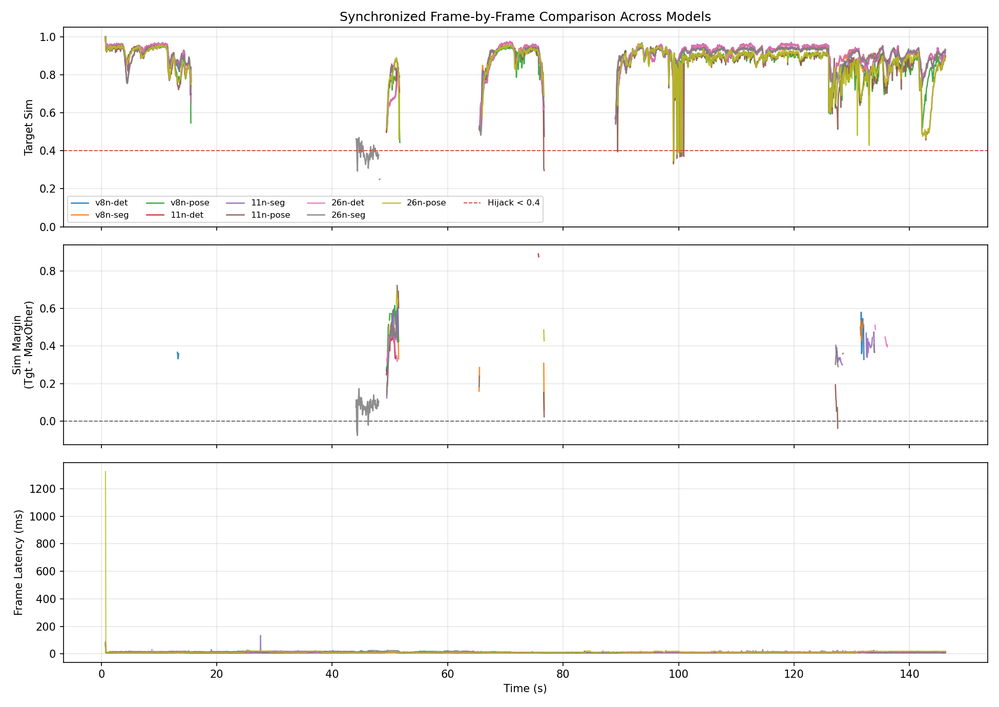

# Bag Benchmark Report: `model_benchmark`

- **Bag Path**: `/home/mu-01/Downloads/arti_benchmark_bags/model_benchmark`
- **Image Topic**: `/robot1/top_cam/image_raw/compressed` (`2184` frames evaluated)
- **Scan / TF**: `None` / `None`
- **Keyframes (`Δ=10f`)**: `q1@f546, recovered@f733`

## 0. 핵심 관찰 요약 (Auto Insights)

- **최고 연산 속도**: `v8n-det` (Infer `3.32ms`, Post+Trk `0.79ms`, Max `191.7 FPS`)
- **최고 진성 유지율 (`True Lock %`, sim>=0.4)**: `26n-seg` (`59.7%`, Avg Sim `0.877`)
- **최고 타인 변별 마진 (`Sim Margin`)**: `26n-pose` (평균 `0.592`, 최소 `0.427`)
- **Pose 부위 가용성 & BBox 폴백 비율**: `v8n-pose` M=0.3%/L=0.3%/FB=0.3%, `11n-pose` M=0.8%/L=0.8%/FB=0.8%, `26n-pose` M=0.7%/L=0.7%/FB=0.7%
- **추적 알고리즘 효과**: `1:ByteTrack` TrueLock=10.2% (Hijack=0.0%, Rec=0), `2:Task-ReID` TrueLock=58.2% (Hijack=0.2%, Rec=0), `3:BoT-SORT` TrueLock=10.2% (Hijack=0.1%, Rec=0), `4:BoT+ReID` TrueLock=58.2% (Hijack=0.5%, Rec=0), `5:Adaptive` TrueLock=58.0% (Hijack=0.2%, Rec=3)

## 1. 모델별 연산 · 후처리 속도 분해 (`5:Adaptive`)

| Model | Pre (ms) | Infer Mean / P95 (ms) | Post+Trk (ms) | ReID (ms) | Total Mean / P95 (ms) | Max FPS |
|---|---:|---:|---:|---:|---:|---:|
| v8n-det (`yolov8n.pt`) | 0.29 | 3.32 / 3.48 | 0.79 | 1.11 | 6.58 / 7.11 | 191.7 |
| v8n-seg (`yolov8n-seg.pt`) | 0.36 | 5.16 / 7.07 | 1.39 | 1.81 | 10.38 / 14.52 | 119.6 |
| v8n-pose (`yolov8n-pose.pt`) | 0.36 | 4.55 / 7.3 | 1.02 | 2.07 | 9.52 / 16.53 | 130.9 |
| 11n-det (`yolo11n.pt`) | 0.32 | 5.06 / 7.64 | 0.91 | 1.28 | 8.82 / 13.29 | 137.9 |
| 11n-seg (`yolo11n-seg.pt`) | 0.31 | 5.45 / 8.74 | 1.16 | 1.46 | 9.9 / 15.87 | 123.9 |
| 11n-pose (`yolo11n-pose.pt`) | 0.42 | 6.77 / 9.4 | 1.19 | 2.36 | 12.5 / 18.48 | 97.0 |
| 26n-det (`yolo26n.pt`) | 0.37 | 6.02 / 7.38 | 0.96 | 1.29 | 9.98 / 13.47 | 120.8 |
| 26n-seg (`yolo26n-seg.pt`) | 0.44 | 7.75 / 11.29 | 1.51 | 1.72 | 13.26 / 21.23 | 91.1 |
| 26n-pose (`yolo26n-pose.pt`) | 0.5 | 7.13 / 10.83 | 1.21 | 1.99 | 13.07 / 19.69 | 96.8 |

## 2. 특징 추출 용이성 · 부위 가용성 · 배경 분리 (`5:Adaptive`)

| Model | U / M / L Valid % | Pose Fallback % | Mask FG % | Avg Tgt Sim ± Std (Min) | U / M / L / F Avg Sim |
|---|---:|---:|---:|---:|---|
| v8n-det | 100.0% / 100.0% / 100.0% | 0.0% | 45.3% | 0.903 ± 0.07 (0.502) | 0.864 / 0.871 / 0.874 / 0.903 |
| v8n-seg | 100.0% / 0.7% / 0.2% | 0.0% | 47.3% | 0.902 ± 0.057 (0.475) | 0.901 / 0.457 / - / 0.902 |
| v8n-pose | 100.0% / 0.3% / 0.3% | 0.3% | 13.1% | 0.87 ± 0.074 (0.39) | 0.861 / - / - / 0.861 |
| 11n-det | 100.0% / 100.0% / 100.0% | 0.0% | 45.3% | 0.904 ± 0.07 (0.497) | 0.864 / 0.871 / 0.874 / 0.904 |
| 11n-seg | 100.0% / 0.8% / 0.3% | 0.0% | 47.2% | 0.899 ± 0.059 (0.477) | 0.898 / 0.435 / 1.0 / 0.899 |
| 11n-pose | 100.0% / 0.8% / 0.8% | 0.8% | 13.3% | 0.862 ± 0.096 (0.296) | 0.851 / - / - / 0.852 |
| 26n-det | 100.0% / 100.0% / 100.0% | 0.0% | 45.3% | 0.904 ± 0.069 (0.52) | 0.864 / 0.871 / 0.875 / 0.904 |
| 26n-seg | 100.0% / 5.0% / 4.7% | 0.0% | 47.2% | 0.877 ± 0.123 (0.249) | 0.876 / - / - / 0.875 |
| 26n-pose | 100.0% / 0.7% / 0.7% | 0.7% | 13.2% | 0.866 ± 0.091 (0.347) | 0.858 / - / - / 0.859 |

## 3. 재식별 변별력 · 혼잡 · 오인식 방어 (`5:Adaptive`)

> `True Lock %`: 전체 프레임 중 유사도 `>=0.4`로 실제 타겟을 유지한 비율 · `Hijack %`: 유사도 `<0.4` 오탐 잠금 비율

| Model | Det % | >=2P % | Locked % | True Lock % | Hijack % | Direct Sw | Recovered (Avg f) | Other Avg / Max | Margin Mean / Min |
|---|---:|---:|---:|---:|---:|---:|---:|---:|---:|
| v8n-det | 99.6% | 38.8% | 59.0% | **58.7%** | 0.0% | 0 | 3 (300.3f) | 0.306 / 0.502 | 0.404 / 0.269 |
| v8n-seg | 99.8% | 39.0% | 59.0% | **58.9%** | 0.0% | 0 | 3 (299.3f) | 0.35 / 0.413 | 0.42 / 0.062 |
| v8n-pose | 99.7% | 38.9% | 58.4% | **58.2%** | 0.0% | 0 | 3 (304.3f) | 0.224 / 0.35 | 0.522 / 0.264 |
| 11n-det | 99.8% | 38.4% | 59.0% | **58.9%** | 0.0% | 0 | 4 (224.5f) | 0.243 / 0.361 | 0.413 / 0.247 |
| 11n-seg | 99.8% | 40.8% | 58.9% | **58.8%** | 0.0% | 0 | 3 (299.7f) | 0.395 / 0.51 | 0.393 / 0.084 |
| 11n-pose | 99.7% | 38.0% | 58.3% | **57.7%** | 0.5% | 0 | 3 (304.7f) | 0.355 / 0.571 | 0.294 / -0.038 |
| 26n-det | 99.8% | 39.1% | 59.0% | **58.9%** | 0.0% | 0 | 3 (299.3f) | 0.293 / 0.448 | 0.408 / 0.297 |
| 26n-seg | 99.8% | 39.2% | 61.8% | **59.7%** | 2.0% | 1 | 4 (167.4f) | 0.324 / 0.513 | 0.212 / -0.076 |
| 26n-pose | 99.8% | 37.4% | 58.4% | **58.0%** | 0.2% | 0 | 3 (304.0f) | 0.226 / 0.27 | 0.592 / 0.427 |

## 4. 추적 알고리즘 비교 (`yolo26n-pose`)

| Mode | Locked % | True Lock % | Hijack % | SEARCH % | GUARD % | Direct Sw | Recovered (Avg f) | Avg Tgt Sim | Total (ms) |
|---|---:|---:|---:|---:|---:|---:|---:|---:|---:|
| 1:ByteTrack | 10.2% | **10.2%** | 0.0% | 0.0% | 0.0% | 0 | 0 | 0.856 | 12.78 |
| 2:Task-ReID | 58.5% | **58.2%** | 0.2% | 0.0% | 0.0% | 3 | 0 | 0.866 | 11.73 |
| 3:BoT-SORT | 10.3% | **10.2%** | 0.1% | 0.0% | 0.0% | 0 | 0 | 0.853 | 14.81 |
| 4:BoT+ReID | 58.8% | **58.2%** | 0.5% | 0.0% | 0.0% | 3 | 0 | 0.861 | 14.11 |
| 5:Adaptive | 58.4% | **58.0%** | 0.2% | 41.8% | 0.3% | 0 | 3 (304.0f) | 0.866 | 9.99 |

## 5.5 Ground Truth(GT) 기반 실제 추적 정확도 (IoU >= 0.5)

| Experiment | Mode | GT Pos / Neg (f) | GT True Lock % | GT Hijack % | GT Miss % | GT False Lock % | Mean IoU | Fail Episodes (예상 개입) |
|---|---|---:|---:|---:|---:|---:|---:|---:|
| v8n-det | 5:Adaptive | 1301 / 883 | **98.5%** | 0.0% | 1.5% | 0.1% | 0.973 | 3 |
| v8n-seg | 5:Adaptive | 1301 / 883 | **98.7%** | 0.0% | 1.3% | 0.2% | 0.974 | 3 |
| v8n-pose | 5:Adaptive | 1301 / 883 | **97.5%** | 0.1% | 2.4% | 0.1% | 0.979 | 5 |
| 11n-det | 5:Adaptive | 1301 / 883 | **98.7%** | 0.0% | 1.3% | 0.2% | 0.976 | 4 |
| 11n-seg | 5:Adaptive | 1301 / 883 | **98.7%** | 0.0% | 1.3% | 0.1% | 0.969 | 2 |
| 11n-pose | 5:Adaptive | 1301 / 883 | **97.4%** | 0.2% | 2.5% | 0.1% | 0.972 | 6 |
| 26n-det | 5:Adaptive | 1301 / 883 | **98.7%** | 0.0% | 1.3% | 0.2% | 0.979 | 3 |
| 26n-seg | 5:Adaptive | 1301 / 883 | **98.7%** | 0.0% | 1.3% | 7.1% | 1.0 | 3 |
| 26n-pose | 5:Adaptive | 1301 / 883 | **97.6%** | 0.1% | 2.3% | 0.1% | 0.958 | 5 |
| mode_1 | 1:ByteTrack | 1301 / 883 | **17.1%** | 0.1% | 82.9% | 0.0% | 0.944 | 4 |
| mode_2 | 2:Task-ReID | 1301 / 883 | **97.8%** | 0.1% | 2.1% | 0.1% | 0.958 | 5 |
| mode_3 | 3:BoT-SORT | 1301 / 883 | **17.1%** | 0.1% | 82.8% | 0.1% | 0.929 | 4 |
| mode_4 | 4:BoT+ReID | 1301 / 883 | **97.8%** | 0.4% | 1.8% | 0.3% | 0.946 | 6 |
| mode_5 | 5:Adaptive | 1301 / 883 | **97.6%** | 0.1% | 2.3% | 0.1% | 0.958 | 5 |

## 6. 시각 검증 스냅샷 (`snapshots/`)

- `compare_tasks_hist_q1_f0546.png`
  
- `compare_versions_q1_f0546.png`
  
- `compare_pixels_q1_f0546.png`
  
- `compare_seq_q1_f0546.png`
  
- `compare_tasks_hist_recovered_f0733.png`
  
- `compare_versions_recovered_f0733.png`
  
- `compare_pixels_recovered_f0733.png`
  
- `compare_seq_recovered_f0733.png`
  
