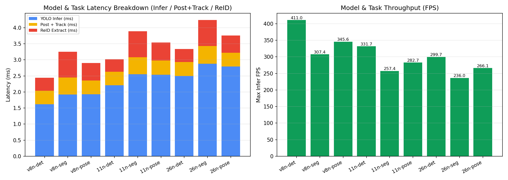
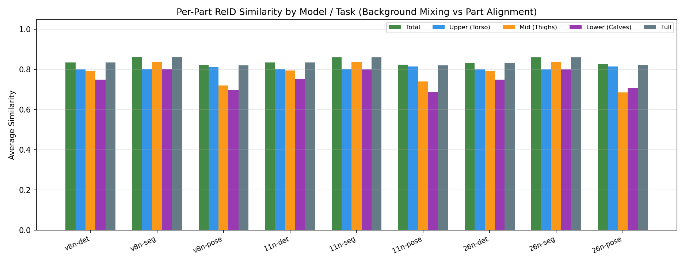
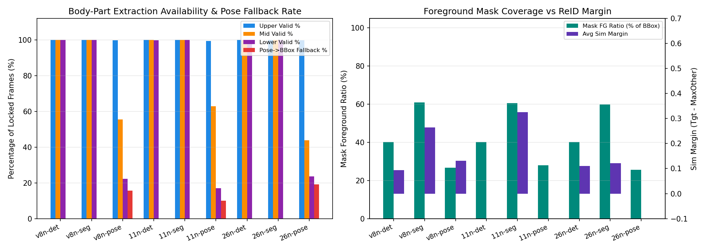
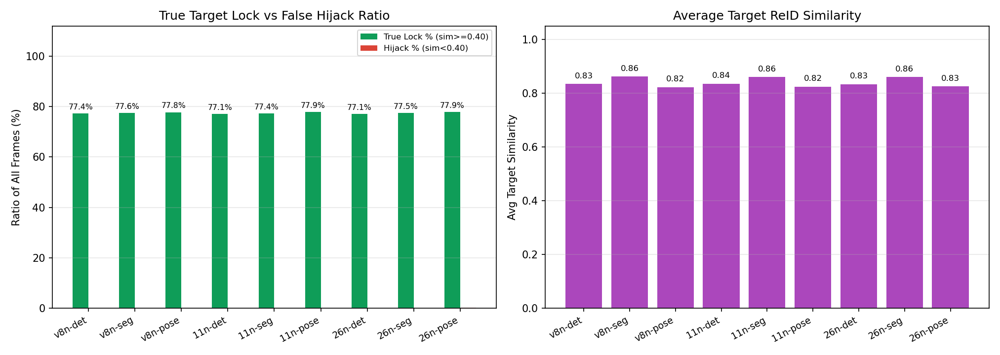
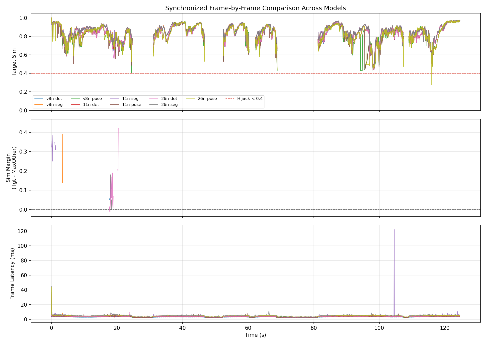
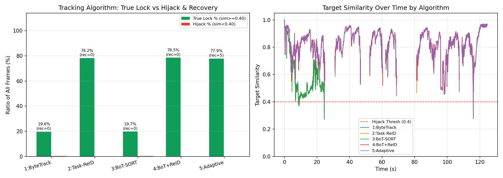

# Bag Benchmark Report: `one_man`

- **Bag Path**: `/home/jsb/bag/one_man`
- **Image Topic**: `/robot4/top_cam/image_raw/compressed` (`1870` frames evaluated)
- **Scan / TF**: `None` / `None`
- **Keyframes (`Δ=10f`)**: `recovered@f467, mid@f935`

## 0. 핵심 관찰 요약 (Auto Insights)

- **최고 연산 속도**: `v8n-det` (Infer `1.62ms`, Post+Trk `0.42ms`, Max `411.0 FPS`)
- **최고 진성 유지율 (`True Lock %`, sim>=0.4)**: `26n-pose` (`77.9%`, Avg Sim `0.826`)
- **최고 타인 변별 마진 (`Sim Margin`)**: `11n-seg` (평균 `0.326`, 최소 `0.25`)
- **Pose 부위 가용성 & BBox 폴백 비율**: `v8n-pose` M=55.4%/L=22.2%/FB=15.6%, `11n-pose` M=62.8%/L=17.0%/FB=10.1%, `26n-pose` M=43.8%/L=23.7%/FB=19.2%
- **추적 알고리즘 효과**: `1:ByteTrack` TrueLock=19.6% (Hijack=0.3%, Rec=0), `2:Task-ReID` TrueLock=78.2% (Hijack=0.1%, Rec=0), `3:BoT-SORT` TrueLock=19.7% (Hijack=0.3%, Rec=0), `4:BoT+ReID` TrueLock=78.5% (Hijack=0.1%, Rec=0), `5:Adaptive` TrueLock=77.9% (Hijack=0.1%, Rec=5)

## 1. 모델별 연산 · 후처리 속도 분해 (`5:Adaptive`)

| Model | Pre (ms) | Infer Mean / P95 (ms) | Post+Trk (ms) | ReID (ms) | Total Mean / P95 (ms) | Max FPS |
|---|---:|---:|---:|---:|---:|---:|
| v8n-det (`yolov8n.pt`) | 0.17 | 1.62 / 1.66 | 0.42 | 0.4 | 3.13 / 3.74 | 411.0 |
| v8n-seg (`yolov8n-seg.pt`) | 0.17 | 1.92 / 1.98 | 0.53 | 0.8 | 4.09 / 5.37 | 307.4 |
| v8n-pose (`yolov8n-pose.pt`) | 0.19 | 1.93 / 1.98 | 0.43 | 0.54 | 3.74 / 4.77 | 345.6 |
| 11n-det (`yolo11n.pt`) | 0.16 | 2.21 / 2.26 | 0.42 | 0.39 | 3.72 / 4.31 | 331.7 |
| 11n-seg (`yolo11n-seg.pt`) | 0.17 | 2.55 / 2.61 | 0.53 | 0.81 | 4.73 / 6.07 | 257.4 |
| 11n-pose (`yolo11n-pose.pt`) | 0.18 | 2.54 / 2.65 | 0.44 | 0.56 | 4.39 / 5.47 | 282.7 |
| 26n-det (`yolo26n.pt`) | 0.18 | 2.5 / 2.57 | 0.43 | 0.41 | 4.07 / 4.66 | 299.7 |
| 26n-seg (`yolo26n-seg.pt`) | 0.18 | 2.88 / 2.99 | 0.55 | 0.81 | 5.1 / 6.36 | 236.0 |
| 26n-pose (`yolo26n-pose.pt`) | 0.19 | 2.79 / 2.85 | 0.43 | 0.54 | 4.63 / 5.65 | 266.1 |

## 2. 특징 추출 용이성 · 부위 가용성 · 배경 분리 (`5:Adaptive`)

| Model | U / M / L Valid % | Pose Fallback % | Mask FG % | Avg Tgt Sim ± Std (Min) | U / M / L / F Avg Sim |
|---|---:|---:|---:|---:|---|
| v8n-det | 100.0% / 100.0% / 99.9% | 0.0% | 40.2% | 0.835 ± 0.085 (0.437) | 0.801 / 0.793 / 0.749 / 0.835 |
| v8n-seg | 100.0% / 100.0% / 100.0% | 0.0% | 61.0% | 0.862 ± 0.078 (0.489) | 0.802 / 0.838 / 0.803 / 0.862 |
| v8n-pose | 99.7% / 55.4% / 22.2% | 15.6% | 26.7% | 0.823 ± 0.107 (0.407) | 0.813 / 0.72 / 0.698 / 0.82 |
| 11n-det | 100.0% / 100.0% / 99.7% | 0.0% | 40.2% | 0.836 ± 0.084 (0.439) | 0.802 / 0.795 / 0.751 / 0.836 |
| 11n-seg | 100.0% / 100.0% / 100.0% | 0.0% | 60.6% | 0.861 ± 0.078 (0.482) | 0.802 / 0.838 / 0.801 / 0.861 |
| 11n-pose | 99.4% / 62.8% / 17.0% | 10.1% | 27.9% | 0.825 ± 0.1 (0.439) | 0.815 / 0.741 / 0.688 / 0.821 |
| 26n-det | 100.0% / 100.0% / 99.7% | 0.0% | 40.2% | 0.834 ± 0.086 (0.441) | 0.801 / 0.792 / 0.749 / 0.834 |
| 26n-seg | 100.0% / 100.0% / 100.0% | 0.0% | 59.8% | 0.86 ± 0.079 (0.474) | 0.8 / 0.838 / 0.8 / 0.86 |
| 26n-pose | 99.7% / 43.8% / 23.7% | 19.2% | 25.6% | 0.826 ± 0.102 (0.278) | 0.815 / 0.686 / 0.708 / 0.823 |

## 3. 재식별 변별력 · 혼잡 · 오인식 방어 (`5:Adaptive`)

> `True Lock %`: 전체 프레임 중 유사도 `>=0.4`로 실제 타겟을 유지한 비율 · `Hijack %`: 유사도 `<0.4` 오탐 잠금 비율

| Model | Det % | >=2P % | Locked % | True Lock % | Hijack % | Direct Sw | Recovered (Avg f) | Other Avg / Max | Margin Mean / Min |
|---|---:|---:|---:|---:|---:|---:|---:|---:|---:|
| v8n-det | 77.6% | 0.4% | 99.7% | **77.4%** | 0.0% | 0 | 5 (70.5f) | 0.671 / 0.697 | 0.094 / 0.051 |
| v8n-seg | 77.9% | 0.1% | 99.7% | **77.6%** | 0.0% | 0 | 5 (83.6f) | 0.55 / 0.667 | 0.265 / 0.139 |
| v8n-pose | 78.1% | 0.1% | 99.6% | **77.8%** | 0.0% | 0 | 5 (83.0f) | 0.658 / 0.658 | 0.131 / 0.131 |
| 11n-det | 77.4% | 0.0% | 99.6% | **77.1%** | 0.0% | 0 | 5 (71.5f) | - | - |
| 11n-seg | 77.7% | 0.5% | 99.7% | **77.4%** | 0.0% | 0 | 5 (84.4f) | 0.589 / 0.624 | 0.326 / 0.25 |
| 11n-pose | 78.1% | 0.0% | 99.7% | **77.9%** | 0.0% | 0 | 5 (82.8f) | - | - |
| 26n-det | 77.3% | 1.2% | 99.7% | **77.1%** | 0.0% | 0 | 5 (85.8f) | 0.567 / 0.744 | 0.111 / -0.012 |
| 26n-seg | 77.9% | 0.5% | 99.6% | **77.5%** | 0.0% | 0 | 6 (70.0f) | 0.684 / 0.759 | 0.122 / 0.002 |
| 26n-pose | 78.2% | 0.0% | 99.7% | **77.9%** | 0.1% | 0 | 5 (82.4f) | - | - |

## 4. 추적 알고리즘 비교 (`yolo26n-pose`)

| Mode | Locked % | True Lock % | Hijack % | SEARCH % | GUARD % | Direct Sw | Recovered (Avg f) | Avg Tgt Sim | Total (ms) |
|---|---:|---:|---:|---:|---:|---:|---:|---:|---:|
| 1:ByteTrack | 25.4% | **19.6%** | 0.3% | 0.0% | 0.0% | 0 | 0 | 0.584 | 4.44 |
| 2:Task-ReID | 100.0% | **78.2%** | 0.1% | 0.0% | 0.0% | 5 | 0 | 0.826 | 4.71 |
| 3:BoT-SORT | 25.4% | **19.7%** | 0.3% | 0.0% | 0.0% | 0 | 0 | 0.584 | 7.09 |
| 4:BoT+ReID | 100.0% | **78.5%** | 0.1% | 0.0% | 0.0% | 5 | 0 | 0.826 | 7.23 |
| 5:Adaptive | 99.7% | **77.9%** | 0.1% | 22.0% | 0.0% | 0 | 5 (82.4f) | 0.826 | 4.59 |

## 6. 시각 검증 스냅샷 (`snapshots/`)

- `compare_tasks_hist_recovered_f0467.png`
  
- `compare_versions_recovered_f0467.png`
  
- `compare_pixels_recovered_f0467.png`
  
- `compare_seq_recovered_f0467.png`
  
- `compare_tasks_hist_mid_f0935.png`
  
- `compare_versions_mid_f0935.png`
  
- `compare_pixels_mid_f0935.png`
  
- `compare_seq_mid_f0935.png`
  
