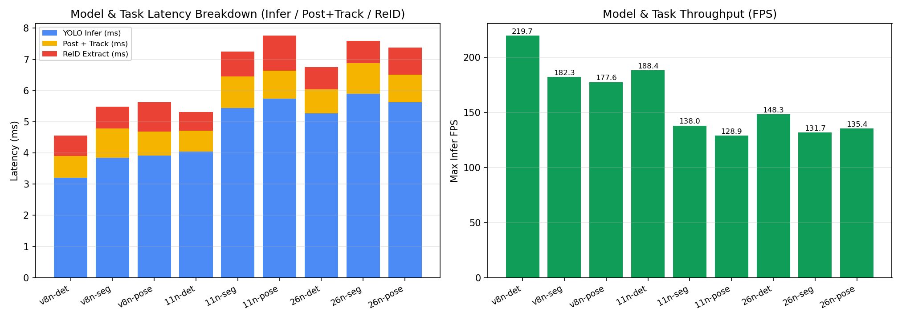
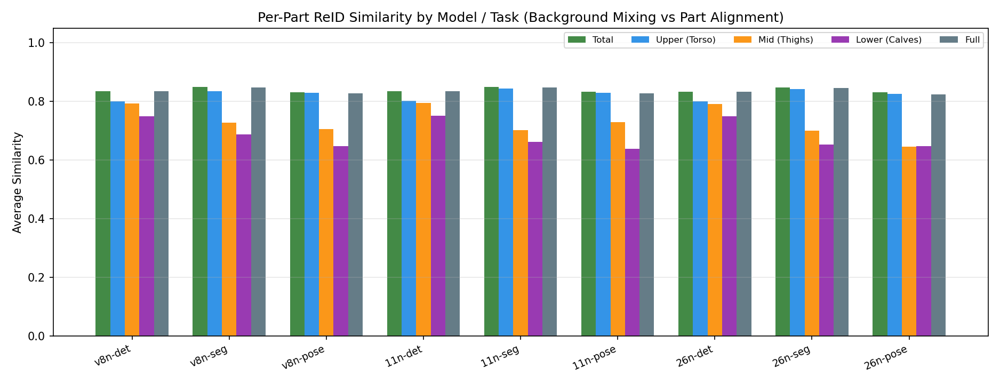
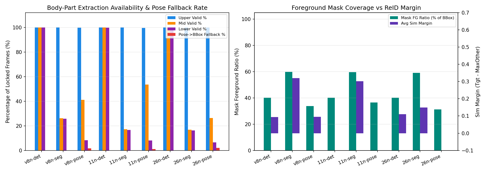
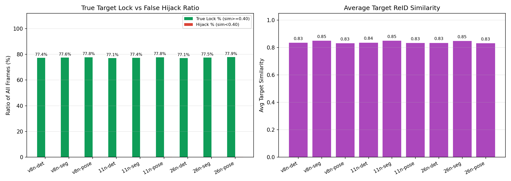
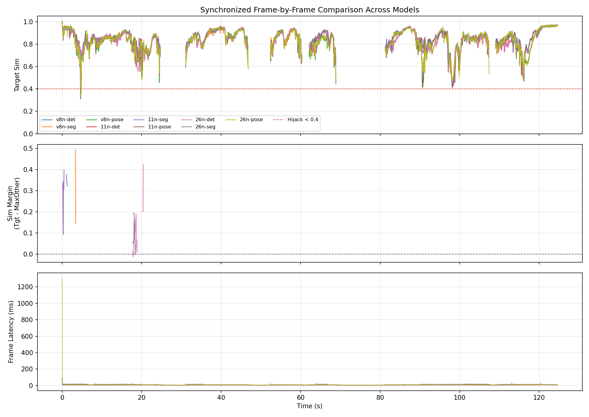
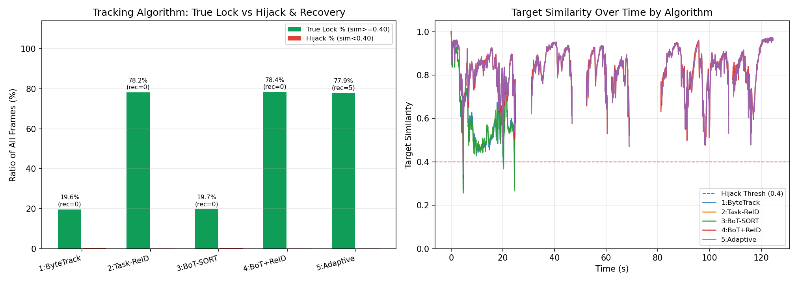

# Bag Benchmark Report: `one_man`

- **Bag Path**: `/home/mu-01/Downloads/arti_benchmark_bags/one_man`
- **Image Topic**: `/robot4/top_cam/image_raw/compressed` (`1870` frames evaluated)
- **Scan / TF**: `None` / `None`
- **Keyframes (`Δ=10f`)**: `recovered@f467, mid@f935`

## 0. 핵심 관찰 요약 (Auto Insights)

- **최고 연산 속도**: `v8n-det` (Infer `3.2ms`, Post+Trk `0.7ms`, Max `219.7 FPS`)
- **최고 진성 유지율 (`True Lock %`, sim>=0.4)**: `26n-pose` (`77.9%`, Avg Sim `0.832`)
- **최고 타인 변별 마진 (`Sim Margin`)**: `v8n-seg` (평균 `0.32`, 최소 `0.146`)
- **Pose 부위 가용성 & BBox 폴백 비율**: `v8n-pose` M=41.1%/L=8.3%/FB=1.7%, `11n-pose` M=53.6%/L=8.0%/FB=1.1%, `26n-pose` M=26.3%/L=6.6%/FB=2.1%
- **추적 알고리즘 효과**: `1:ByteTrack` TrueLock=19.6% (Hijack=0.3%, Rec=0), `2:Task-ReID` TrueLock=78.2% (Hijack=0.1%, Rec=0), `3:BoT-SORT` TrueLock=19.7% (Hijack=0.3%, Rec=0), `4:BoT+ReID` TrueLock=78.4% (Hijack=0.1%, Rec=0), `5:Adaptive` TrueLock=77.9% (Hijack=0.1%, Rec=5)

## 1. 모델별 연산 · 후처리 속도 분해 (`5:Adaptive`)

| Model | Pre (ms) | Infer Mean / P95 (ms) | Post+Trk (ms) | ReID (ms) | Total Mean / P95 (ms) | Max FPS |
|---|---:|---:|---:|---:|---:|---:|
| v8n-det (`yolov8n.pt`) | 0.28 | 3.2 / 3.92 | 0.7 | 0.65 | 5.72 / 9.9 | 219.7 |
| v8n-seg (`yolov8n-seg.pt`) | 0.29 | 3.85 / 4.39 | 0.93 | 0.71 | 6.9 / 8.83 | 182.3 |
| v8n-pose (`yolov8n-pose.pt`) | 0.3 | 3.92 / 4.52 | 0.77 | 0.93 | 7.08 / 9.06 | 177.6 |
| 11n-det (`yolo11n.pt`) | 0.28 | 4.04 / 4.26 | 0.67 | 0.6 | 6.44 / 7.63 | 188.4 |
| 11n-seg (`yolo11n-seg.pt`) | 0.31 | 5.44 / 8.78 | 1.01 | 0.8 | 8.84 / 15.06 | 138.0 |
| 11n-pose (`yolo11n-pose.pt`) | 0.35 | 5.74 / 9.18 | 0.9 | 1.12 | 9.45 / 16.4 | 128.9 |
| 26n-det (`yolo26n.pt`) | 0.31 | 5.27 / 8.56 | 0.77 | 0.71 | 8.03 / 14.17 | 148.3 |
| 26n-seg (`yolo26n-seg.pt`) | 0.3 | 5.89 / 6.84 | 0.99 | 0.71 | 9.08 / 11.05 | 131.7 |
| 26n-pose (`yolo26n-pose.pt`) | 0.41 | 5.63 / 6.04 | 0.88 | 0.87 | 9.46 / 10.49 | 135.4 |

## 2. 특징 추출 용이성 · 부위 가용성 · 배경 분리 (`5:Adaptive`)

| Model | U / M / L Valid % | Pose Fallback % | Mask FG % | Avg Tgt Sim ± Std (Min) | U / M / L / F Avg Sim |
|---|---:|---:|---:|---:|---|
| v8n-det | 100.0% / 100.0% / 99.9% | 0.0% | 40.2% | 0.835 ± 0.085 (0.437) | 0.801 / 0.793 / 0.749 / 0.835 |
| v8n-seg | 100.0% / 26.2% / 25.7% | 0.0% | 59.9% | 0.849 ± 0.078 (0.484) | 0.835 / 0.728 / 0.688 / 0.847 |
| v8n-pose | 99.8% / 41.1% / 8.3% | 1.7% | 33.8% | 0.832 ± 0.095 (0.347) | 0.829 / 0.706 / 0.647 / 0.827 |
| 11n-det | 100.0% / 100.0% / 99.7% | 0.0% | 40.2% | 0.836 ± 0.084 (0.439) | 0.802 / 0.795 / 0.751 / 0.836 |
| 11n-seg | 100.0% / 17.2% / 16.6% | 0.0% | 59.7% | 0.849 ± 0.079 (0.453) | 0.844 / 0.703 / 0.662 / 0.847 |
| 11n-pose | 99.5% / 53.6% / 8.0% | 1.1% | 36.6% | 0.833 ± 0.098 (0.311) | 0.83 / 0.729 / 0.639 / 0.828 |
| 26n-det | 100.0% / 100.0% / 99.7% | 0.0% | 40.2% | 0.834 ± 0.086 (0.441) | 0.801 / 0.792 / 0.749 / 0.834 |
| 26n-seg | 100.0% / 16.8% / 16.3% | 0.0% | 59.1% | 0.848 ± 0.081 (0.447) | 0.843 / 0.701 / 0.653 / 0.846 |
| 26n-pose | 99.9% / 26.3% / 6.6% | 2.1% | 31.3% | 0.832 ± 0.094 (0.341) | 0.826 / 0.645 / 0.648 / 0.825 |

## 3. 재식별 변별력 · 혼잡 · 오인식 방어 (`5:Adaptive`)

> `True Lock %`: 전체 프레임 중 유사도 `>=0.4`로 실제 타겟을 유지한 비율 · `Hijack %`: 유사도 `<0.4` 오탐 잠금 비율

| Model | Det % | >=2P % | Locked % | True Lock % | Hijack % | Direct Sw | Recovered (Avg f) | Other Avg / Max | Margin Mean / Min |
|---|---:|---:|---:|---:|---:|---:|---:|---:|---:|
| v8n-det | 77.6% | 0.4% | 99.7% | **77.4%** | 0.0% | 0 | 5 (70.5f) | 0.671 / 0.697 | 0.094 / 0.051 |
| v8n-seg | 77.9% | 0.1% | 99.7% | **77.6%** | 0.0% | 0 | 5 (83.6f) | 0.494 / 0.654 | 0.32 / 0.146 |
| v8n-pose | 78.1% | 0.1% | 99.7% | **77.8%** | 0.1% | 0 | 5 (82.8f) | 0.695 / 0.695 | 0.095 / 0.095 |
| 11n-det | 77.4% | 0.0% | 99.6% | **77.1%** | 0.0% | 0 | 5 (71.5f) | - | - |
| 11n-seg | 77.7% | 0.5% | 99.7% | **77.4%** | 0.0% | 0 | 5 (84.4f) | 0.603 / 0.782 | 0.302 / 0.094 |
| 11n-pose | 78.1% | 0.0% | 99.7% | **77.8%** | 0.1% | 0 | 5 (82.8f) | - | - |
| 26n-det | 77.3% | 1.2% | 99.7% | **77.1%** | 0.0% | 0 | 5 (85.8f) | 0.567 / 0.744 | 0.111 / -0.012 |
| 26n-seg | 77.9% | 0.5% | 99.6% | **77.5%** | 0.0% | 0 | 6 (70.0f) | 0.647 / 0.738 | 0.149 / -0.002 |
| 26n-pose | 78.2% | 0.0% | 99.7% | **77.9%** | 0.1% | 0 | 5 (82.4f) | - | - |

## 4. 추적 알고리즘 비교 (`yolo26n-pose`)

| Mode | Locked % | True Lock % | Hijack % | SEARCH % | GUARD % | Direct Sw | Recovered (Avg f) | Avg Tgt Sim | Total (ms) |
|---|---:|---:|---:|---:|---:|---:|---:|---:|---:|
| 1:ByteTrack | 25.4% | **19.6%** | 0.3% | 0.0% | 0.0% | 0 | 0 | 0.604 | 8.4 |
| 2:Task-ReID | 100.0% | **78.2%** | 0.1% | 0.0% | 0.0% | 5 | 0 | 0.832 | 8.78 |
| 3:BoT-SORT | 25.4% | **19.7%** | 0.3% | 0.0% | 0.0% | 0 | 0 | 0.602 | 12.5 |
| 4:BoT+ReID | 100.0% | **78.4%** | 0.1% | 0.0% | 0.0% | 5 | 0 | 0.833 | 13.5 |
| 5:Adaptive | 99.7% | **77.9%** | 0.1% | 22.0% | 0.0% | 0 | 5 (82.4f) | 0.832 | 10.04 |

## 5.5 Ground Truth(GT) 기반 실제 추적 정확도 (IoU >= 0.5)

| Experiment | Mode | GT Pos / Neg (f) | GT True Lock % | GT Hijack % | GT Miss % | GT False Lock % | Mean IoU | Fail Episodes (예상 개입) |
|---|---|---:|---:|---:|---:|---:|---:|---:|
| v8n-det | 5:Adaptive | 1450 / 420 | **99.7%** | 0.0% | 0.3% | 0.5% | 0.983 | 7 |
| v8n-seg | 5:Adaptive | 1450 / 420 | **99.9%** | 0.0% | 0.1% | 0.7% | 0.978 | 4 |
| v8n-pose | 5:Adaptive | 1450 / 420 | **99.9%** | 0.0% | 0.1% | 1.7% | 0.971 | 6 |
| 11n-det | 5:Adaptive | 1450 / 420 | **99.3%** | 0.0% | 0.7% | 0.2% | 0.981 | 6 |
| 11n-seg | 5:Adaptive | 1450 / 420 | **99.7%** | 0.0% | 0.3% | 0.5% | 0.978 | 5 |
| 11n-pose | 5:Adaptive | 1450 / 420 | **99.9%** | 0.0% | 0.1% | 1.9% | 0.972 | 8 |
| 26n-det | 5:Adaptive | 1450 / 420 | **99.4%** | 0.0% | 0.6% | 0.0% | 0.979 | 4 |
| 26n-seg | 5:Adaptive | 1450 / 420 | **100.0%** | 0.0% | 0.0% | 0.0% | 1.0 | 0 |
| 26n-pose | 5:Adaptive | 1450 / 420 | **99.9%** | 0.0% | 0.1% | 2.1% | 0.972 | 8 |
| mode_1 | 1:ByteTrack | 1450 / 420 | **25.6%** | 0.0% | 74.4% | 0.2% | 0.969 | 7 |
| mode_2 | 2:Task-ReID | 1450 / 420 | **99.9%** | 0.0% | 0.1% | 3.3% | 0.972 | 10 |
| mode_3 | 3:BoT-SORT | 1450 / 420 | **25.6%** | 0.0% | 74.4% | 0.5% | 0.883 | 7 |
| mode_4 | 4:BoT+ReID | 1450 / 420 | **99.9%** | 0.1% | 0.0% | 4.5% | 0.89 | 10 |
| mode_5 | 5:Adaptive | 1450 / 420 | **99.9%** | 0.0% | 0.1% | 2.1% | 0.972 | 8 |

## 6. 시각 검증 스냅샷 (`snapshots/`)

- `compare_tasks_hist_recovered_f0467.png`
  
- `compare_versions_recovered_f0467.png`
  
- `compare_pixels_recovered_f0467.png`
  
- `compare_seq_recovered_f0467.png`
  
- `compare_tasks_hist_mid_f0935.png`
  
- `compare_versions_mid_f0935.png`
  
- `compare_pixels_mid_f0935.png`
  
- `compare_seq_mid_f0935.png`
  
