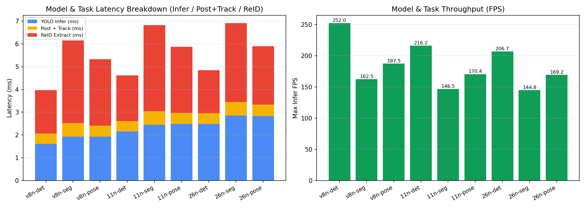
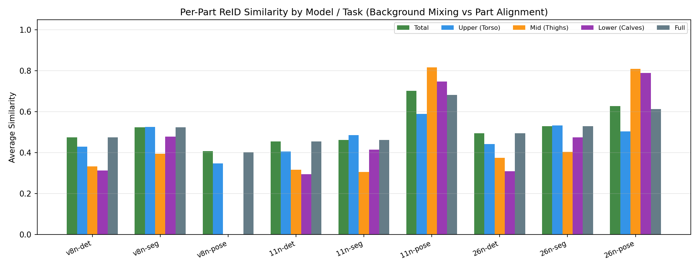
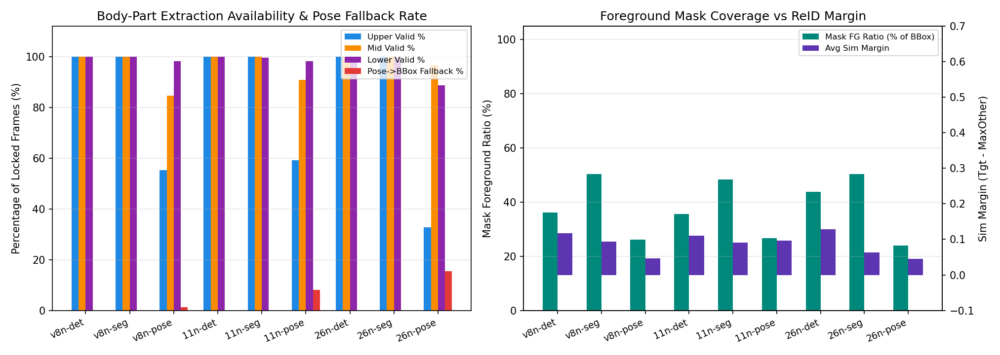
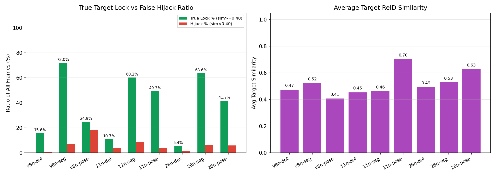
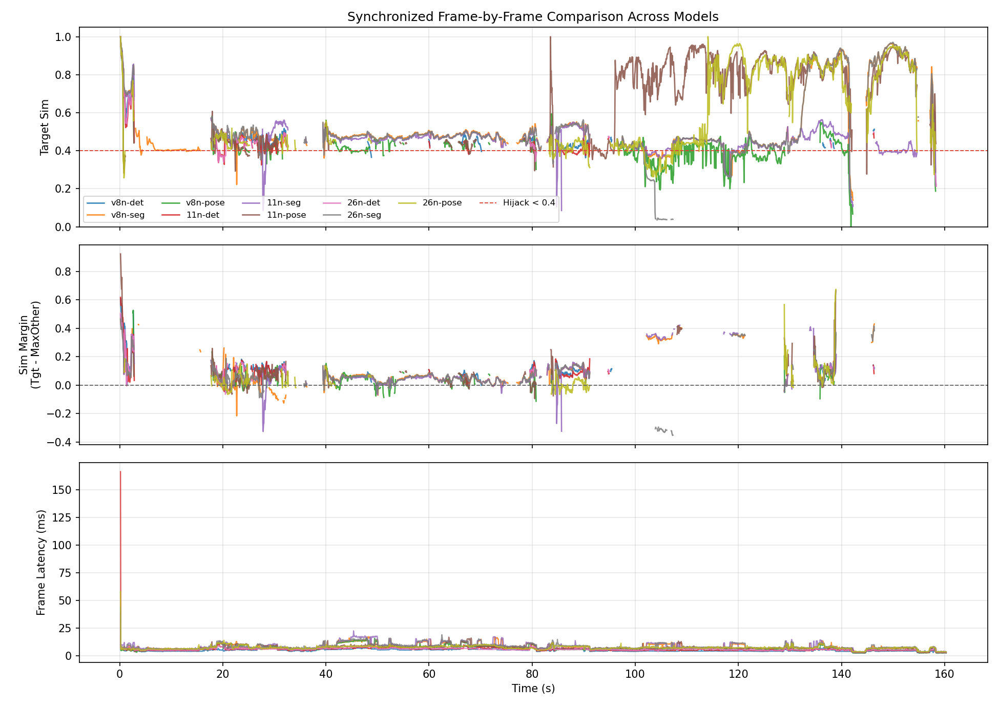
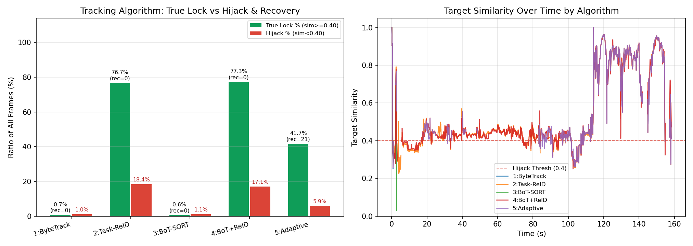
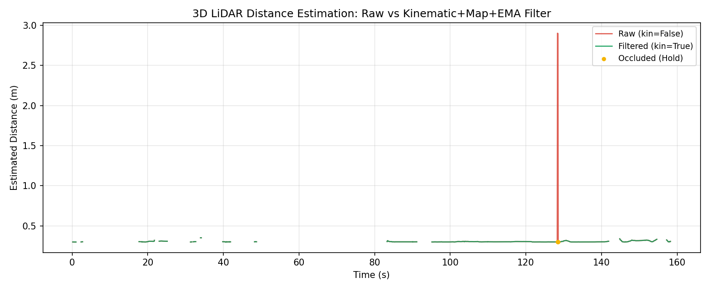

# Bag Benchmark Report: `pose_estimate2`

- **Bag Path**: `/home/jsb/bag3/pose_estimate2`
- **Image Topic**: `/robot4/top_cam/image_raw/compressed` (`2403` frames evaluated)
- **Scan / TF**: `/robot4/scan` / `/robot4/tf`
- **Keyframes (`Δ=10f`)**: `recovered@f34, q1@f601`

## 0. 핵심 관찰 요약 (Auto Insights)

- **최고 연산 속도**: `v8n-det` (Infer `1.61ms`, Post+Trk `0.46ms`, Max `252.0 FPS`)
- **최고 진성 유지율 (`True Lock %`, sim>=0.4)**: `v8n-seg` (`72.0%`, Avg Sim `0.523`)
- **최고 타인 변별 마진 (`Sim Margin`)**: `26n-det` (평균 `0.128`, 최소 `-0.063`)
- **Pose 부위 가용성 & BBox 폴백 비율**: `v8n-pose` M=84.6%/L=98.2%/FB=1.3%, `11n-pose` M=90.8%/L=98.3%/FB=8.0%, `26n-pose` M=96.7%/L=88.7%/FB=15.4%
- **추적 알고리즘 효과**: `1:ByteTrack` TrueLock=0.7% (Hijack=1.0%, Rec=0), `2:Task-ReID` TrueLock=76.7% (Hijack=18.4%, Rec=0), `3:BoT-SORT` TrueLock=0.6% (Hijack=1.1%, Rec=0), `4:BoT+ReID` TrueLock=77.3% (Hijack=17.1%, Rec=0), `5:Adaptive` TrueLock=41.7% (Hijack=5.9%, Rec=21)
- **LiDAR 필터링 효과**: Jumps `0 -> 0`, FarCamEst `3 -> 0`, AMCL Wall/Out `0 -> 0`, Occluded Hold `3f`

## 1. 모델별 연산 · 후처리 속도 분해 (`5:Adaptive`)

| Model | Pre (ms) | Infer Mean / P95 (ms) | Post+Trk (ms) | ReID (ms) | Total Mean / P95 (ms) | Max FPS |
|---|---:|---:|---:|---:|---:|---:|
| v8n-det (`yolov8n.pt`) | 0.2 | 1.61 / 1.68 | 0.46 | 1.9 | 4.79 / 6.78 | 252.0 |
| v8n-seg (`yolov8n-seg.pt`) | 0.2 | 1.92 / 2.01 | 0.6 | 3.63 | 7.61 / 13.0 | 162.5 |
| v8n-pose (`yolov8n-pose.pt`) | 0.21 | 1.92 / 2.0 | 0.49 | 2.92 | 6.49 / 11.45 | 187.5 |
| 11n-det (`yolo11n.pt`) | 0.2 | 2.16 / 2.23 | 0.45 | 2.01 | 5.51 / 7.42 | 216.2 |
| 11n-seg (`yolo11n-seg.pt`) | 0.2 | 2.44 / 2.52 | 0.6 | 3.79 | 8.19 / 13.89 | 146.5 |
| 11n-pose (`yolo11n-pose.pt`) | 0.21 | 2.48 / 2.59 | 0.49 | 2.9 | 7.13 / 10.39 | 170.4 |
| 26n-det (`yolo26n.pt`) | 0.21 | 2.49 / 2.62 | 0.47 | 1.88 | 5.65 / 7.64 | 206.7 |
| 26n-seg (`yolo26n-seg.pt`) | 0.21 | 2.85 / 2.94 | 0.6 | 3.46 | 8.29 / 13.56 | 144.8 |
| 26n-pose (`yolo26n-pose.pt`) | 0.22 | 2.83 / 2.96 | 0.5 | 2.57 | 7.15 / 9.73 | 169.2 |

## 2. 특징 추출 용이성 · 부위 가용성 · 배경 분리 (`5:Adaptive`)

| Model | U / M / L Valid % | Pose Fallback % | Mask FG % | Avg Tgt Sim ± Std (Min) | U / M / L / F Avg Sim |
|---|---:|---:|---:|---:|---|
| v8n-det | 100.0% / 100.0% / 100.0% | 0.0% | 36.1% | 0.474 ± 0.097 (0.363) | 0.429 / 0.333 / 0.312 / 0.474 |
| v8n-seg | 99.9% / 100.0% / 100.0% | 0.0% | 50.4% | 0.523 ± 0.164 (0.141) | 0.526 / 0.394 / 0.479 / 0.523 |
| v8n-pose | 55.3% / 84.6% / 98.2% | 1.3% | 26.2% | 0.407 ± 0.081 (0.002) | 0.347 / - / - / 0.401 |
| 11n-det | 100.0% / 100.0% / 100.0% | 0.0% | 35.7% | 0.454 ± 0.106 (0.325) | 0.406 / 0.316 / 0.294 / 0.454 |
| 11n-seg | 100.0% / 99.9% / 99.5% | 0.0% | 48.3% | 0.462 ± 0.078 (0.085) | 0.486 / 0.306 / 0.415 / 0.462 |
| 11n-pose | 59.2% / 90.8% / 98.3% | 8.0% | 26.7% | 0.702 ± 0.199 (0.277) | 0.59 / 0.817 / 0.747 / 0.682 |
| 26n-det | 100.0% / 100.0% / 100.0% | 0.0% | 43.8% | 0.494 ± 0.146 (0.213) | 0.441 / 0.375 / 0.308 / 0.494 |
| 26n-seg | 99.9% / 100.0% / 99.8% | 0.0% | 50.4% | 0.529 ± 0.186 (0.036) | 0.532 / 0.403 / 0.475 / 0.529 |
| 26n-pose | 32.8% / 96.7% / 88.7% | 15.4% | 23.9% | 0.628 ± 0.22 (0.257) | 0.503 / 0.809 / 0.789 / 0.613 |

## 3. 재식별 변별력 · 혼잡 · 오인식 방어 (`5:Adaptive`)

> `True Lock %`: 전체 프레임 중 유사도 `>=0.4`로 실제 타겟을 유지한 비율 · `Hijack %`: 유사도 `<0.4` 오탐 잠금 비율

| Model | Det % | >=2P % | Locked % | True Lock % | Hijack % | Direct Sw | Recovered (Avg f) | Other Avg / Max | Margin Mean / Min |
|---|---:|---:|---:|---:|---:|---:|---:|---:|---:|
| v8n-det | 95.6% | 51.3% | 16.9% | **15.6%** | 0.6% | 0 | 27 (65.2f) | 0.338 / 0.623 | 0.118 / -0.001 |
| v8n-seg | 95.8% | 56.3% | 82.7% | **72.0%** | 7.3% | 2 | 62 (7.5f) | 0.4 / 0.81 | 0.094 / -0.216 |
| v8n-pose | 95.6% | 48.1% | 44.8% | **24.9%** | 18.0% | 2 | 30 (44.7f) | 0.364 / 0.54 | 0.046 / -0.114 |
| 11n-det | 95.8% | 55.1% | 15.0% | **10.7%** | 3.7% | 1 | 21 (84.0f) | 0.332 / 0.628 | 0.11 / -0.046 |
| 11n-seg | 95.8% | 55.8% | 71.8% | **60.2%** | 8.5% | 2 | 52 (13.1f) | 0.363 / 0.644 | 0.091 / -0.326 |
| 11n-pose | 95.5% | 49.2% | 55.1% | **49.3%** | 3.4% | 3 | 21 (50.4f) | 0.402 / 0.826 | 0.096 / -0.096 |
| 26n-det | 95.7% | 59.2% | 7.1% | **5.4%** | 1.5% | 1 | 16 (122.8f) | 0.353 / 0.579 | 0.128 / -0.063 |
| 26n-seg | 95.5% | 53.8% | 73.2% | **63.6%** | 6.4% | 2 | 57 (11.1f) | 0.426 / 0.822 | 0.063 / -0.354 |
| 26n-pose | 95.6% | 48.5% | 49.8% | **41.7%** | 5.9% | 2 | 21 (53.3f) | 0.466 / 0.811 | 0.045 / -0.067 |

## 4. 추적 알고리즘 비교 (`yolo26n-pose`)

| Mode | Locked % | True Lock % | Hijack % | SEARCH % | GUARD % | Direct Sw | Recovered (Avg f) | Avg Tgt Sim | Total (ms) |
|---|---:|---:|---:|---:|---:|---:|---:|---:|---:|
| 1:ByteTrack | 1.7% | **0.7%** | 1.0% | 0.0% | 0.0% | 0 | 0 | 0.501 | 5.68 |
| 2:Task-ReID | 99.5% | **76.7%** | 18.4% | 0.0% | 0.0% | 31 | 0 | 0.523 | 7.49 |
| 3:BoT-SORT | 1.8% | **0.6%** | 1.1% | 0.0% | 0.0% | 0 | 0 | 0.469 | 9.31 |
| 4:BoT+ReID | 98.8% | **77.3%** | 17.1% | 0.0% | 0.0% | 36 | 0 | 0.526 | 11.13 |
| 5:Adaptive | 49.8% | **41.7%** | 5.9% | 52.4% | 8.8% | 2 | 21 (53.3f) | 0.628 | 7.01 |

## 5. 3D LiDAR Localizer 비교 (`Raw` vs `Kinematic+Map+EMA`)

| Config | LiDAR | Occluded (Hold) | CamEst | LiDAR Jumps (>0.8m) | Far CamEst (>2.0m) | AMCL Wall/Out |
|---|---:|---:|---:|---:|---:|---:|
| Raw (kin=False) | 1142 | 0 | 3 | 0 | 3 | 0 |
| Filtered (kin=True) | 1142 | 3 | 0 | 0 | 0 | 0 |

## 6. 시각 검증 스냅샷 (`snapshots/`)

- `compare_tasks_hist_recovered_f0034.png`
  
- `compare_versions_recovered_f0034.png`
  
- `compare_pixels_recovered_f0034.png`
  
- `compare_seq_recovered_f0034.png`
  
- `compare_tasks_hist_q1_f0601.png`
  
- `compare_versions_q1_f0601.png`
  
- `compare_pixels_q1_f0601.png`
  
- `compare_seq_q1_f0601.png`
  
