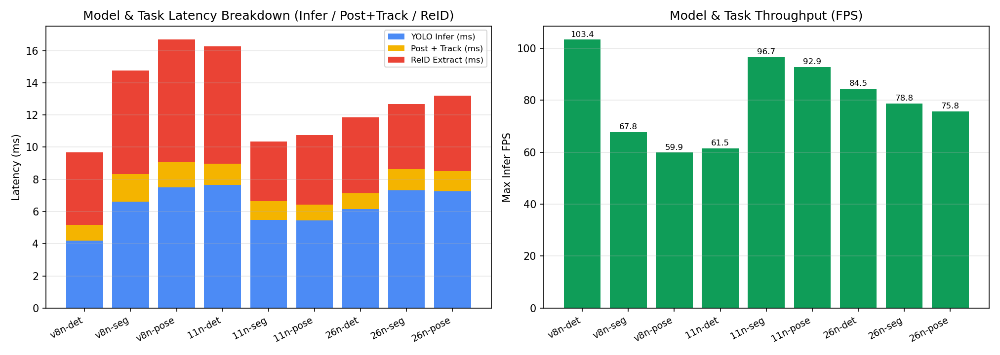
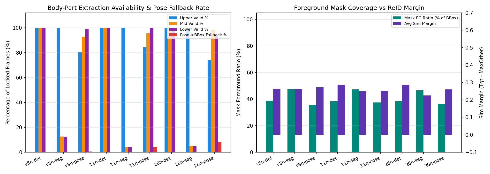
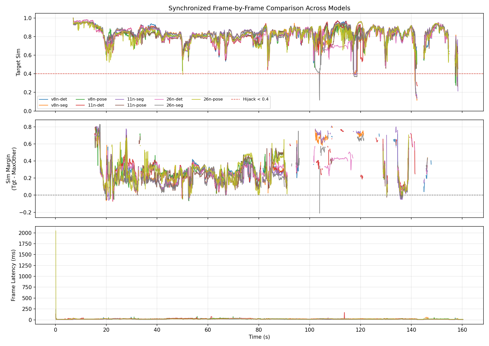
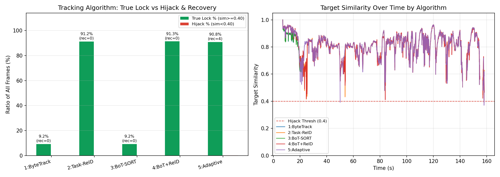
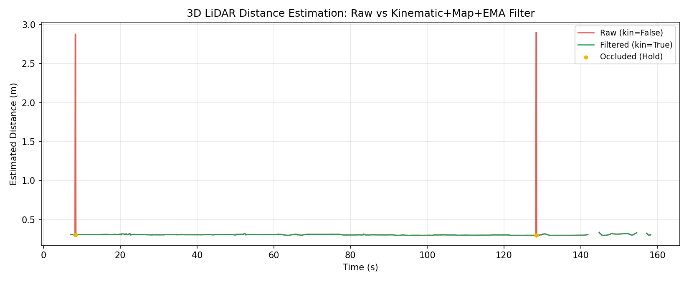

# Bag Benchmark Report: `pose_estimate2`

- **Bag Path**: `/home/mu-01/Downloads/bag3/pose_estimate2`
- **Image Topic**: `/robot4/top_cam/image_raw/compressed` (`2403` frames evaluated)
- **Scan / TF**: `/robot4/scan` / `/robot4/tf`
- **Keyframes (`Δ=10f`)**: `crowd@f12, recovered@f752`

## 0. 핵심 관찰 요약 (Auto Insights)

- **최고 연산 속도**: `v8n-det` (Infer `4.18ms`, Post+Trk `0.98ms`, Max `103.4 FPS`)
- **최고 진성 유지율 (`True Lock %`, sim>=0.4)**: `v8n-pose` (`91.1%`, Avg Sim `0.82`)
- **최고 타인 변별 마진 (`Sim Margin`)**: `26n-det` (평균 `0.287`, 최소 `-0.063`)
- **Pose 부위 가용성 & BBox 폴백 비율**: `v8n-pose` M=92.7%/L=99.0%/FB=0.6%, `11n-pose` M=95.4%/L=99.8%/FB=4.3%, `26n-pose` M=98.5%/L=94.1%/FB=8.3%
- **추적 알고리즘 효과**: `1:ByteTrack` TrueLock=9.2% (Hijack=0.0%, Rec=0), `2:Task-ReID` TrueLock=91.2% (Hijack=0.0%, Rec=0), `3:BoT-SORT` TrueLock=9.2% (Hijack=0.0%, Rec=0), `4:BoT+ReID` TrueLock=91.3% (Hijack=0.0%, Rec=0), `5:Adaptive` TrueLock=90.8% (Hijack=0.1%, Rec=4)
- **LiDAR 필터링 효과**: Jumps `0 -> 0`, FarCamEst `6 -> 0`, AMCL Wall/Out `0 -> 0`, Occluded Hold `6f`

## 1. 모델별 연산 · 후처리 속도 분해 (`5:Adaptive`)

| Model | Pre (ms) | Infer Mean / P95 (ms) | Post+Trk (ms) | ReID (ms) | Total Mean / P95 (ms) | Max FPS |
|---|---:|---:|---:|---:|---:|---:|
| v8n-det (`yolov8n.pt`) | 0.45 | 4.18 / 6.09 | 0.98 | 4.51 | 12.54 / 25.54 | 103.4 |
| v8n-seg (`yolov8n-seg.pt`) | 0.58 | 6.6 / 7.77 | 1.72 | 6.44 | 19.91 / 32.59 | 67.8 |
| v8n-pose (`yolov8n-pose.pt`) | 0.68 | 7.49 / 8.03 | 1.59 | 7.61 | 21.96 / 33.44 | 59.9 |
| 11n-det (`yolo11n.pt`) | 0.61 | 7.64 / 9.21 | 1.34 | 7.29 | 20.57 / 33.35 | 61.5 |
| 11n-seg (`yolo11n-seg.pt`) | 0.4 | 5.47 / 6.01 | 1.18 | 3.69 | 13.3 / 19.28 | 96.7 |
| 11n-pose (`yolo11n-pose.pt`) | 0.45 | 5.46 / 5.7 | 0.96 | 4.34 | 13.82 / 20.45 | 92.9 |
| 26n-det (`yolo26n.pt`) | 0.5 | 6.14 / 9.72 | 0.99 | 4.71 | 14.74 / 28.46 | 84.5 |
| 26n-seg (`yolo26n-seg.pt`) | 0.49 | 7.31 / 11.09 | 1.34 | 4.04 | 16.24 / 22.72 | 78.8 |
| 26n-pose (`yolo26n-pose.pt`) | 0.68 | 7.27 / 9.6 | 1.24 | 4.69 | 17.62 / 22.73 | 75.8 |

## 2. 특징 추출 용이성 · 부위 가용성 · 배경 분리 (`5:Adaptive`)

| Model | U / M / L Valid % | Pose Fallback % | Mask FG % | Avg Tgt Sim ± Std (Min) | U / M / L / F Avg Sim |
|---|---:|---:|---:|---:|---|
| v8n-det | 100.0% / 100.0% / 100.0% | 0.0% | 38.8% | 0.824 ± 0.086 (0.456) | 0.776 / 0.787 / 0.745 / 0.824 |
| v8n-seg | 100.0% / 12.5% / 12.4% | 0.0% | 47.5% | 0.835 ± 0.096 (0.115) | 0.825 / 0.673 / 0.586 / 0.834 |
| v8n-pose | 80.4% / 92.7% / 99.0% | 0.6% | 35.7% | 0.82 ± 0.077 (0.276) | 0.759 / 0.776 / 0.76 / 0.818 |
| 11n-det | 100.0% / 100.0% / 100.0% | 0.0% | 38.3% | 0.817 ± 0.093 (0.27) | 0.767 / 0.782 / 0.736 / 0.817 |
| 11n-seg | 100.0% / 4.3% / 4.2% | 0.0% | 47.3% | 0.839 ± 0.087 (0.135) | 0.835 / 0.667 / 0.581 / 0.838 |
| 11n-pose | 84.3% / 95.4% / 99.8% | 4.3% | 37.4% | 0.818 ± 0.079 (0.379) | 0.77 / 0.776 / 0.755 / 0.815 |
| 26n-det | 100.0% / 100.0% / 100.0% | 0.0% | 38.3% | 0.81 ± 0.086 (0.47) | 0.76 / 0.771 / 0.726 / 0.81 |
| 26n-seg | 99.9% / 5.0% / 4.8% | 0.0% | 46.5% | 0.83 ± 0.102 (0.116) | 0.825 / 0.57 / 0.519 / 0.829 |
| 26n-pose | 74.0% / 98.5% / 94.1% | 8.3% | 36.4% | 0.817 ± 0.083 (0.358) | 0.753 / 0.777 / 0.755 / 0.81 |

## 3. 재식별 변별력 · 혼잡 · 오인식 방어 (`5:Adaptive`)

> `True Lock %`: 전체 프레임 중 유사도 `>=0.4`로 실제 타겟을 유지한 비율 · `Hijack %`: 유사도 `<0.4` 오탐 잠금 비율

| Model | Det % | >=2P % | Locked % | True Lock % | Hijack % | Direct Sw | Recovered (Avg f) | Other Avg / Max | Margin Mean / Min |
|---|---:|---:|---:|---:|---:|---:|---:|---:|---:|
| v8n-det | 95.6% | 51.3% | 95.2% | **91.0%** | 0.0% | 3 | 4 (16.6f) | 0.481 / 0.794 | 0.264 / -0.035 |
| v8n-seg | 95.8% | 56.3% | 95.2% | **90.6%** | 0.7% | 5 | 7 (10.9f) | 0.537 / 0.821 | 0.263 / -0.065 |
| v8n-pose | 95.6% | 48.1% | 95.3% | **91.1%** | 0.1% | 5 | 5 (15.8f) | 0.508 / 0.777 | 0.273 / -0.067 |
| 11n-det | 95.8% | 55.1% | 94.9% | **90.6%** | 0.2% | 6 | 4 (17.0f) | 0.44 / 0.786 | 0.286 / -0.072 |
| 11n-seg | 95.8% | 55.8% | 95.2% | **90.1%** | 1.1% | 3 | 5 (15.8f) | 0.531 / 0.846 | 0.249 / -0.061 |
| 11n-pose | 95.5% | 49.2% | 95.3% | **91.1%** | 0.0% | 5 | 5 (16.2f) | 0.514 / 0.819 | 0.252 / -0.045 |
| 26n-det | 95.7% | 59.2% | 94.3% | **90.2%** | 0.0% | 5 | 5 (12.9f) | 0.465 / 0.78 | 0.287 / -0.063 |
| 26n-seg | 95.5% | 53.8% | 95.0% | **89.4%** | 1.3% | 5 | 7 (10.9f) | 0.568 / 0.825 | 0.226 / -0.21 |
| 26n-pose | 95.6% | 48.5% | 95.2% | **90.8%** | 0.1% | 7 | 4 (16.6f) | 0.491 / 0.783 | 0.26 / -0.046 |

## 4. 추적 알고리즘 비교 (`yolo26n-pose`)

| Mode | Locked % | True Lock % | Hijack % | SEARCH % | GUARD % | Direct Sw | Recovered (Avg f) | Avg Tgt Sim | Total (ms) |
|---|---:|---:|---:|---:|---:|---:|---:|---:|---:|
| 1:ByteTrack | 9.7% | **9.2%** | 0.0% | 0.0% | 0.0% | 0 | 0 | 0.847 | 11.78 |
| 2:Task-ReID | 95.5% | **91.2%** | 0.0% | 0.0% | 0.0% | 9 | 0 | 0.813 | 13.83 |
| 3:BoT-SORT | 9.7% | **9.2%** | 0.0% | 0.0% | 0.0% | 0 | 0 | 0.843 | 22.43 |
| 4:BoT+ReID | 95.5% | **91.3%** | 0.0% | 0.0% | 0.0% | 9 | 0 | 0.81 | 22.63 |
| 5:Adaptive | 95.2% | **90.8%** | 0.1% | 4.7% | 33.7% | 7 | 4 (16.6f) | 0.817 | 14.86 |

## 5. 3D LiDAR Localizer 비교 (`Raw` vs `Kinematic+Map+EMA`)

| Config | LiDAR | Occluded (Hold) | CamEst | LiDAR Jumps (>0.8m) | Far CamEst (>2.0m) | AMCL Wall/Out |
|---|---:|---:|---:|---:|---:|---:|
| Raw (kin=False) | 2180 | 0 | 6 | 0 | 6 | 0 |
| Filtered (kin=True) | 2180 | 6 | 0 | 0 | 0 | 0 |

## 5.5 Ground Truth(GT) 기반 실제 추적 정확도 (IoU >= 0.5)

| Experiment | Mode | GT Pos / Neg (f) | GT True Lock % | GT Hijack % | GT Miss % | GT False Lock % | Mean IoU | Fail Episodes (예상 개입) |
|---|---|---:|---:|---:|---:|---:|---:|---:|
| v8n-det | 5:Adaptive | 1996 / 304 | **95.5%** | 4.3% | 0.2% | 64.1% | 0.921 | 10 |
| v8n-seg | 5:Adaptive | 1996 / 304 | **96.0%** | 4.0% | 0.0% | 64.8% | 0.929 | 13 |
| v8n-pose | 5:Adaptive | 1996 / 304 | **95.4%** | 4.5% | 0.2% | 64.8% | 0.898 | 11 |
| 11n-det | 5:Adaptive | 1996 / 304 | **95.4%** | 4.5% | 0.1% | 62.5% | 0.925 | 12 |
| 11n-seg | 5:Adaptive | 1996 / 304 | **95.8%** | 4.0% | 0.2% | 65.1% | 0.929 | 9 |
| 11n-pose | 5:Adaptive | 1996 / 304 | **95.7%** | 4.2% | 0.1% | 64.1% | 0.906 | 11 |
| 26n-det | 5:Adaptive | 1996 / 304 | **95.6%** | 4.2% | 0.2% | 57.9% | 0.922 | 11 |
| 26n-seg | 5:Adaptive | 1996 / 304 | **96.0%** | 4.0% | 0.0% | 60.9% | 0.963 | 6 |
| 26n-pose | 5:Adaptive | 1996 / 304 | **96.1%** | 3.8% | 0.1% | 63.2% | 0.913 | 14 |
| mode_1 | 1:ByteTrack | 1996 / 304 | **10.1%** | 0.0% | 89.9% | 6.9% | 0.964 | 15 |
| mode_2 | 2:Task-ReID | 1996 / 304 | **93.1%** | 6.9% | 0.1% | 65.1% | 0.886 | 14 |
| mode_3 | 3:BoT-SORT | 1996 / 304 | **10.1%** | 0.0% | 89.9% | 6.9% | 0.952 | 15 |
| mode_4 | 4:BoT+ReID | 1996 / 304 | **92.5%** | 7.4% | 0.1% | 65.5% | 0.848 | 16 |
| mode_5 | 5:Adaptive | 1996 / 304 | **96.1%** | 3.8% | 0.1% | 63.2% | 0.913 | 14 |

## 6. 시각 검증 스냅샷 (`snapshots/`)

- `compare_tasks_hist_crowd_f0012.png`
  
- `compare_versions_crowd_f0012.png`
  
- `compare_pixels_crowd_f0012.png`
  
- `compare_seq_crowd_f0012.png`
  
- `compare_tasks_hist_recovered_f0752.png`
  
- `compare_versions_recovered_f0752.png`
  
- `compare_pixels_recovered_f0752.png`
  
- `compare_seq_recovered_f0752.png`
  
