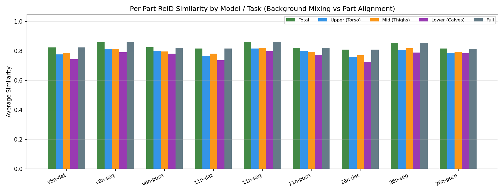
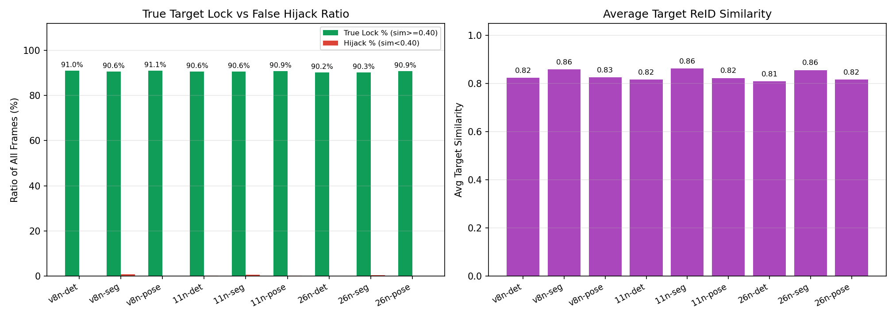

# Bag Benchmark Report: `pose_estimate2`

- **Bag Path**: `/home/jsb/bag3/pose_estimate2`
- **Image Topic**: `/robot4/top_cam/image_raw/compressed` (`2403` frames evaluated)
- **Scan / TF**: `/robot4/scan` / `/robot4/tf`
- **Keyframes (`Δ=10f`)**: `crowd@f12, recovered@f327`

## 0. 핵심 관찰 요약 (Auto Insights)

- **최고 연산 속도**: `v8n-det` (Infer `1.56ms`, Post+Trk `0.43ms`, Max `236.5 FPS`)
- **최고 진성 유지율 (`True Lock %`, sim>=0.4)**: `v8n-pose` (`91.1%`, Avg Sim `0.826`)
- **최고 타인 변별 마진 (`Sim Margin`)**: `v8n-pose` (평균 `0.29`, 최소 `-0.069`)
- **Pose 부위 가용성 & BBox 폴백 비율**: `v8n-pose` M=93.0%/L=99.3%/FB=0.9%, `11n-pose` M=95.4%/L=99.9%/FB=4.2%, `26n-pose` M=98.9%/L=94.5%/FB=7.7%
- **추적 알고리즘 효과**: `1:ByteTrack` TrueLock=9.2% (Hijack=0.0%, Rec=0), `2:Task-ReID` TrueLock=91.1% (Hijack=0.0%, Rec=0), `3:BoT-SORT` TrueLock=9.2% (Hijack=0.0%, Rec=0), `4:BoT+ReID` TrueLock=91.1% (Hijack=0.2%, Rec=0), `5:Adaptive` TrueLock=90.9% (Hijack=0.0%, Rec=5)
- **LiDAR 필터링 효과**: Jumps `0 -> 0`, FarCamEst `6 -> 0`, AMCL Wall/Out `0 -> 0`, Occluded Hold `6f`

## 1. 모델별 연산 · 후처리 속도 분해 (`5:Adaptive`)

| Model | Pre (ms) | Infer Mean / P95 (ms) | Post+Trk (ms) | ReID (ms) | Total Mean / P95 (ms) | Max FPS |
|---|---:|---:|---:|---:|---:|---:|
| v8n-det (`yolov8n.pt`) | 0.18 | 1.56 / 1.57 | 0.43 | 2.24 | 5.52 / 8.6 | 236.5 |
| v8n-seg (`yolov8n-seg.pt`) | 0.18 | 1.84 / 1.87 | 0.58 | 3.93 | 7.89 / 13.14 | 157.7 |
| v8n-pose (`yolov8n-pose.pt`) | 0.19 | 1.88 / 1.98 | 0.47 | 3.28 | 7.2 / 12.67 | 177.5 |
| 11n-det (`yolo11n.pt`) | 0.22 | 2.21 / 2.34 | 0.49 | 2.57 | 6.7 / 10.92 | 189.5 |
| 11n-seg (`yolo11n-seg.pt`) | 0.23 | 2.53 / 2.76 | 0.65 | 4.11 | 8.98 / 14.67 | 137.2 |
| 11n-pose (`yolo11n-pose.pt`) | 0.3 | 2.91 / 3.35 | 0.67 | 3.75 | 9.23 / 15.11 | 136.5 |
| 26n-det (`yolo26n.pt`) | 0.3 | 2.96 / 3.45 | 0.65 | 2.76 | 8.02 / 12.05 | 157.2 |
| 26n-seg (`yolo26n-seg.pt`) | 0.32 | 3.63 / 4.13 | 0.85 | 4.29 | 10.85 / 17.0 | 114.1 |
| 26n-pose (`yolo26n-pose.pt`) | 0.25 | 2.69 / 2.72 | 0.52 | 3.19 | 8.3 / 12.63 | 156.2 |

## 2. 특징 추출 용이성 · 부위 가용성 · 배경 분리 (`5:Adaptive`)

| Model | U / M / L Valid % | Pose Fallback % | Mask FG % | Avg Tgt Sim ± Std (Min) | U / M / L / F Avg Sim |
|---|---:|---:|---:|---:|---|
| v8n-det | 100.0% / 100.0% / 100.0% | 0.0% | 38.8% | 0.824 ± 0.086 (0.456) | 0.776 / 0.787 / 0.745 / 0.824 |
| v8n-seg | 100.0% / 100.0% / 100.0% | 0.0% | 48.0% | 0.859 ± 0.096 (0.154) | 0.814 / 0.814 / 0.791 / 0.858 |
| v8n-pose | 57.5% / 93.0% / 99.3% | 0.9% | 27.5% | 0.826 ± 0.081 (0.31) | 0.8 / 0.797 / 0.783 / 0.823 |
| 11n-det | 100.0% / 100.0% / 100.0% | 0.0% | 38.3% | 0.817 ± 0.093 (0.27) | 0.767 / 0.782 / 0.736 / 0.817 |
| 11n-seg | 100.0% / 100.0% / 100.0% | 0.0% | 47.5% | 0.863 ± 0.087 (0.174) | 0.817 / 0.823 / 0.799 / 0.863 |
| 11n-pose | 69.9% / 95.4% / 99.9% | 4.2% | 29.6% | 0.823 ± 0.083 (0.33) | 0.803 / 0.794 / 0.775 / 0.82 |
| 26n-det | 100.0% / 100.0% / 100.0% | 0.0% | 38.3% | 0.81 ± 0.086 (0.47) | 0.76 / 0.771 / 0.726 / 0.81 |
| 26n-seg | 100.0% / 100.0% / 100.0% | 0.0% | 46.8% | 0.856 ± 0.099 (0.167) | 0.808 / 0.818 / 0.789 / 0.856 |
| 26n-pose | 15.5% / 98.9% / 94.5% | 7.7% | 24.2% | 0.817 ± 0.09 (0.26) | 0.786 / 0.794 / 0.784 / 0.813 |

## 3. 재식별 변별력 · 혼잡 · 오인식 방어 (`5:Adaptive`)

> `True Lock %`: 전체 프레임 중 유사도 `>=0.4`로 실제 타겟을 유지한 비율 · `Hijack %`: 유사도 `<0.4` 오탐 잠금 비율

| Model | Det % | >=2P % | Locked % | True Lock % | Hijack % | Direct Sw | Recovered (Avg f) | Other Avg / Max | Margin Mean / Min |
|---|---:|---:|---:|---:|---:|---:|---:|---:|---:|
| v8n-det | 95.6% | 51.3% | 95.2% | **91.0%** | 0.0% | 3 | 4 (16.6f) | 0.481 / 0.794 | 0.264 / -0.035 |
| v8n-seg | 95.8% | 56.3% | 95.2% | **90.6%** | 0.7% | 4 | 8 (9.6f) | 0.557 / 0.833 | 0.266 / -0.053 |
| v8n-pose | 95.6% | 48.1% | 95.3% | **91.1%** | 0.0% | 3 | 5 (13.3f) | 0.494 / 0.83 | 0.29 / -0.069 |
| 11n-det | 95.8% | 55.1% | 94.9% | **90.6%** | 0.2% | 6 | 4 (17.0f) | 0.439 / 0.786 | 0.287 / -0.072 |
| 11n-seg | 95.8% | 55.8% | 95.2% | **90.6%** | 0.6% | 3 | 5 (15.8f) | 0.547 / 0.854 | 0.253 / -0.055 |
| 11n-pose | 95.5% | 49.2% | 95.3% | **90.9%** | 0.1% | 6 | 6 (13.7f) | 0.511 / 0.826 | 0.255 / -0.065 |
| 26n-det | 95.7% | 59.2% | 94.3% | **90.2%** | 0.0% | 5 | 5 (12.9f) | 0.466 / 0.779 | 0.287 / -0.071 |
| 26n-seg | 95.5% | 53.8% | 95.0% | **90.3%** | 0.4% | 4 | 8 (9.8f) | 0.59 / 0.836 | 0.22 / -0.056 |
| 26n-pose | 95.6% | 48.5% | 95.1% | **90.9%** | 0.0% | 2 | 5 (14.0f) | 0.47 / 0.801 | 0.276 / -0.028 |

## 4. 추적 알고리즘 비교 (`yolo26n-pose`)

| Mode | Locked % | True Lock % | Hijack % | SEARCH % | GUARD % | Direct Sw | Recovered (Avg f) | Avg Tgt Sim | Total (ms) |
|---|---:|---:|---:|---:|---:|---:|---:|---:|---:|
| 1:ByteTrack | 9.7% | **9.2%** | 0.0% | 0.0% | 0.0% | 0 | 0 | 0.844 | 6.62 |
| 2:Task-ReID | 95.4% | **91.1%** | 0.0% | 0.0% | 0.0% | 8 | 0 | 0.814 | 8.32 |
| 3:BoT-SORT | 9.7% | **9.2%** | 0.0% | 0.0% | 0.0% | 0 | 0 | 0.843 | 10.68 |
| 4:BoT+ReID | 95.5% | **91.1%** | 0.2% | 0.0% | 0.0% | 10 | 0 | 0.811 | 12.62 |
| 5:Adaptive | 95.1% | **90.9%** | 0.0% | 4.8% | 33.7% | 2 | 5 (14.0f) | 0.817 | 8.69 |

## 5. 3D LiDAR Localizer 비교 (`Raw` vs `Kinematic+Map+EMA`)

| Config | LiDAR | Occluded (Hold) | CamEst | LiDAR Jumps (>0.8m) | Far CamEst (>2.0m) | AMCL Wall/Out |
|---|---:|---:|---:|---:|---:|---:|
| Raw (kin=False) | 2179 | 0 | 6 | 0 | 6 | 0 |
| Filtered (kin=True) | 2179 | 6 | 0 | 0 | 0 | 0 |

## 5.5 Ground Truth(GT) 기반 실제 추적 정확도 (IoU >= 0.5)

| Experiment | Mode | GT Pos / Neg (f) | GT True Lock % | GT Hijack % | GT Miss % | GT False Lock % | Mean IoU | Fail Episodes (예상 개입) |
|---|---|---:|---:|---:|---:|---:|---:|---:|
| v8n-det | 5:Adaptive | 1996 / 304 | **95.5%** | 4.3% | 0.2% | 64.1% | 0.921 | 10 |
| v8n-seg | 5:Adaptive | 1996 / 304 | **96.0%** | 4.0% | 0.0% | 64.5% | 0.929 | 14 |
| v8n-pose | 5:Adaptive | 1996 / 304 | **95.8%** | 4.0% | 0.2% | 64.5% | 0.9 | 11 |
| 11n-det | 5:Adaptive | 1996 / 304 | **95.4%** | 4.5% | 0.1% | 62.5% | 0.925 | 12 |
| 11n-seg | 5:Adaptive | 1996 / 304 | **95.8%** | 4.0% | 0.2% | 65.1% | 0.929 | 9 |
| 11n-pose | 5:Adaptive | 1996 / 304 | **96.1%** | 3.8% | 0.1% | 63.8% | 0.909 | 15 |
| 26n-det | 5:Adaptive | 1996 / 304 | **95.5%** | 4.3% | 0.2% | 57.9% | 0.921 | 11 |
| 26n-seg | 5:Adaptive | 1996 / 304 | **96.0%** | 4.0% | 0.0% | 60.5% | 0.963 | 5 |
| 26n-pose | 5:Adaptive | 1996 / 304 | **96.1%** | 3.8% | 0.1% | 62.8% | 0.914 | 16 |
| mode_1 | 1:ByteTrack | 1996 / 304 | **10.1%** | 0.0% | 89.9% | 6.9% | 0.964 | 15 |
| mode_2 | 2:Task-ReID | 1996 / 304 | **93.6%** | 6.3% | 0.1% | 64.5% | 0.891 | 14 |
| mode_3 | 3:BoT-SORT | 1996 / 304 | **10.1%** | 0.0% | 89.9% | 6.9% | 0.951 | 15 |
| mode_4 | 4:BoT+ReID | 1996 / 304 | **93.2%** | 6.8% | 0.1% | 65.5% | 0.854 | 16 |
| mode_5 | 5:Adaptive | 1996 / 304 | **96.1%** | 3.8% | 0.1% | 62.8% | 0.914 | 16 |

## 6. 시각 검증 스냅샷 (`snapshots/`)

- `compare_tasks_hist_crowd_f0012.png`
  
- `compare_versions_crowd_f0012.png`
  
- `compare_pixels_crowd_f0012.png`
  
- `compare_seq_crowd_f0012.png`
  
- `compare_tasks_hist_recovered_f0327.png`
  
- `compare_versions_recovered_f0327.png`
  
- `compare_pixels_recovered_f0327.png`
  
- `compare_seq_recovered_f0327.png`
  
