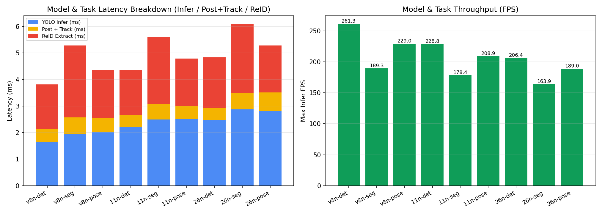
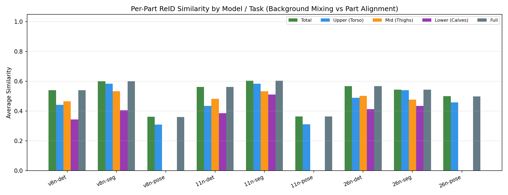
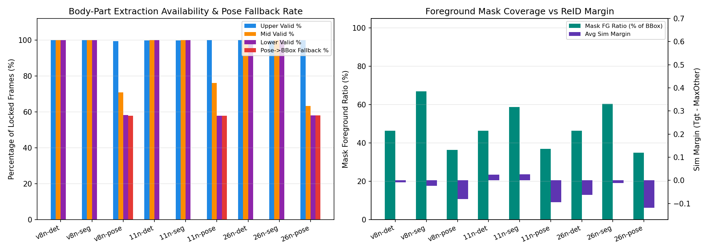
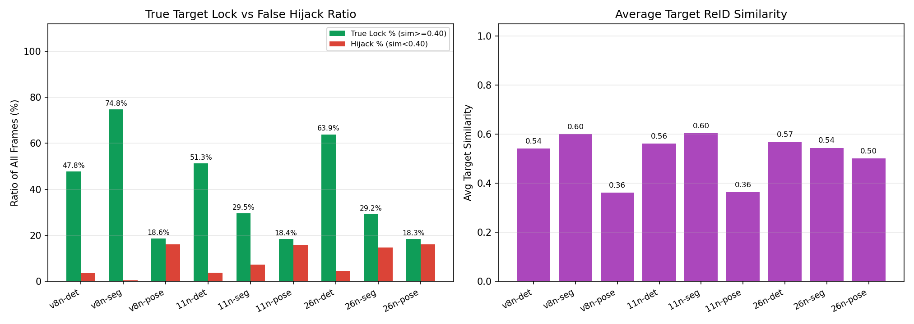
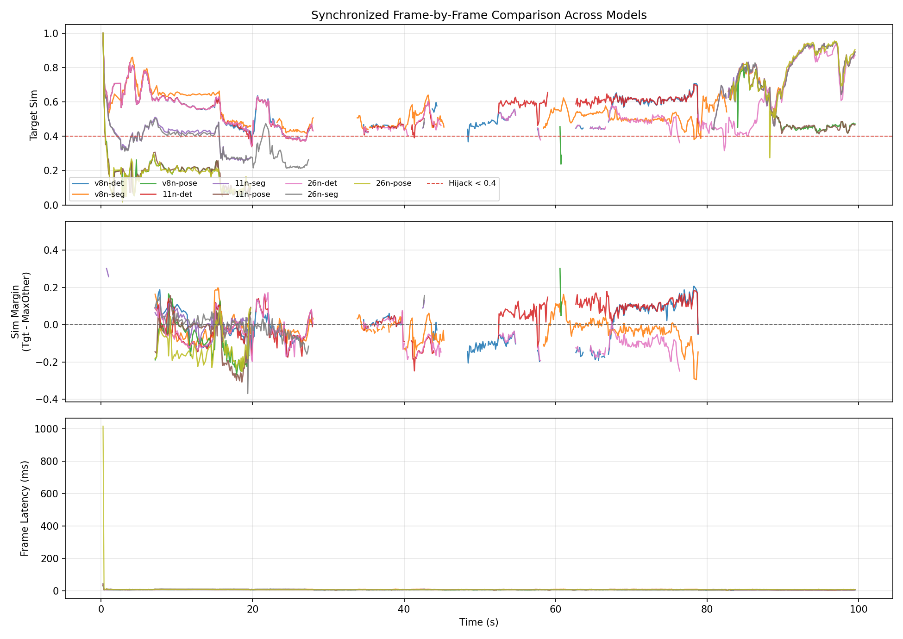
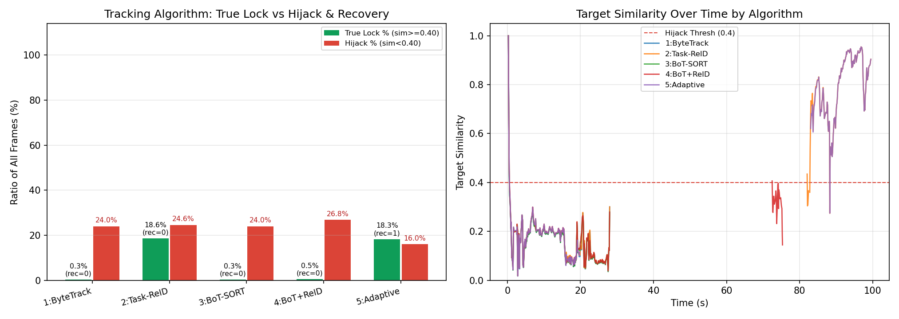
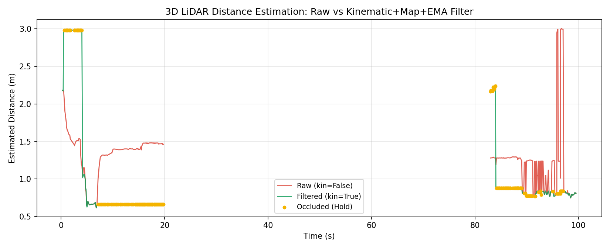

# Bag Benchmark Report: `robot1_full`

- **Bag Path**: `/home/jsb/bag/complete_bag/robot1_full`
- **Image Topic**: `/robot1/top_cam/image_raw/compressed` (`862` frames evaluated)
- **Scan / TF**: `/robot1/scan` / `/robot1/tf`
- **Keyframes (`Δ=10f`)**: `q1@f216, recovered@f707`

## 0. 핵심 관찰 요약 (Auto Insights)

- **최고 연산 속도**: `v8n-det` (Infer `1.65ms`, Post+Trk `0.48ms`, Max `261.3 FPS`)
- **최고 진성 유지율 (`True Lock %`, sim>=0.4)**: `v8n-seg` (`74.8%`, Avg Sim `0.6`)
- **최고 타인 변별 마진 (`Sim Margin`)**: `11n-seg` (평균 `0.027`, 최소 `-0.098`)
- **Pose 부위 가용성 & BBox 폴백 비율**: `v8n-pose` M=70.9%/L=58.2%/FB=57.9%, `11n-pose` M=76.0%/L=57.8%/FB=57.8%, `26n-pose` M=63.2%/L=58.1%/FB=58.1%
- **추적 알고리즘 효과**: `1:ByteTrack` TrueLock=0.3% (Hijack=24.0%, Rec=0), `2:Task-ReID` TrueLock=18.6% (Hijack=24.6%, Rec=0), `3:BoT-SORT` TrueLock=0.3% (Hijack=24.0%, Rec=0), `4:BoT+ReID` TrueLock=0.5% (Hijack=26.8%, Rec=0), `5:Adaptive` TrueLock=18.3% (Hijack=16.0%, Rec=1)
- **LiDAR 필터링 효과**: Jumps `0 -> 1`, FarCamEst `11 -> 2`, AMCL Wall/Out `0 -> 0`, Occluded Hold `197f`

## 1. 모델별 연산 · 후처리 속도 분해 (`5:Adaptive`)

| Model | Pre (ms) | Infer Mean / P95 (ms) | Post+Trk (ms) | ReID (ms) | Total Mean / P95 (ms) | Max FPS |
|---|---:|---:|---:|---:|---:|---:|
| v8n-det (`yolov8n.pt`) | 0.19 | 1.65 / 1.77 | 0.48 | 1.69 | 4.88 / 6.82 | 261.3 |
| v8n-seg (`yolov8n-seg.pt`) | 0.19 | 1.94 / 2.06 | 0.63 | 2.71 | 6.6 / 8.99 | 189.3 |
| v8n-pose (`yolov8n-pose.pt`) | 0.22 | 2.01 / 2.15 | 0.55 | 1.8 | 5.5 / 7.16 | 229.0 |
| 11n-det (`yolo11n.pt`) | 0.18 | 2.21 / 2.29 | 0.46 | 1.69 | 5.43 / 7.45 | 228.8 |
| 11n-seg (`yolo11n-seg.pt`) | 0.18 | 2.49 / 2.56 | 0.6 | 2.51 | 6.68 / 9.05 | 178.4 |
| 11n-pose (`yolo11n-pose.pt`) | 0.18 | 2.51 / 2.58 | 0.49 | 1.79 | 5.85 / 7.36 | 208.9 |
| 26n-det (`yolo26n.pt`) | 0.18 | 2.47 / 2.55 | 0.45 | 1.92 | 5.99 / 7.66 | 206.4 |
| 26n-seg (`yolo26n-seg.pt`) | 0.18 | 2.88 / 2.99 | 0.6 | 2.62 | 7.24 / 9.79 | 163.9 |
| 26n-pose (`yolo26n-pose.pt`) | 0.36 | 2.82 / 2.97 | 0.69 | 1.78 | 7.38 / 7.89 | 189.0 |

## 2. 특징 추출 용이성 · 부위 가용성 · 배경 분리 (`5:Adaptive`)

| Model | U / M / L Valid % | Pose Fallback % | Mask FG % | Avg Tgt Sim ± Std (Min) | U / M / L / F Avg Sim |
|---|---:|---:|---:|---:|---|
| v8n-det | 100.0% / 100.0% / 100.0% | 0.0% | 46.3% | 0.541 ± 0.101 (0.35) | 0.441 / 0.465 / 0.344 / 0.541 |
| v8n-seg | 100.0% / 100.0% / 100.0% | 0.0% | 67.0% | 0.6 ± 0.148 (0.381) | 0.584 / 0.533 / 0.405 / 0.6 |
| v8n-pose | 99.3% / 70.9% / 58.2% | 57.9% | 36.4% | 0.361 ± 0.212 (0.039) | 0.308 / - / - / 0.36 |
| 11n-det | 99.8% / 100.0% / 100.0% | 0.0% | 46.4% | 0.562 ± 0.095 (0.339) | 0.434 / 0.481 / 0.386 / 0.562 |
| 11n-seg | 99.7% / 100.0% / 100.0% | 0.0% | 58.8% | 0.603 ± 0.225 (0.249) | 0.583 / 0.532 / 0.511 / 0.603 |
| 11n-pose | 100.0% / 76.0% / 57.8% | 57.8% | 36.9% | 0.363 ± 0.215 (0.034) | 0.311 / - / - / 0.363 |
| 26n-det | 100.0% / 100.0% / 100.0% | 0.0% | 46.4% | 0.568 ± 0.154 (0.316) | 0.49 / 0.502 / 0.413 / 0.568 |
| 26n-seg | 99.7% / 100.0% / 100.0% | 0.0% | 60.3% | 0.544 ± 0.242 (0.213) | 0.541 / 0.477 / 0.434 / 0.544 |
| 26n-pose | 100.0% / 63.2% / 58.1% | 58.1% | 34.9% | 0.5 ± 0.332 (0.018) | 0.459 / - / - / 0.499 |

## 3. 재식별 변별력 · 혼잡 · 오인식 방어 (`5:Adaptive`)

> `True Lock %`: 전체 프레임 중 유사도 `>=0.4`로 실제 타겟을 유지한 비율 · `Hijack %`: 유사도 `<0.4` 오탐 잠금 비율

| Model | Det % | >=2P % | Locked % | True Lock % | Hijack % | Direct Sw | Recovered (Avg f) | Other Avg / Max | Margin Mean / Min |
|---|---:|---:|---:|---:|---:|---:|---:|---:|---:|
| v8n-det | 99.2% | 71.6% | 51.6% | **47.8%** | 3.4% | 1 | 22 (10.5f) | 0.465 / 0.698 | -0.008 / -0.206 |
| v8n-seg | 99.9% | 71.6% | 75.3% | **74.8%** | 0.3% | 1 | 10 (19.5f) | 0.484 / 0.754 | -0.023 / -0.296 |
| v8n-pose | 99.8% | 71.5% | 34.8% | **18.6%** | 16.1% | 0 | 2 (281.5f) | 0.186 / 0.44 | -0.08 / -0.27 |
| 11n-det | 99.7% | 71.6% | 55.2% | **51.3%** | 3.7% | 5 | 13 (15.3f) | 0.478 / 0.703 | 0.025 / -0.249 |
| 11n-seg | 99.8% | 72.2% | 36.7% | **29.5%** | 7.2% | 0 | 2 (182.0f) | 0.308 / 0.513 | 0.027 / -0.098 |
| 11n-pose | 99.7% | 71.3% | 34.5% | **18.4%** | 15.9% | 0 | 1 (566.0f) | 0.187 / 0.453 | -0.094 / -0.309 |
| 26n-det | 99.8% | 71.6% | 68.5% | **63.9%** | 4.4% | 2 | 19 (13.7f) | 0.486 / 0.694 | -0.063 / -0.249 |
| 26n-seg | 99.2% | 71.7% | 44.2% | **29.2%** | 14.6% | 0 | 2 (121.0f) | 0.299 / 0.631 | -0.011 / -0.37 |
| 26n-pose | 99.7% | 71.5% | 34.5% | **18.3%** | 16.0% | 0 | 1 (566.0f) | 0.22 / 0.433 | -0.119 / -0.253 |

## 4. 추적 알고리즘 비교 (`yolo26n-pose`)

| Mode | Locked % | True Lock % | Hijack % | SEARCH % | GUARD % | Direct Sw | Recovered (Avg f) | Avg Tgt Sim | Total (ms) |
|---|---:|---:|---:|---:|---:|---:|---:|---:|---:|
| 1:ByteTrack | 24.4% | **0.3%** | 24.0% | 0.0% | 0.0% | 0 | 0 | 0.149 | 5.3 |
| 2:Task-ReID | 43.3% | **18.6%** | 24.6% | 0.0% | 0.0% | 1 | 0 | 0.427 | 6.51 |
| 3:BoT-SORT | 24.4% | **0.3%** | 24.0% | 0.0% | 0.0% | 0 | 0 | 0.151 | 8.17 |
| 4:BoT+ReID | 27.4% | **0.5%** | 26.8% | 0.0% | 0.0% | 1 | 0 | 0.172 | 9.46 |
| 5:Adaptive | 34.5% | **18.3%** | 16.0% | 65.7% | 9.4% | 0 | 1 (566.0f) | 0.5 | 6.18 |

## 5. 3D LiDAR Localizer 비교 (`Raw` vs `Kinematic+Map+EMA`)

| Config | LiDAR | Occluded (Hold) | CamEst | LiDAR Jumps (>0.8m) | Far CamEst (>2.0m) | AMCL Wall/Out |
|---|---:|---:|---:|---:|---:|---:|
| Raw (kin=False) | 285 | 0 | 11 | 0 | 11 | 0 |
| Filtered (kin=True) | 97 | 197 | 2 | 1 | 2 | 0 |

## 6. 시각 검증 스냅샷 (`snapshots/`)

- `compare_tasks_hist_q1_f0216.png`
  
- `compare_versions_q1_f0216.png`
  
- `compare_pixels_q1_f0216.png`
  
- `compare_seq_q1_f0216.png`
  
- `compare_tasks_hist_recovered_f0707.png`
  
- `compare_versions_recovered_f0707.png`
  
- `compare_pixels_recovered_f0707.png`
  
- `compare_seq_recovered_f0707.png`
  
