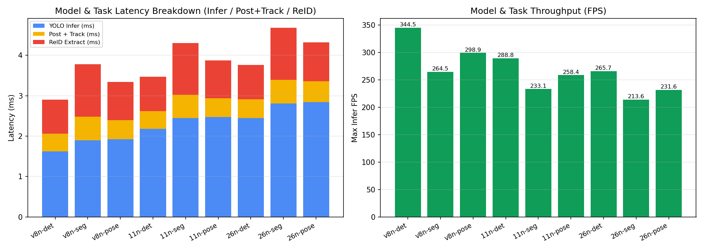
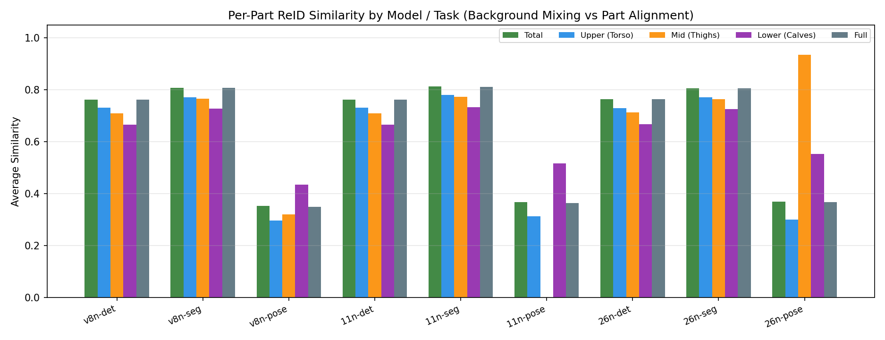
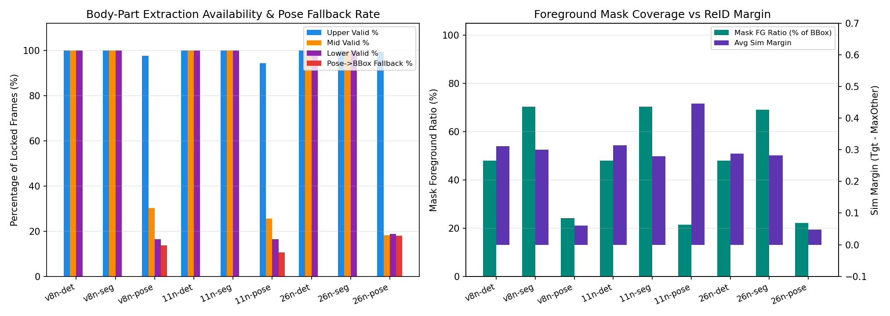
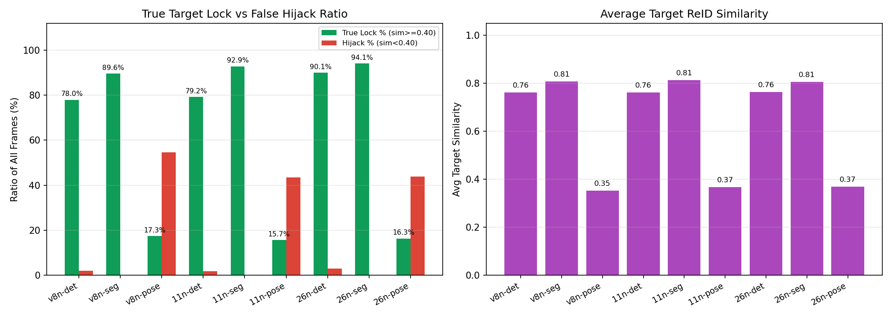
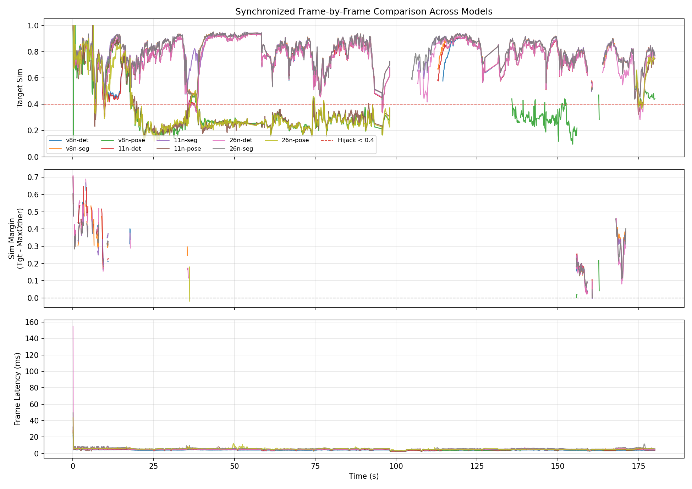
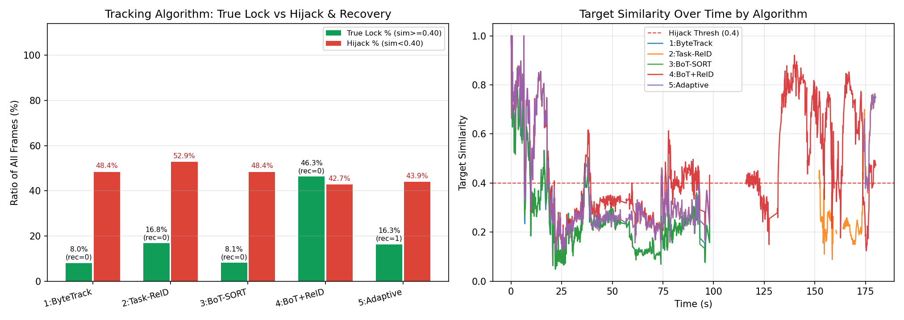
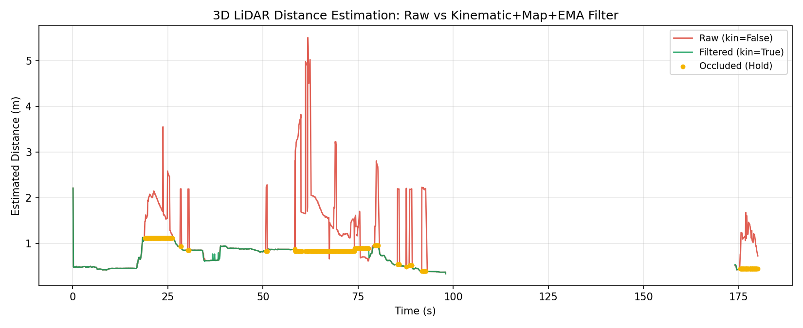

# Bag Benchmark Report: `test_full`

- **Bag Path**: `/home/jsb/bag/complete_bag/test_full`
- **Image Topic**: `/robot1/top_cam/image_raw/compressed` (`1522` frames evaluated)
- **Scan / TF**: `/robot1/scan` / `/robot1/tf`
- **Keyframes (`Δ=10f`)**: `q1@f380, recovered@f1466`

## 0. 핵심 관찰 요약 (Auto Insights)

- **최고 연산 속도**: `v8n-det` (Infer `1.62ms`, Post+Trk `0.44ms`, Max `344.5 FPS`)
- **최고 진성 유지율 (`True Lock %`, sim>=0.4)**: `26n-seg` (`94.1%`, Avg Sim `0.806`)
- **최고 타인 변별 마진 (`Sim Margin`)**: `11n-pose` (평균 `0.446`, 최소 `0.446`)
- **Pose 부위 가용성 & BBox 폴백 비율**: `v8n-pose` M=30.3%/L=16.4%/FB=13.7%, `11n-pose` M=25.5%/L=16.4%/FB=10.7%, `26n-pose` M=18.2%/L=18.7%/FB=18.0%
- **추적 알고리즘 효과**: `1:ByteTrack` TrueLock=8.0% (Hijack=48.4%, Rec=0), `2:Task-ReID` TrueLock=16.8% (Hijack=52.9%, Rec=0), `3:BoT-SORT` TrueLock=8.1% (Hijack=48.4%, Rec=0), `4:BoT+ReID` TrueLock=46.3% (Hijack=42.7%, Rec=0), `5:Adaptive` TrueLock=16.3% (Hijack=43.9%, Rec=1)
- **LiDAR 필터링 효과**: Jumps `5 -> 0`, FarCamEst `74 -> 1`, AMCL Wall/Out `0 -> 0`, Occluded Hold `332f`

## 1. 모델별 연산 · 후처리 속도 분해 (`5:Adaptive`)

| Model | Pre (ms) | Infer Mean / P95 (ms) | Post+Trk (ms) | ReID (ms) | Total Mean / P95 (ms) | Max FPS |
|---|---:|---:|---:|---:|---:|---:|
| v8n-det (`yolov8n.pt`) | 0.17 | 1.62 / 1.67 | 0.44 | 0.84 | 3.97 / 4.6 | 344.5 |
| v8n-seg (`yolov8n-seg.pt`) | 0.17 | 1.9 / 1.93 | 0.58 | 1.3 | 5.04 / 6.4 | 264.5 |
| v8n-pose (`yolov8n-pose.pt`) | 0.17 | 1.92 / 2.0 | 0.48 | 0.94 | 4.51 / 5.45 | 298.9 |
| 11n-det (`yolo11n.pt`) | 0.17 | 2.18 / 2.21 | 0.44 | 0.85 | 4.53 / 5.28 | 288.8 |
| 11n-seg (`yolo11n-seg.pt`) | 0.17 | 2.45 / 2.47 | 0.57 | 1.28 | 5.55 / 6.77 | 233.1 |
| 11n-pose (`yolo11n-pose.pt`) | 0.17 | 2.47 / 2.56 | 0.47 | 0.93 | 4.96 / 6.0 | 258.4 |
| 26n-det (`yolo26n.pt`) | 0.18 | 2.45 / 2.57 | 0.46 | 0.85 | 5.01 / 6.03 | 265.7 |
| 26n-seg (`yolo26n-seg.pt`) | 0.17 | 2.81 / 2.88 | 0.58 | 1.29 | 5.97 / 7.21 | 213.6 |
| 26n-pose (`yolo26n-pose.pt`) | 0.19 | 2.84 / 3.16 | 0.52 | 0.96 | 5.47 / 6.56 | 231.6 |

## 2. 특징 추출 용이성 · 부위 가용성 · 배경 분리 (`5:Adaptive`)

| Model | U / M / L Valid % | Pose Fallback % | Mask FG % | Avg Tgt Sim ± Std (Min) | U / M / L / F Avg Sim |
|---|---:|---:|---:|---:|---|
| v8n-det | 100.0% / 100.0% / 100.0% | 0.0% | 48.0% | 0.762 ± 0.136 (0.317) | 0.731 / 0.709 / 0.665 / 0.762 |
| v8n-seg | 100.0% / 100.0% / 100.0% | 0.0% | 70.4% | 0.807 ± 0.113 (0.415) | 0.771 / 0.766 / 0.727 / 0.807 |
| v8n-pose | 97.6% / 30.3% / 16.4% | 13.7% | 24.1% | 0.352 ± 0.185 (0.096) | 0.296 / 0.32 / 0.434 / 0.349 |
| 11n-det | 100.0% / 100.0% / 100.0% | 0.0% | 48.0% | 0.762 ± 0.137 (0.306) | 0.731 / 0.709 / 0.666 / 0.762 |
| 11n-seg | 100.0% / 100.0% / 100.0% | 0.0% | 70.4% | 0.813 ± 0.101 (0.43) | 0.78 / 0.774 / 0.734 / 0.812 |
| 11n-pose | 94.4% / 25.5% / 16.4% | 10.7% | 21.4% | 0.367 ± 0.194 (0.148) | 0.313 / - / 0.517 / 0.363 |
| 26n-det | 100.0% / 100.0% / 100.0% | 0.0% | 48.0% | 0.764 ± 0.133 (0.282) | 0.729 / 0.713 / 0.667 / 0.764 |
| 26n-seg | 100.0% / 100.0% / 100.0% | 0.0% | 69.2% | 0.806 ± 0.112 (0.418) | 0.772 / 0.765 / 0.726 / 0.806 |
| 26n-pose | 99.3% / 18.2% / 18.7% | 18.0% | 22.2% | 0.369 ± 0.202 (0.117) | 0.299 / 0.936 / 0.553 / 0.367 |

## 3. 재식별 변별력 · 혼잡 · 오인식 방어 (`5:Adaptive`)

> `True Lock %`: 전체 프레임 중 유사도 `>=0.4`로 실제 타겟을 유지한 비율 · `Hijack %`: 유사도 `<0.4` 오탐 잠금 비율

| Model | Det % | >=2P % | Locked % | True Lock % | Hijack % | Direct Sw | Recovered (Avg f) | Other Avg / Max | Margin Mean / Min |
|---|---:|---:|---:|---:|---:|---:|---:|---:|---:|
| v8n-det | 96.3% | 7.6% | 83.1% | **78.0%** | 2.0% | 0 | 1 (38.5f) | 0.43 / 0.665 | 0.312 / 0.016 |
| v8n-seg | 96.3% | 8.5% | 93.1% | **89.6%** | 0.0% | 0 | 2 (31.6f) | 0.461 / 0.675 | 0.3 / 0.004 |
| v8n-pose | 96.3% | 4.5% | 74.7% | **17.3%** | 54.7% | 0 | 3 (71.2f) | 0.204 / 0.254 | 0.06 / 0.002 |
| 11n-det | 96.3% | 8.3% | 84.2% | **79.2%** | 1.8% | 0 | 1 (34.8f) | 0.409 / 0.662 | 0.314 / 0.015 |
| 11n-seg | 96.3% | 7.4% | 96.5% | **92.9%** | 0.0% | 0 | 2 (21.6f) | 0.494 / 0.678 | 0.279 / -0.002 |
| 11n-pose | 95.4% | 4.5% | 61.9% | **15.7%** | 43.4% | 0 | 3 (89.0f) | 0.202 / 0.202 | 0.446 / 0.446 |
| 26n-det | 96.4% | 7.8% | 96.4% | **90.1%** | 2.8% | 0 | 2 (21.6f) | 0.427 / 0.667 | 0.288 / 0.009 |
| 26n-seg | 96.4% | 7.8% | 97.6% | **94.1%** | 0.0% | 0 | 2 (18.0f) | 0.485 / 0.668 | 0.283 / 0.001 |
| 26n-pose | 96.7% | 4.7% | 62.2% | **16.3%** | 43.9% | 0 | 1 (303.0f) | 0.274 / 0.321 | 0.048 / -0.018 |

## 4. 추적 알고리즘 비교 (`yolo26n-pose`)

| Mode | Locked % | True Lock % | Hijack % | SEARCH % | GUARD % | Direct Sw | Recovered (Avg f) | Avg Tgt Sim | Total (ms) |
|---|---:|---:|---:|---:|---:|---:|---:|---:|---:|
| 1:ByteTrack | 58.4% | **8.0%** | 48.4% | 0.0% | 0.0% | 0 | 0 | 0.267 | 4.96 |
| 2:Task-ReID | 72.1% | **16.8%** | 52.9% | 0.0% | 0.0% | 1 | 0 | 0.351 | 5.82 |
| 3:BoT-SORT | 58.1% | **8.1%** | 48.4% | 0.0% | 0.0% | 0 | 0 | 0.267 | 7.35 |
| 4:BoT+ReID | 91.5% | **46.3%** | 42.7% | 0.0% | 0.0% | 1 | 0 | 0.467 | 8.33 |
| 5:Adaptive | 62.2% | **16.3%** | 43.9% | 39.8% | 0.2% | 0 | 1 (303.0f) | 0.369 | 5.34 |

## 5. 3D LiDAR Localizer 비교 (`Raw` vs `Kinematic+Map+EMA`)

| Config | LiDAR | Occluded (Hold) | CamEst | LiDAR Jumps (>0.8m) | Far CamEst (>2.0m) | AMCL Wall/Out |
|---|---:|---:|---:|---:|---:|---:|
| Raw (kin=False) | 842 | 0 | 74 | 5 | 74 | 0 |
| Filtered (kin=True) | 583 | 332 | 1 | 0 | 1 | 0 |

## 6. 시각 검증 스냅샷 (`snapshots/`)

- `compare_tasks_hist_q1_f0380.png`
  
- `compare_versions_q1_f0380.png`
  
- `compare_pixels_q1_f0380.png`
  
- `compare_seq_q1_f0380.png`
  
- `compare_tasks_hist_recovered_f1466.png`
  
- `compare_versions_recovered_f1466.png`
  
- `compare_pixels_recovered_f1466.png`
  
- `compare_seq_recovered_f1466.png`
  
