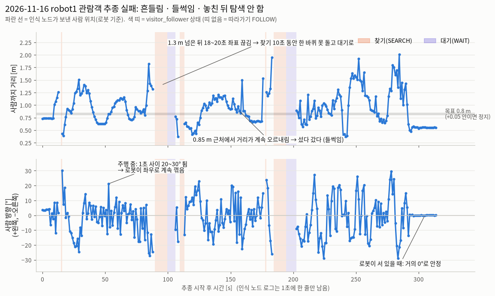

## 증상

인식 모듈(`multi_person_tracker_node`)의 `target_person/point_map`을 받아 `visitor_follower`로 약 3.5분 추종했다.

- 로봇이 좌우로 계속 꺾고, 가끔 엉뚱한 방향을 본다.
- 앞뒤로도 섰다 갔다 하면서 들썩인다.
- 사람이 거의 끌고 다니듯 해야 따라온다.
- 놓쳤을 때(SEARCH) 한 바퀴 돌며 찾지 않고 그대로 대기(WAIT)로 넘어간다.



- 파란 선: 인식 노드가 보낸 사람 위치(로봇 기준 거리·방향)
- 색 띠: `visitor_follower` 상태
- 인식 노드 로그는 1초에 한 줄만 남으므로 실제(약 15 Hz)는 이보다 더 촘촘하게 흔들린다.

| 관찰 | 로그 근거 (추종 시작 후 시간) |
|---|---|
| 로봇이 서 있으면 사람 방향이 안정적 | 0~5 s +3.4~+4.2°, 292~313 s 0.0±0.1° |
| 주행 중에는 방향이 1초 사이 20~30° 튐 | 52.7 s +21.2° → 53.8 s −7.9° (거리 0.82 m) |
| 거리가 0.8~1.0 m에서 계속 오르내림 | 140~175 s, 240~260 s |
| 놓친 뒤 SEARCH 10초 → WAIT | 89.5 s SEARCH → 99.5 s WAIT → 106 s FOLLOW, 184.4 s SEARCH → 194.5 s WAIT → 202.5 s FOLLOW |

노드 로그 (`~/.ros/log/python3_111749_1794825390224.log`, 일부):

```
[INFO] [1794825479.454670224] [robot1.visitor_follower]: 상태 FOLLOW → SEARCH
[INFO] [1794825489.454713921] [robot1.visitor_follower]: 상태 SEARCH → WAIT
[INFO] [1794825495.954795306] [robot1.visitor_follower]: 상태 WAIT → FOLLOW
```

인식 노드 로그 (`~/.ros/log/python3_111303_1794825236832.log`, 일부):

```
[robot1.multi_person_tracker_node]: [타겟 위치 ID=38 | LiDAR] 로봇기준(base_link): ... (거리 0.82m, 각도 +21.2°)
[robot1.multi_person_tracker_node]: [타겟 위치 ID=38 | LiDAR] 로봇기준(base_link): ... (거리 0.82m, 각도 -7.9°)
```

## 재현 방법

```bash
# 인식 모듈(person_tracker)을 띄우고 타겟을 클릭한 뒤
ros2 run arti_follow visitor_follower --ros-args -r __ns:=/robot1
# 사람이 1~2 m 범위에서 걸어 다닌다
```

## 원인

인식 모듈의 좌표는 지금 상태 그대로라고 가정하고, 그 좌표를 받는 `visitor_follower` 쪽 원인만 적는다.
인식 쪽 문제(영상 지연을 고려하지 않은 좌표 계산, 1.3 m 이상에서 재식별 실패)는 인식 담당이 따로 다룬다.

**파라미터보다 구조 문제다.**
노드는 Nav2를 쓰지 않고 직접 만든 길 찾기(격자 BFS)와 DWA로 `cmd_vel`을 보낸다.
그런데 0.1 s마다 아래를 처음부터 다시 한다.

```
튀는 사람 좌표 → 목표점 새로 잡음 → 길 지도 새로 계산 → (v, w) 후보 중 최선 → cmd_vel
```

1. **목표가 매번 튄다** (`on_person`, `lead_time`)
   - 받은 좌표를 그대로 쓴다.
   - 사람 속도는 바로 전 좌표와의 차이로 구한다.
   - 여기에 `lead_time` 1.5 s를 곱해 앞쪽에 목표를 잡는다.
   - 좌표가 0.3 m만 튀어도 속도가 상한 1.5 m/s에 걸리고, 목표점이 최대 2.25 m 튄다.
   - 튀는 값을 걸러 내는 단계가 없다.
2. **좌우로 자주 돈다**
   - 왼쪽·오른쪽으로 살짝 도는 후보끼리 점수 차이가 아주 작다.
   - 그래서 목표가 조금만 튀어도 선택이 뒤집힌다.
   - 0.85 m 안에서는 제자리 회전에 데드밴드가 없어서 몇 도짜리 잡음에도 돈다.
3. **앞뒤로 들썩인다** (`distance_tolerance` 0.05)
   - "DWA로 전진"과 "곧바로 `v = 0`" 사이 경계가 0.85 m 하나뿐이다.
   - 거리 잡음이 그 위아래를 넘나들 때마다 섰다 갔다 한다.
   - 멈출 때도 감속 없이 한 번에 0이 된다.
4. **놓친 뒤 한 바퀴를 못 돈다** (`control`의 SEARCH)
   - `search_time` 10 s 안에 `search_spin` 0.6 rad/s로는 한 바퀴(2π)에 10.5 s가 걸린다.
   - 마지막 좌표로 이동한 뒤에야 돌기 시작하는데, 이동 시간에 제한이 없어서 회전할 시간이 더 줄어든다.

## 해결

`src/arti_follow/arti_follow/visitor_follower.py`:

| 문제 | 바꾼 것 | 파라미터 |
|---|---|---|
| 목표가 튐 | 사람 좌표를 **칼만 필터**(등속 모델: 위치+속도)로 매끄럽게 추정. 예측과 너무 다른 좌표(마할라노비스 거리² > 9.21)는 버린다. 5번 연속 버려지면 사람이 정말 옮긴 것으로 보고 필터를 다시 시작 | `kf_accel_std` 1.0, `kf_meas_std` 0.15, `kf_gate` 9.21, `kf_max_rejects` 5 |
| 목표가 튐 | 앞을 내다보는 시간 1.5 → 0.5 s | `lead_time` |
| 좌우 회전 | 가까이 서 있을 때 ±0.15 rad(약 9°) 안이면 돌지 않음 | `face_deadband` |
| 앞뒤 들썩임 | 0.85 m 안에서 서고, **0.95 m 밖이 돼야** 다시 출발 (경계를 둘로) | `restart_margin` 0.15 |
| 덜컹 정지 | 멈출 때(가까움·IDLE·WAIT·LOST) 0.4 m/s²로 감속. 회전도 `angular_accel` 안에서 바뀜. 센서 끊김·막힘·`follow/enable` false는 지금처럼 즉시 정지 | `linear_decel` 0.4 |
| 한 바퀴 못 돎 | 마지막 좌표로 최대 4 s 이동 → 멈춰서 **남은 시간 안에 한 바퀴** 돌 속도로 회전 (최소 0.6, 최대 1.5 rad/s, 가속분 5 % 여유) | `search_move_time` 4.0, `search_spin` |

**PC 확인 (로봇 없이):**

인식 좌표처럼 잡음(±0.15 m)과 1 m 이상값을 섞은 모의 데이터로 돌렸다.

| 항목 | 고치기 전 | 고친 후 |
|---|---|---|
| 위치 오차 | 0.36 m | 0.09 m |
| 속도 오차 | 1.09 m/s | 0.18 m/s |
| 0.067 s당 목표점 이동 | 평균 2.44 m | 평균 0.09 m |
| 사람이 멈췄을 때 추정 속도 | 0.95 m/s | 0.15 m/s |

- 이상값 11개는 모두 버려졌다.
- 노드를 프로세스 안에서 가상 세계로 굴려 봤다(도메인 77, `cmd_vel` 미발행).
  - 사람이 멈추면 감속해 0.89 m에서 서고, 그 뒤 섰다 갔다 하지 않는다.
  - SEARCH 약 10 s 동안 379° 돌았다.
- 남은 것: 다가가는 동안 좌우 미세 보정(±0.3 rad/s)은 남는다. 실제 로봇에서 거슬리는지 확인이 필요하다.

**아직 로봇에서 확인하지 않아서 status는 미해결로 둔다.**

## 확인 방법

카메라를 뺀 토픽만 rosbag으로 녹화해 이 기록의 그래프와 비교한다.

```bash
ros2 bag record /robot1/target_person/point_map /robot1/cmd_vel /robot1/follow/state /robot1/odom /robot1/tf /robot1/scan
```

확인할 것:

- 사람이 서 있을 때 `cmd_vel`의 `linear.x`가 0과 양수를 오가지 않는지
- `angular.z`의 부호가 1초에 여러 번 바뀌지 않는지
- SEARCH 동안 odom yaw가 한 바퀴(2π) 이상 바뀌는지

## 참고

- 그래프 원본: 위 두 로그 파일을 파싱해 matplotlib으로 그림
- 칼만 필터(등속 모델): 상태 = [x, y, vx, vy]. 예측(등속으로 이동) → 보정(측정과 섞음) 반복
- 관련 기록: [visitor_follower 주행 테스트 중 로봇이 앞 벽 쪽으로 감](2026-11-16-visitor-follower-wall-approach.md)
