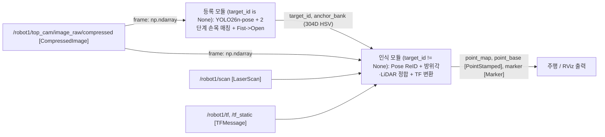
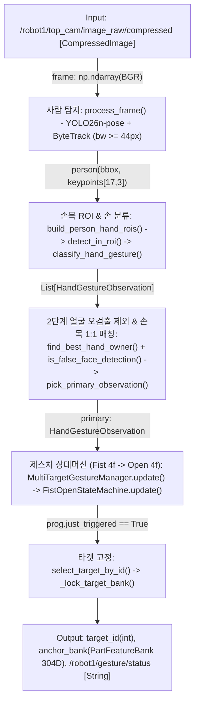
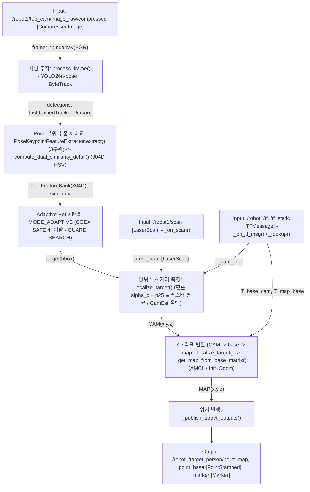

# `person_tracker` 핵심 파이프라인 코드 가이드

> [!NOTE]
> 아래 모든 파일·함수 링크는 상대 경로 + 줄 번호 형식(`./파일명.py#L줄번호`)으로 작성되어 있어, **GitHub 웹 UI**와 **VS Code Markdown 미리보기(`Ctrl+Shift+V`)** 양쪽에서 클릭 시 해당 함수 정의 줄로 바로 이동합니다.

---

## 1. 디렉토리 및 모듈 구성

| 파일 | 역할 | 설계도 위치 |
|---|---|---|
| [`base_tracker_node.py`](./base_tracker_node.py#L38) | 공용 ROS 2 베이스 노드 (`BaseTrackerNode`): 영상 입력·위치추정·오버레이·`arti/tour_end`·`TrackerStateStore` | 공용 ROS 골격 |
| [`tracker_state.py`](./tracker_state.py#L17) | 선택적(`enable_state_store`) 불변 상태 스냅샷(`TrackerState`) + 이벤트 콜백(`TrackerStateStore`) | 상태/콜백 인터페이스 |
| [`gesture_test_node.py`](./gesture_test_node.py#L40) | 제스처 등록 노드 (`GestureTestNode`, `BaseTrackerNode` 상속): 손 제스처 등록·상태 발행·`ReID Monitor` GUI | 전체 루프(`handle_frame`) |
| [`multi_tracker_core.py`](./multi_tracker_core.py#L85) | YOLO26n-pose + ByteTrack 1차 추적 및 Adaptive ReID (`COEX` / `SAFE` / `GUARD` / `SEARCH`) | 사람 탐지 · 인식 판별 |
| [`feature_extractors.py`](./feature_extractors.py#L441) | 304D HSV 히스토그램 + Pose 17관절 해부학 부위 마스킹(`upper`/`mid`/`lower`/`full`) 및 유사도 비교 | 외형 특징 추출 · EMA |
| [`gesture_core.py`](./gesture_core.py#L145) | 손목 정사각 ROI, MediaPipe 21관절 분류, 2단계 얼굴 오검출 필터, 1:1 손목 매칭, `Fist->Open` 상태머신 | 등록 모듈 |
| [`lidar_person_localizer.py`](./lidar_person_localizer.py#L100) | 카메라-라이다-TF 타임스탬프 정합(`_select_scan_for_stamp`) + 거리 추정 + `base_link`/`map` TF 좌표 변환 및 토픽 발행 | 인식 모듈 거리·좌표 변환 |
| [`reid_visualizer.py`](./reid_visualizer.py#L34) | `ReID Monitor` 실시간 그래프, 부위 막대, 304D HSV 히트맵 (`Anchor` / `Recent EMA` / `Compare`) | 디버그 시각화 |
| [`camera_publisher_node.py`](./camera_publisher_node.py#L1) | 로컬 웹캠/DroidCam을 `/robot1/top_cam/image_raw/compressed` ROS 토픽으로 발행 | 영상 입력 퍼블리셔 |
| [`top_cam_tf_node.py`](./top_cam_tf_node.py#L1) | 상단 카메라 정적 TF (`oakd_rgb_camera_frame` -> `top_cam_link` -> `top_cam_optical_frame`) 발행 | `/tf_static` 퍼블리셔 |
| [`env_bootstrap.py`](./env_bootstrap.py#L1) | `rokey_venv` 파이썬 경로 부트스트랩 및 네임스페이스 토픽·모델 경로 해석 | 공통 유틸 |

---

## 2. ROS 2 메시지 인터페이스

| 구분 | 토픽 / 소스 | 메시지 타입 | 설명 |
|---|---|---|---|
| **입력 (영상)** | `/<ns>/top_cam/image_raw/compressed` (또는 `video_source`) | `sensor_msgs/CompressedImage` (`Image` 선택 가능) | 상단 웹캠 BGR 영상 (웹캠 직접 입력 시 `640x480`) |
| **입력 (라이다)** | `/<ns>/scan` | `sensor_msgs/LaserScan` | 2D LiDAR 거리 스캔 (`rplidar_link`) |
| **입력 (TF)** | `/<ns>/tf`, `/<ns>/tf_static` | `tf2_msgs/TFMessage` | `map -> odom -> base_link -> top_cam_link -> rplidar_link` |
| **출력 (타겟 맵 좌표)** | `/<ns>/target_person/point_map` | `geometry_msgs/PointStamped` | `map` 기준 타겟 관람객 좌표 (`frame_id: map`) |
| **출력 (로봇 기준 좌표)** | `/<ns>/target_person/point_base` | `geometry_msgs/PointStamped` | 로봇 `base_link` 기준 타겟 상대 좌표 |
| **출력 (RViz 마커)** | `/<ns>/target_person/marker` | `visualization_msgs/Marker` | 타겟 위치 실린더 마커 (`LiDAR`=초록, `CamEst`=주황) |
| **출력 (제스처 상태)** | `/<ns>/gesture/status` | `std_msgs/String` | `SCANNING`, `FIST_ARMED`, `TRIGGERED`, `LOCKED`, `LOST_WAIT` |

---

## 3. 모듈 입출력 요약



---

## 4. 모듈별 동작 흐름 · 입출력 인터페이스 다이어그램 (클릭 이동)

각 모듈의 **순수 동작 흐름(핵심 함수)과 입출력 인터페이스**만 간결하게 정리했습니다.

---

### ① 등록 모듈 동작 흐름 (`target_id is None`)



- **함수 바로 이동 (등록 모듈 순서)**:
  - 입력·탐지: [`_compressed_cb()`](./base_tracker_node.py#L329) / [`_raw_cb()`](./base_tracker_node.py#L338) / [`_poll_local_frame()`](./base_tracker_node.py#L320) → [`handle_frame()`](./gesture_test_node.py#L408) → [`process_frame()`](./multi_tracker_core.py#L521)
  - 손 ROI·분류: [`build_person_hand_rois()`](./gesture_core.py#L578) ([`_clamp_square_roi()`](./gesture_core.py#L561) / [`build_person_gesture_roi()`](./gesture_core.py#L516)) → [`detect_in_roi()`](./gesture_core.py#L169) → [`classify_hand_gesture()`](./gesture_core.py#L89)
  - 얼굴 제외·손목 1:1 매칭: [`find_best_hand_owner_slot()`](./gesture_core.py#L769) → [`match_hand_to_person_wrist_slot()`](./gesture_core.py#L687) ([`is_false_face_detection()`](./gesture_core.py#L625)) → [`pick_primary_observation()`](./gesture_core.py#L240)
  - 상태머신·잠금: [`MultiTargetGestureManager.update_person_hands()`](./gesture_core.py#L451) → [`FistOpenStateMachine.update()`](./gesture_core.py#L302) → [`select_target_by_id()`](./multi_tracker_core.py#L501) → [`_activate_target()`](./multi_tracker_core.py#L483) → [`_lock_target_bank()`](./multi_tracker_core.py#L458)

---

### ② 인식 모듈 동작 흐름 (`target_id != None`)



- **함수 바로 이동 (인식 모듈 순서)**:
  - 외형 추출·유사도: [`BaseFeatureExtractor.extract()`](./feature_extractors.py#L165) / [`extract_part_masks()`](./feature_extractors.py#L129) ([`PoseKeypointFeatureExtractor._prepare_part_masks()`](./feature_extractors.py#L452) · [`BBoxFeatureExtractor._prepare_part_masks()`](./feature_extractors.py#L350)) → [`calc_hsv_hist()`](./feature_extractors.py#L62) → [`PartFeatureBank`](./feature_extractors.py#L30) → [`compute_dual_similarity_detail()`](./feature_extractors.py#L271) → [`compare_banks_detail()`](./feature_extractors.py#L202) / [`hist_sim()`](./feature_extractors.py#L85)
  - Adaptive ReID 상태머신·보충: [`MODE_ADAPTIVE`](./multi_tracker_core.py#L721) (`COEX` [`L722`](./multi_tracker_core.py#L722) · `SAFE` [`L755`](./multi_tracker_core.py#L755) · `SEARCH` [`L777`](./multi_tracker_core.py#L777) · `GUARD` [`L867`](./multi_tracker_core.py#L867)), [`_update_target_banks_safely()`](./multi_tracker_core.py#L385) (`UPGRADE`·`BACKFILL`), [`backfill_part()`](./feature_extractors.py#L313), [`update_recent_bank()`](./feature_extractors.py#L330), [`_apply_exclude_boxes()`](./feature_extractors.py#L93), [`_is_crowded_near_target()`](./multi_tracker_core.py#L297), [`_compute_spatial_score()`](./multi_tracker_core.py#L314), [`_score_candidate()`](./multi_tracker_core.py#L367)
  - 센서 동기화·좌표 변환·발행: [`LidarPersonLocalizer.__init__()`](./lidar_person_localizer.py#L111), [`_on_scan()`](./lidar_person_localizer.py#L286), [`_select_scan_for_stamp()`](./lidar_person_localizer.py#L301), [`_on_tf_msg()`](./lidar_person_localizer.py#L278), [`_on_tf_static_msg()`](./lidar_person_localizer.py#L282), [`_estimate_candidate_spatial()`](./base_tracker_node.py#L410) → [`localize_target()`](./lidar_person_localizer.py#L430) → [`_get_map_from_base_matrix()`](./lidar_person_localizer.py#L349) → [`_publish_target_outputs()`](./lidar_person_localizer.py#L565)
  - 상태·콜백·수동 제어: [`TrackerStateStore.update()`](./tracker_state.py#L82) / [`register_state_hook()`](./base_tracker_node.py#L178), [`_on_mouse_click()`](./base_tracker_node.py#L366), [`_process_key()`](./base_tracker_node.py#L383), [`_reset_target()`](./base_tracker_node.py#L347), [`_on_tour_end()`](./base_tracker_node.py#L359), [`_on_set_parameters()`](./base_tracker_node.py#L269)

---

### ③ 공통 디버그 시각화 (`ReID Monitor` & GUI)
- [`_draw_pose_and_mask_overlays()`](./base_tracker_node.py#L490): Pose 스켈레톤·관절 마커 및 3부위 히스토그램 마스킹 영역 반투명(`0.34`)·외곽선 오버레이 렌더링 (`show_pose_mask`)
- [`ReIDDebugVisualizer.render()`](./reid_visualizer.py#L125) / [`_render_hsv_vector_patch()`](./reid_visualizer.py#L65) / [`_ensure_reid_window()`](./gesture_test_node.py#L109): 120f 유사도 시계열 그래프, 인원별 `Tot/U/M/L/F` 막대, `Anchor` / `Recent (EMA)` / `Other(Target)` 행별 4부위(`Upper`/`Mid`/`Lower`/`Full`) 304D 히트맵 및 `Total Sim`·`A-R Sim`·`EMA` 상태 렌더링 (기동 진입점: [`main()`](./gesture_test_node.py#L576) → [`run_tracker_node()`](./base_tracker_node.py#L646), [`__init__()`](./gesture_test_node.py#L50))

---

## 5. 실행 및 테스트 방법

```bash
# 집/로컬 테스트 시 실습실 Discovery Server 비활성화 (양쪽 터미널 모두 실행)
unset ROS_DISCOVERY_SERVER ROS_SUPER_CLIENT
ros2 daemon stop
```

- **로컬 웹캠 단독 테스트 (로컬라이저 끔)**:
  ```bash
  ros2 run person_tracker gesture_test_node --ros-args -r __ns:=/robot1 -p video_source:=0 -p use_localizer:=false
  ```
- **rosbag / 토픽 구독 테스트 (인식 + LiDAR/TF 좌표 계산)**:
  ```bash
  # 터미널 1
  ros2 bag play ~/bag/rosbag2_2026_11_17-21_21_09 --loop
  # 터미널 2 (video_source:="" 이면 토픽 구독, 관측 전용 시 publish_target_topics:=false)
  ros2 run person_tracker gesture_test_node --ros-args -r __ns:=/robot1 -p 'video_source:=""' -p use_localizer:=true
  # 실행 중 웹캠 <-> 토픽 전환
  ros2 param set /robot1/gesture_test_node video_source ""
  ros2 param set /robot1/gesture_test_node video_source "0"
  ```
- **주요 ReID/EMA·동기화/상태 ROS 2 파라미터** (`--ros-args -p <이름>:=<값>`): `enable_state_store` (`true` on test node), `auto_start_lidar_motor` (`publish_target_topics` 따라감), `ema_min_sim` (`0.60`), `ema_alpha` (`0.04`), `ema_require_single` (`true`), `scan_sync_slop_sec` (`0.25`), `require_scan_sync` (`true`), `tracker_conf` (`0.15`), `tracker_iou` (`0.55`), `reid_match_thresh` (`0.50`), `search_min_sim` (`0.48`), `coexist_min_sim` (`0.74`), `recover_margin` (`0.06`), `recover_confirm_frames` (`2`), `id_switch_thresh` (`0.48`), `safe_mismatch_limit` (`4`)
- **GUI 단축키**: `[Y]` YOLO+ROI 전환 · `[R]` 타겟 초기화 · `[1/2]` Fist 프레임 · `[3/4]` Open 프레임 · `[D]` CPU/GPU 전환 · `[V]` ReID 모니터 창 토글 · `[M]` 포즈/마스크 오버레이 토글 · `[P]` 타겟 토픽 발행 토글
