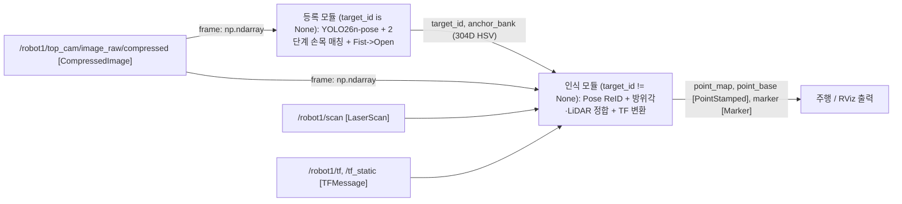
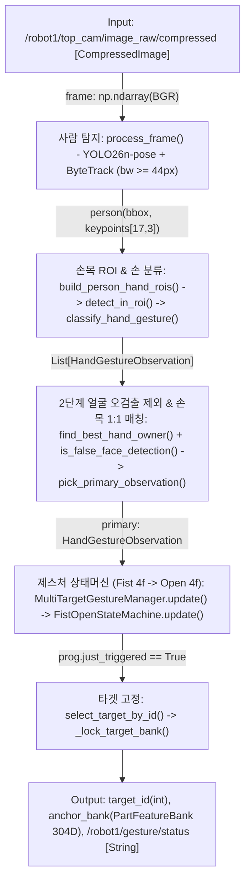

# `person_tracker` 핵심 파이프라인 코드 가이드

> [!NOTE]
> 아래 모든 파일·함수 링크는 상대 경로 + 줄 번호 형식(`./파일명.py#L줄번호`)으로 작성되어 있어, **GitHub 웹 UI**와 **VS Code Markdown 미리보기(`Ctrl+Shift+V`)** 양쪽에서 클릭 시 해당 함수 정의 줄로 바로 이동합니다.

---

## 1. 디렉토리 및 모듈 구성

```text
person_tracker/
├── core/    # 공용 인식·제스처·LiDAR 핵심 엔진 (ROS 노드 아님)
├── nodes/   # 실전 주행·카메라·TF 연동 ROS 2 노드
├── debug/   # 제스처 테스트·ReID 시각화·네트워크 모니터 도구
└── legacy/  # 초기 단일 모델·9종 벤치마크 노드/코어
```

| 구분 | 파일 | 역할 | 설계도 위치 |
|---|---|---|---|
| **Core** | [`multi_tracker_core.py`](./core/multi_tracker_core.py#L85) | YOLO26n-pose + ByteTrack 1차 추적 및 Adaptive ReID (`COEX` / `SAFE` / `GUARD` / `SEARCH`) | 사람 탐지 · 인식 판별 |
| **Core** | [`feature_extractors.py`](./core/feature_extractors.py#L441) | 304D HSV 히스토그램 + Pose 17관절 해부학 부위 마스킹(`upper`/`mid`/`lower`/`full`) 및 유사도 비교 | 외형 특징 추출 · EMA |
| **Core** | [`gesture_core.py`](./core/gesture_core.py#L145) | 손목 정사각 ROI, MediaPipe 21관절 분류, 2단계 얼굴 오검출 필터, 1:1 손목 매칭, `Fist->Open` 상태머신 | 등록 모듈 |
| **Core** | [`lidar_person_localizer.py`](./core/lidar_person_localizer.py#L102) | 카메라-라이다-TF 타임스탬프 정합(`_select_scan_for_stamp`) + 거리 추정 + `base_link`/`map` TF 좌표 변환 및 토픽 발행 | 인식 모듈 거리·좌표 변환 |
| **Core** | [`tracker_state.py`](./core/tracker_state.py#L17) | 선택적(`enable_state_store`) 불변 상태 스냅샷(`TrackerState`) + 이벤트 콜백(`TrackerStateStore`) | 상태/콜백 인터페이스 |
| **Core** | [`env_bootstrap.py`](./core/env_bootstrap.py#L1) | `rokey_venv` 파이썬 경로 부트스트랩 및 설정(`phone_camera.yaml`)·토픽·모델 경로 해석 | 공통 유틸 |
| **Nodes** | [`base_tracker_node.py`](./nodes/base_tracker_node.py#L38) | 공용 ROS 2 베이스 노드 (`BaseTrackerNode`): 영상 입력·동적 소스전환·위치추정·오버레이·`arti/tour_end` | 공용 ROS 골격 |
| **Nodes** | [`front_tracker_node.py`](./nodes/front_tracker_node.py#L28) | 정면 자동(`register_front`)/클릭 등록 실전 노드 (`FrontTrackerNode`, `tracker:=front`) | 실전 등록 노드 |
| **Nodes** | [`camera_publisher_node.py`](./nodes/camera_publisher_node.py#L1) | 로컬 웹캠/DroidCam을 `/robot1/top_cam/image_raw/compressed` ROS 토픽으로 발행 (`camera_pub`) | 영상 입력 퍼블리셔 |
| **Nodes** | [`top_cam_tf_node.py`](./nodes/top_cam_tf_node.py#L1) | 상단 카메라 정적 TF (`oakd_rgb_camera_frame` -> `top_cam_link` -> `top_cam_optical_frame`) 발행 | `/tf_static` 퍼블리셔 |
| **Nodes** | [`init_pose_node.py`](./nodes/init_pose_node.py#L1) | AMCL 초기 위치 발행 및 `map -> base_link / top_cam_link` TF 확인 (`init_pose`) | 초기 위치 퍼블리셔 |
| **Debug** | [`gesture_test_node.py`](./debug/gesture_test_node.py#L41) | 제스처 등록 + `ReID Monitor` GUI 노드 (`GestureTestNode`, 실주행 기본 `tracker:=gesture` 겸용) | 전체 루프(`handle_frame`) |
| **Debug** | [`reid_visualizer.py`](./debug/reid_visualizer.py#L34) | `ReID Monitor` 실시간 그래프, 부위 막대, 304D HSV 히트맵 (`Anchor` / `Recent EMA` / `Compare`) | 디버그 시각화 |
| **Debug** | [`net_monitor_node.py`](./debug/net_monitor_node.py#L1) | 토픽 수신 FPS·대역폭·지연 측정 모니터 (`net_monitor`) | 네트워크 진단 |
| **Legacy** | [`multi_tracker_node.py`](./legacy/multi_tracker_node.py#L27) | 9모델 × 5모드 실시간 비교 벤치마크 노드 (`tracker:=all` / `bringup.launch.py`) | 비교 벤치마크 |
| **Legacy** | [`tracker_core.py`](./legacy/tracker_core.py#L36) · [`tracker_node.py`](./legacy/tracker_node.py#L23) | 초기 BBox Detect 단일 모델 추적 코어·노드 (`tracker_node`) | 초기 Detect 레거시 |
| **Legacy** | [`seg_tracker_core.py`](./legacy/seg_tracker_core.py#L1) · [`seg_tracker_node.py`](./legacy/seg_tracker_node.py#L23) | 초기 Segmentation 단일 모델 추적 코어·노드 (`seg_tracker_node`) | 초기 Seg 레거시 |

---

## 2. ROS 2 메시지 인터페이스

| 구분 | 토픽 / 소스 | 메시지 타입 | 설명 |
|---|---|---|---|
| **입력 (영상)** | `/<ns>/top_cam/image_raw/compressed` (또는 `video_source`) | `sensor_msgs/CompressedImage` (`Image` 선택 가능) | 상단 웹캠 BGR 영상 (웹캠 직접 입력 시 `640x480`) |
| **입력 (라이다)** | `/<ns>/scan` | `sensor_msgs/LaserScan` | 2D LiDAR 거리 스캔 (`rplidar_link`) |
| **입력 (TF)** | `/<ns>/tf`, `/<ns>/tf_static` | `tf2_msgs/TFMessage` | `map -> odom -> base_link -> top_cam_link -> rplidar_link` |
| **출력 (타겟 맵 좌표)** | `/<ns>/target_person/point_map` | `geometry_msgs/PointStamped` | `map` 기준 타겟 관람객 좌표 (`frame_id: map`) |
| **출력 (로봇 기준 좌표)** | `/<ns>/target_person/point_base` | `geometry_msgs/PointStamped` | 로봇 `base_link` 기준 타겟 상대 좌표 |
| **출력 (RViz 마커)** | `/<ns>/target_person/marker` | `visualization_msgs/Marker` | 타겟 위치 실린더 마커 (`LiDAR`=초록, `CamEst`=주황) |
| **출력 (제스처 상태)** | `/<ns>/gesture/status` | `std_msgs/String` | `SCANNING`, `FIST_ARMED`, `TRIGGERED`, `LOCKED`, `LOST_WAIT` |

---

## 3. 모듈 입출력 요약



---

## 4. 모듈별 동작 흐름 · 입출력 인터페이스 다이어그램 (클릭 이동)

각 모듈의 **순수 동작 흐름(핵심 함수)과 입출력 인터페이스**만 간결하게 정리했습니다.

---

### ① 등록 모듈 동작 흐름 (`target_id is None`)



- **함수 바로 이동 (등록 모듈 순서)**:
  - 입력·탐지: [`_compressed_cb()`](./nodes/base_tracker_node.py#L335) / [`_raw_cb()`](./nodes/base_tracker_node.py#L346) / [`_poll_local_frame()`](./nodes/base_tracker_node.py#L324) → [`handle_frame()`](./debug/gesture_test_node.py#L408) → [`process_frame()`](./core/multi_tracker_core.py#L521)
  - 손 ROI·분류: [`build_person_hand_rois()`](./core/gesture_core.py#L578) ([`_clamp_square_roi()`](./core/gesture_core.py#L561) / [`build_person_gesture_roi()`](./core/gesture_core.py#L516)) → [`detect_in_roi()`](./core/gesture_core.py#L169) → [`classify_hand_gesture()`](./core/gesture_core.py#L89)
  - 얼굴 제외·손목 1:1 매칭: [`find_best_hand_owner_slot()`](./core/gesture_core.py#L769) → [`match_hand_to_person_wrist_slot()`](./core/gesture_core.py#L687) ([`is_false_face_detection()`](./core/gesture_core.py#L625)) → [`pick_primary_observation()`](./core/gesture_core.py#L240)
  - 상태머신·잠금: [`MultiTargetGestureManager.update_person_hands()`](./core/gesture_core.py#L451) → [`FistOpenStateMachine.update()`](./core/gesture_core.py#L302) → [`select_target_by_id()`](./core/multi_tracker_core.py#L501) → [`_activate_target()`](./core/multi_tracker_core.py#L483) → [`_lock_target_bank()`](./core/multi_tracker_core.py#L458)

---

### ② 인식 모듈 동작 흐름 (`target_id != None`)


- **함수 바로 이동 (인식 모듈 순서)**:
  - 외형 추출·유사도: [`BaseFeatureExtractor.extract()`](./core/feature_extractors.py#L165) / [`extract_part_masks()`](./core/feature_extractors.py#L129) ([`PoseKeypointFeatureExtractor._prepare_part_masks()`](./core/feature_extractors.py#L452) · [`BBoxFeatureExtractor._prepare_part_masks()`](./core/feature_extractors.py#L350)) → [`calc_hsv_hist()`](./core/feature_extractors.py#L62) → [`PartFeatureBank`](./core/feature_extractors.py#L30) → [`compute_dual_similarity_detail()`](./core/feature_extractors.py#L271) → [`compare_banks_detail()`](./core/feature_extractors.py#L202) / [`hist_sim()`](./core/feature_extractors.py#L85)
  - Adaptive ReID 상태머신·보충: [`MODE_ADAPTIVE`](./core/multi_tracker_core.py#L721) (`COEX` [`L722`](./core/multi_tracker_core.py#L722) · `SAFE` [`L755`](./core/multi_tracker_core.py#L755) · `SEARCH` [`L777`](./core/multi_tracker_core.py#L777) · `GUARD` [`L867`](./core/multi_tracker_core.py#L867)), [`_update_target_banks_safely()`](./core/multi_tracker_core.py#L385) (`UPGRADE`·`BACKFILL`), [`backfill_part()`](./core/feature_extractors.py#L313), [`update_recent_bank()`](./core/feature_extractors.py#L330), [`_apply_exclude_boxes()`](./core/feature_extractors.py#L93), [`_is_crowded_near_target()`](./core/multi_tracker_core.py#L297), [`_compute_spatial_score()`](./core/multi_tracker_core.py#L314), [`_score_candidate()`](./core/multi_tracker_core.py#L367)
  - 센서 동기화·좌표 변환·발행: [`LidarPersonLocalizer.__init__()`](./core/lidar_person_localizer.py#L113), [`_on_scan()`](./core/lidar_person_localizer.py#L279), [`_estimate_clock_offset_sec()`](./core/lidar_person_localizer.py#L294), [`_select_scan_for_stamp()`](./core/lidar_person_localizer.py#L331), [`_compute_half_sector()`](./core/lidar_person_localizer.py#L361), [`_select_cluster_distance()`](./core/lidar_person_localizer.py#L400), [`reset_kinematics()`](./core/lidar_person_localizer.py#L522), [`_on_tf_msg()`](./core/lidar_person_localizer.py#L271), [`_on_tf_static_msg()`](./core/lidar_person_localizer.py#L275), [`_estimate_candidate_spatial()`](./nodes/base_tracker_node.py#L421) → [`localize_target()`](./core/lidar_person_localizer.py#L613) → [`_get_map_from_base_matrix()`](./core/lidar_person_localizer.py#L440) → [`_publish_target_outputs()`](./core/lidar_person_localizer.py#L829)
  - 상태·콜백·수동 제어: [`TrackerStateStore.update()`](./core/tracker_state.py#L82) / [`register_state_hook()`](./nodes/base_tracker_node.py#L180), [`_on_mouse_click()`](./nodes/base_tracker_node.py#L377), [`_process_key()`](./nodes/base_tracker_node.py#L394), [`_reset_target()`](./nodes/base_tracker_node.py#L357), [`_on_tour_end()`](./nodes/base_tracker_node.py#L370), [`_on_set_parameters()`](./nodes/base_tracker_node.py#L261)

---

### ③ 공통 디버그 시각화 (`ReID Monitor` & GUI)
- [`_draw_pose_and_mask_overlays()`](./nodes/base_tracker_node.py#L510): Pose 스켈레톤·관절 마커 및 3부위 히스토그램 마스킹 영역 반투명(`0.34`)·외곽선 오버레이 렌더링 (`show_pose_mask`)
- [`ReIDDebugVisualizer.render()`](./debug/reid_visualizer.py#L125) / [`_render_hsv_vector_patch()`](./debug/reid_visualizer.py#L65) / [`_ensure_reid_window()`](./debug/gesture_test_node.py#L110): 120f 유사도 시계열 그래프, 인원별 `Tot/U/M/L/F` 막대, `Anchor` / `Recent (EMA)` / `Other(Target)` 행별 4부위(`Upper`/`Mid`/`Lower`/`Full`) 304D 히트맵 및 `Total Sim`·`A-R Sim`·`EMA` 상태 렌더링 (기동 진입점: [`main()`](./debug/gesture_test_node.py#L576) → [`run_tracker_node()`](./nodes/base_tracker_node.py#L666), [`__init__()`](./debug/gesture_test_node.py#L51))

---

## 5. 실행 및 테스트 방법

```bash
# 집/로컬 테스트 시 실습실 Discovery Server 비활성화 (양쪽 터미널 모두 실행)
unset ROS_DISCOVERY_SERVER ROS_SUPER_CLIENT
ros2 daemon stop
```

- **로컬 웹캠 단독 테스트 (로컬라이저 끔)**:
  ```bash
  ros2 run person_tracker gesture_test_node --ros-args -r __ns:=/robot1 -p video_source:=0 -p use_localizer:=false
  ```
- **rosbag / 토픽 구독 테스트 (인식 + LiDAR/TF 좌표 계산)**:
  ```bash
  # 터미널 1
  ros2 bag play ~/bag/rosbag2_2026_11_17-21_21_09 --loop
  # 터미널 2 (video_source:="" 이면 토픽 구독, 관측 전용 시 publish_target_topics:=false)
  ros2 run person_tracker gesture_test_node --ros-args -r __ns:=/robot1 -p 'video_source:=""' -p use_localizer:=true
  # 실행 중 웹캠 <-> 토픽 전환
  ros2 param set /robot1/gesture_test_node video_source ""
  ros2 param set /robot1/gesture_test_node video_source "0"
  ```
- **주요 ReID/EMA·동기화/상태 ROS 2 파라미터** (`--ros-args -p <이름>:=<값>`): `enable_state_store` (`true` on test node), `auto_start_lidar_motor` (`publish_target_topics` 따라감), `compensate_clock_offset` (`true`), `clock_offset_threshold_sec` (`0.12`), `lidar_cluster_mode` (`front_valid`), `lidar_cluster_tol_m` (`0.35`), `lidar_min_cluster_rays` (`2`), `use_pose_sector` (`true`), `use_kinematic_gating` (`true`), `ema_min_sim` (`0.60`), `ema_alpha` (`0.04`), `ema_require_single` (`true`), `scan_sync_slop_sec` (`0.25`), `require_scan_sync` (`true`), `tracker_conf` (`0.15`), `tracker_iou` (`0.55`), `reid_match_thresh` (`0.50`), `search_min_sim` (`0.48`), `coexist_min_sim` (`0.74`), `recover_margin` (`0.06`), `recover_confirm_frames` (`2`), `id_switch_thresh` (`0.48`), `safe_mismatch_limit` (`4`)
- **GUI 단축키**: `[Y]` YOLO+ROI 전환 · `[R]` 타겟 초기화 · `[1/2]` Fist 프레임 · `[3/4]` Open 프레임 · `[D]` CPU/GPU 전환 · `[V]` ReID 모니터 창 토글 · `[M]` 포즈/마스크 오버레이 토글 · `[P]` 타겟 토픽 발행 토글
